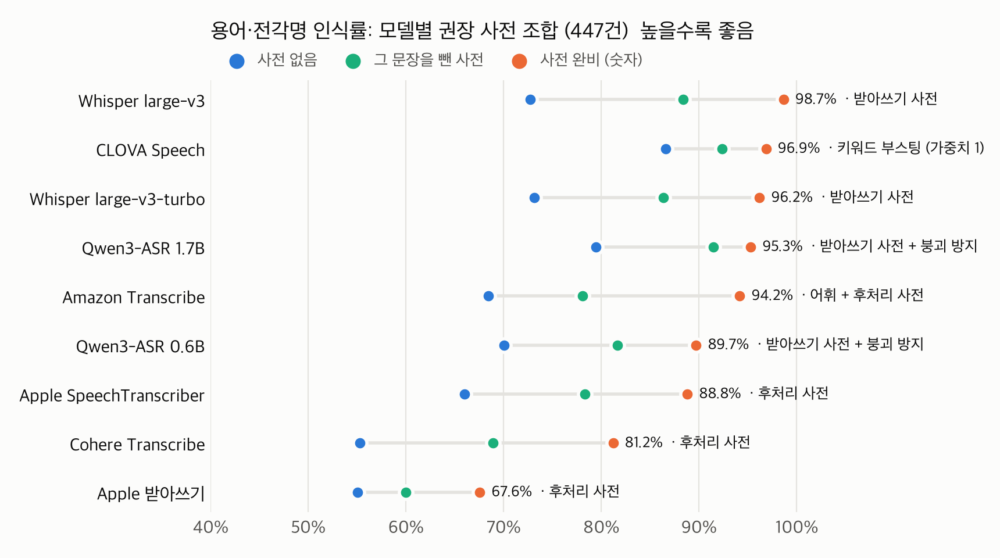

# 궁금(宮今) STT 벤치마크 결과 보고서

작성 안기겸 · 2026-10-24 · 경복궁 해설 발화 녹음 180개, STT 8종

---

## 1. 결론

| 항목 | 판단 | 근거 |
|---|---|---|
| **속도** | 8종 모두 PWA에서 쓰기에 충분합니다 | 말을 마친 뒤 결과가 나오기까지 p90 0.17~1.50초. 가장 느린 Amazon Transcribe도 2초 안에 들어옵니다. |
| **사전 등록** | **합니다. 위치별 사전 방식을 씁니다** | 사전이 없으면 용어 인식률이 55~79%, 전각명 인식률이 48~72%에 그칩니다. 위치별 사전을 넣으면 Whisper large-v3가 용어 98.7%, 전각명 99.2%까지 오릅니다. |
| **파인튜닝** | **하지 않습니다** | 위치별 사전을 넣은 Whisper large-v3는 CER 2.4%이고, 용어 447건 중 놓친 것은 6건입니다. 남은 오류는 대부분 숫자 표기(서른 단 ↔ 30단), 어미(돼 ↔ 되어), 띄어쓰기 차이입니다. Amazon Transcribe는 한국어 파인튜닝(사용자 지정 언어 모델)을 아예 지원하지 않습니다. |
| **모델** | Whisper large-v3-turbo + 위치별 사전 | CER 2.8%, 용어 96.2%, 전각명 99.2%, 발화당 0.41초로 정확도와 속도가 가장 균형 잡혀 있습니다. AWS 관리형으로만 구성한다면 Amazon Transcribe + 위치별 사용자 지정 어휘입니다(CER 4.6%, 용어 79.6%, 전각명 69.2%, 1.19초, 분당 $0.01). |

핸드폰 자체 STT에 해당하는 Apple 받아쓰기는 8종 가운데 정확도가 가장 낮았습니다. 사전이 없을 때 CER 10.0%, 용어 인식률 55.0%였습니다.

---

## 2. 측정 조건

### 2.1 데이터

| 항목 | 값 |
|---|---|
| 발화문 | `경복궁_STT_발화문_300.xlsx` 중 녹음된 U0001~U0180 (180개, 해설 위치 26곳) |
| 오디오 | 팀 직접 녹음 m4a(48kHz mono)를 16kHz mono PCM으로 변환 |
| 길이 | 총 1,363.9초, 발화당 4.2~12.8초 (중앙값 7.3초) |
| 평가 용어 | 정답 문장에 나온 용어집 용어 314건 + 전각명 133건 = **447건** |
| 난이도 태그 | 숫자·연도 65개, 용어 3개 이상 40개, 긴 발화(60자 이상) 15개 |

**녹음과 발화문의 대응을 바로잡은 내역**
- `U0121~U0150`: 원래 파일명이 `새로운 녹음 122~151`이었습니다. 1씩 당겨서 U0121~U0150으로 이름을 바꿨습니다.
- `U0061~U0069`: 이 9개 파일에는 U0060~U0068 문장이 녹음되어 있습니다. 녹음 순서가 1칸 밀려서 U0060 문장은 두 번 녹음됐고, U0069 문장은 녹음이 없습니다. 이 9개는 실제로 녹음된 문장을 정답으로 삼았습니다.
- 위 두 가지 외에는 모든 녹음이 파일명과 같은 번호의 발화문과 일치했습니다. 전체 전사 결과를 300개 발화문 전체와 대조해서 확인했습니다.

### 2.2 측정 모델

| 모델 | 구분 | 실행 방식 | 사전 입력 방식 |
|---|---|---|---|
| Whisper large-v3 | 로컬(오픈 가중치) | mlx-whisper, fp16, Apple GPU | `initial_prompt` (최대 223토큰) |
| Whisper large-v3-turbo | 로컬(오픈 가중치) | mlx-whisper, fp16, Apple GPU | `initial_prompt` (최대 223토큰) |
| Qwen3-ASR 1.7B | 로컬(오픈 가중치) | transformers 5.20, fp16, MPS | 시스템 프롬프트(context) |
| Qwen3-ASR 0.6B | 로컬(오픈 가중치) | transformers 5.20, fp16, MPS | 시스템 프롬프트(context) |
| Cohere Transcribe (03-2026) | 로컬(오픈 가중치) | transformers 5.20, fp16, MPS | 없음 |
| Amazon Transcribe | AWS 관리형 | 스트리밍 API, 서울 리전, ko-KR | 사용자 지정 어휘 |
| Apple SpeechTranscriber | 기기 내 | SpeechAnalyzer (iOS 26·macOS 26부터) | `AnalysisContext` 문맥 문자열 |
| Apple 받아쓰기 | 기기 내 | SpeechAnalyzer `DictationTranscriber` (시스템 받아쓰기 계열) | `AnalysisContext` 문맥 문자열 |

- Apple 2종은 "핸드폰 자체 STT"를 대신해, 같은 엔진을 macOS에서 잰 값입니다.
- 이번에 측정하지 않은 것은 두 가지입니다. 기존 SFSpeechRecognizer는 측정 맥의 받아쓰기 설정이 꺼져 있어서 재지 못했고, Android 음성 인식은 측정 장비가 없었습니다.

### 2.3 사전 조건

| 조건 | 내용 | 적용 모델 |
|---|---|---|
| 없음 | 음성만 입력 | 8종 전부 |
| **위치별 사전** | 해설 위치마다 그 위치 발화문에 나온 전각명·용어를 빈도순으로 모은 목록입니다(위치당 5~26개, 중앙값 18개). 앱이 GPS로 현재 전각을 알고 그 구역 용어만 넣는 상황을 가정했습니다. | Whisper 2종, Qwen 2종, Apple 2종, Transcribe |
| **전체 사전** | 용어집 231개(표기 변형 포함)와 전각명 71개를 합친 336개 표기 | Qwen 2종, Apple 2종, Transcribe |

- Whisper는 프롬프트가 최대 223토큰이라 위치별 사전만 넣었습니다. 위치별 사전은 26곳 모두 잘리지 않고 들어갔고, 전체 사전은 1,486토큰이라 넣을 수 없습니다.
- Transcribe는 스트림을 열 때 미리 만들어 둔 사용자 지정 어휘를 지정하는 방식입니다. 전체 사전 어휘 1개와 해설 위치별 어휘 26개를 만들었고, 위치별 조건에서는 발화마다 그 위치의 어휘를 지정했습니다. 어휘 형식에 맞춰 띄어쓰기는 하이픈으로, 숫자는 한글 읽기로 바꿨습니다.

### 2.4 지표와 장비

| 지표 | 정의 |
|---|---|
| **CER** | 공백과 문장부호를 뺀 글자 단위 편집 거리를 정답 글자 수로 나눈 값(180개 합산)입니다. 정답은 숫자를 아라비아 숫자로 적었고 모델은 둘 중 아무 표기나 낼 수 있어서, 양쪽 숫자를 모두 한자어 읽기로 바꾼 뒤 비교합니다(1395년 = 천삼백구십오년). |
| CER(숫자 원문) | 숫자를 바꾸지 않고 잰 CER입니다. |
| **용어 인식률** | 정답 문장에 나온 용어·전각명 표기가 전사 결과에 그대로 나온 비율입니다. 표기 변형 중 하나만 맞아도 인식으로 칩니다. |
| 붕괴 발화 | CER이 50% 이상인 발화 수입니다. 반복, 프롬프트 출력 같은 이상 출력을 셉니다. |
| **대기 시간** | 발화 하나를 넣고 텍스트를 받기까지 걸린 시간입니다. 모델 로딩은 빼고, 첫 파일로 1회 워밍업한 뒤 잽니다. |
| RTF | 처리 시간 합 ÷ 오디오 길이 합 |

- **장비**: MacBook Pro M1 Max 32GB, macOS 27.0.1. 로컬 모델 속도는 이 장비 기준입니다.
- **Transcribe 측정 방식**: 이 맥에서 서울 리전으로 오디오 조각을 쉬지 않고 보냈습니다. 대기 시간에는 연결과 네트워크 왕복 시간이 포함됩니다.
- **PWA 기준**: 말을 마친 뒤 결과가 나오기까지 2초 이내(p90)로 잡았습니다.

---

## 3. 결과

### 3.1 사전 없음

| 모델 | 구분 | CER | CER(숫자 원문) | 용어집 용어 | 전각명 | 용어 전체 | 붕괴 | RTF | 평균 대기 | p90 대기 |
|---|---|---:|---:|---:|---:|---:|---:|---:|---:|---:|
| Qwen3-ASR 1.7B | 로컬 | **4.17%** | 8.28% | **82.5%** | **72.2%** | **79.4%** | 0 | 0.088 | 0.67초 | 0.87초 |
| Whisper large-v3-turbo | 로컬 | 5.12% | 5.90% | 76.1% | 66.2% | 73.2% | 0 | 0.053 | 0.40초 | 0.43초 |
| Whisper large-v3 | 로컬 | 5.67% | 6.25% | 77.1% | 62.4% | 72.7% | 1 | 0.102 | 0.77초 | 0.89초 |
| Amazon Transcribe | AWS | 5.78% | 5.98% | 73.6% | 56.4% | 68.5% | 0 | 0.144 | 1.09초 | 1.50초 |
| Apple SpeechTranscriber | 기기 내 | 6.11% | 6.45% | 69.1% | 58.6% | 66.0% | 0 | **0.019** | **0.14초** | **0.17초** |
| Qwen3-ASR 0.6B | 로컬 | 6.49% | 12.50% | 75.5% | 57.1% | 70.0% | 0 | 0.057 | 0.43초 | 0.58초 |
| Cohere Transcribe | 로컬 | 8.92% | 9.28% | 58.3% | 48.1% | 55.3% | 0 | 0.056 | 0.42초 | 0.52초 |
| Apple 받아쓰기 | 기기 내 | 9.98% | 13.20% | 58.0% | 48.1% | 55.0% | 0 | 0.123 | 0.93초 | 1.34초 |

발화 유형별 CER은 다음과 같습니다(사전 없음).

| 모델 | 숫자·연도 (65개) | 용어 3개 이상 (40개) | 긴 발화 (15개) |
|---|---:|---:|---:|
| Qwen3-ASR 1.7B | 3.64% | 3.84% | 3.93% |
| Whisper large-v3-turbo | 4.59% | 5.63% | 4.21% |
| Whisper large-v3 | 4.54% | 5.83% | 6.24% |
| Amazon Transcribe | 5.06% | 5.83% | 4.48% |
| Apple SpeechTranscriber | 5.70% | 6.86% | 5.56% |
| Qwen3-ASR 0.6B | 5.96% | 7.00% | 5.56% |
| Cohere Transcribe | 7.97% | 10.02% | 7.87% |
| Apple 받아쓰기 | 8.36% | 10.50% | 9.23% |

- 전체 CER은 4~10%로 낮은 편입니다. 반면 고유명사는 가장 좋은 모델도 전각명 10개 중 3개 가까이를 틀립니다.
- Qwen3-ASR은 숫자를 "천삼백구십오 년"처럼 한글로 적습니다. 그래서 숫자를 맞추지 않은 CER(숫자 원문)이 두 배 가까이 높습니다.

### 3.2 사전 적용

| 모델 | 사전 | CER | 용어 전체 | 전각명 | 붕괴 | 평균 대기 |
|---|---|---|---|---|---|---|
| Whisper large-v3 | 위치별 | 5.67% → **2.43%** | 72.7% → **98.7%** | 62.4% → **99.2%** | 1 → 0 | 0.77 → 0.78초 |
| Whisper large-v3-turbo | 위치별 | 5.12% → **2.76%** | 73.2% → **96.2%** | 66.2% → **99.2%** | 0 → 0 | 0.40 → 0.41초 |
| Qwen3-ASR 1.7B | 위치별 | 4.17% → 3.38% | 79.4% → 95.5% | 72.2% → 94.7% | 0 → 1 | 0.67 → 0.70초 |
| Qwen3-ASR 1.7B | 전체 | 4.17% → 8.56% | 79.4% → 86.1% | 72.2% → 75.9% | 0 → 2 | 0.67 → 1.44초 |
| Qwen3-ASR 0.6B | 위치별 | 6.49% → 3.94% | 70.0% → 89.7% | 57.1% → 92.5% | 0 → 0 | 0.43 → 0.43초 |
| Qwen3-ASR 0.6B | 전체 | 6.49% → 5.85% | 70.0% → 74.5% | 57.1% → 65.4% | 0 → 0 | 0.43 → 0.80초 |
| Amazon Transcribe | 위치별 어휘 | 5.78% → 4.60% | 68.5% → 79.6% | 56.4% → 69.2% | 0 → 0 | 1.09 → 1.19초 |
| Amazon Transcribe | 전체 어휘 | 5.78% → 5.09% | 68.5% → 75.8% | 56.4% → 63.9% | 0 → 0 | 1.09 → 1.20초 |
| Apple 받아쓰기 | 위치별 | 9.98% → 8.87% | 55.0% → 66.4% | 48.1% → 65.4% | 0 → 0 | 0.93 → 0.79초 |
| Apple 받아쓰기 | 전체 | 9.98% → 9.34% | 55.0% → 61.7% | 48.1% → 57.9% | 0 → 0 | 0.93 → 1.24초 |
| Apple SpeechTranscriber | 위치별·전체 | 변화 없음 | 변화 없음 | 변화 없음 | 0 | 0.14초 |
| Cohere Transcribe | — | 사전 입력 기능 없음 | | | | |

- 사전 효과는 **위치별 사전이 전체 사전보다 큽니다.** 용어 인식률을 위치별과 전체로 비교하면 Qwen3-ASR 1.7B는 95.5%와 86.1%, Transcribe는 79.6%와 75.8%, Apple 받아쓰기는 66.4%와 61.7%였습니다.
- **Transcribe는 사전 효과가 작습니다.** 같은 위치별 사전을 넣었을 때 전각명 인식률이 Whisper는 99.2%, Transcribe는 69.2%였습니다. Transcribe는 어휘를 넣은 뒤에도 흥례문 → 흑례문(7회), 신무문 → 신문문(4회), 건춘문 → 건축문·건축물(5회)처럼 틀렸습니다.
- **전체 사전은 Qwen을 느리게 합니다.** 336개 표기를 매번 프롬프트로 넣으면 Qwen3-ASR 1.7B의 평균 대기가 0.67초에서 1.44초로 늘어납니다.
- **Apple SpeechTranscriber는 사전을 반영하지 않습니다.** 사전을 넣어도 180개 전사가 글자 하나까지 같았습니다.
- **Whisper는 사전을 넣어도 속도가 그대로입니다.**

### 3.3 속도

- 사전 없음 기준으로 8종 모두 p90 대기 0.17~1.50초, 최대 2.07초입니다. PWA 기준(2초)을 p90에서 모두 충족합니다.
- 로컬 모델 가운데에서는 Whisper large-v3-turbo가 가장 빠릅니다(RTF 0.053, 발화당 0.40초).
- Transcribe의 대기 1.1~1.2초에는 스트림 연결과 네트워크 왕복이 포함됩니다.

---

## 4. 오류 분석

### 4.1 자주 틀린 용어 (사전 없음, 8종 합산)

| 용어 | 종류 | 등장 | 오인식률 | 대표 오인식 |
|---|---|---:|---:|---|
| 홍예 | 용어 | 3 | 100% | 홍해, 홍의 |
| 영제교 | 전각 | 2 | 100% | 영재교 |
| 다포계 | 용어 | 2 | 100% | 다폭의, 다포개 |
| 천록 | 용어 | 2 | 94% | 철록 |
| 품계석 | 용어 | 3 | 92% | 품괴석, 풍계석, 품계해석 |
| 건춘문 | 전각 | 7 | 91% | 건축문, 건축물 |
| 강녕전 | 전각 | 8 | 89% | 강령전, 강영전 |
| 하례 | 용어 | 2 | 88% | 할애, 할례 |
| 드므 | 용어 | 2 | 88% | 드무 |
| 칠조룡 | 용어 | 2 | 88% | 7조령, 실조룡 |
| 흥례문 | 전각 | 10 | 84% | 흥래문, 흑래문 |
| 건청궁 | 전각 | 4 | 81% | 건천궁, 건천군 |
| 창덕궁 대화재 | 용어 | 2 | 81% | 창덕궁 대화제 |
| 경회루 | 전각 | 6 | 79% | 경회로, 경외로 |
| 어좌 | 용어 | 4 | 75% | 어자, 어저 |

- 오인식률은 놓친 횟수를 (등장 횟수 × 8종)으로 나눈 값입니다. 2회 이상 등장한 용어만 넣었습니다.
- 대부분 소리가 비슷한 일반어로 바뀝니다(건춘문 → 건축물, 하례 → 할애, 사신 → 사진). 고유명사를 모르는 모델이 흔한 단어 쪽으로 받아 적는 패턴입니다.

### 4.2 사전 적용 후 남은 오류 (Whisper large-v3 + 위치별 사전)

- **놓친 용어는 447건 중 6건**입니다: 흥례문 → 홍례문, 경복궁 중건 → 경복궁을 중건, 해태 → 해트, 품계석 → 품계해석, 사신 → 사진, 신료 → 신뢰.
- 180개 중 103개(57.2%)는 정답과 완전히 같았습니다.
- 나머지 오류는 대부분 다음 유형입니다.
    - 숫자 표기: "서른 단" ↔ "30단", "마흔여덟 개" ↔ "48개"
    - 어미: "배치돼" ↔ "배치되어", "지정됐습니다" ↔ "지정되었습니다"
    - 조사·띄어쓰기: "석축 기단" ↔ "석축기단"

### 4.3 붕괴 발화

| 모델·조건 | 건수 | 내용 | 붕괴 제외 CER |
|---|---:|---|---:|
| Whisper large-v3, 사전 없음 | 1 | 같은 문장을 두 번 반복해서 출력 | 5.26% |
| Qwen3-ASR 1.7B, 위치별 사전 | 1 | 받아쓰기 대신 사전 목록을 출력 | 2.52% |
| Qwen3-ASR 1.7B, 전체 사전 | 2 | 받아쓰기 대신 사전 목록을 출력 | 3.51% |

Qwen은 사전을 프롬프트로 넣는 구조라, 드물게 사전 목록 자체를 출력합니다. Whisper에 위치별 사전을 넣은 조건에서는 붕괴가 없었습니다.

---

## 5. 판단

### 5.1 사전 등록: 합니다

- 사전이 없으면 전각명 인식률이 48~72%입니다. 해설·안내 서비스에서 가장 중요한 단어인 전각명을 2~4개 중 1개꼴로 틀립니다.
- 위치별 사전을 넣으면 Whisper 2종의 전각명 인식률이 99.2%가 되고, 속도 손실도 없습니다.
- 방식은 **위치별 사전**으로 합니다. 앱이 GPS로 현재 구역을 알면 그 구역 용어만 STT에 넘깁니다. 전체 사전보다 효과가 크고, Qwen처럼 프롬프트로 사전을 넣는 모델에서 느려지거나 붕괴하는 위험도 적습니다.
- 사전 원본은 엑셀의 `용어 커버리지`(용어집 231개)와 `전각 커버리지`(전각 71개)입니다. 벤치마크에 쓴 목록은 `data/hint_terms.txt`(전체)와 `data/hints_by_location.json`(위치별)에 있습니다.

### 5.2 파인튜닝: 하지 않습니다

- Whisper large-v3 + 위치별 사전에서 CER은 2.43%, 놓친 용어는 447건 중 6건입니다.
- 남은 오류는 숫자 표기, 어미, 띄어쓰기 차이가 대부분입니다. 뒤에 붙는 LLM 답변이나 번역의 의미에는 영향이 없는 유형입니다.
- 사전만으로 용어 문제가 해결되므로, 학습 데이터를 만들고 학습·배포하는 데 드는 비용을 들일 근거가 이번 데이터에서는 나오지 않았습니다.

### 5.3 모델 선택지

| 선택지 | 구성 | CER | 용어 / 전각명 | 평균 대기 | 운영 형태·비용 |
|---|---|---:|---|---:|---|
| **A. 정확도 우선** | Whisper large-v3-turbo + 위치별 사전 | 2.76% | 96.2% / 99.2% | 0.41초 | 모델을 직접 배포해 운영. AWS EC2 GPU 인스턴스나 SageMaker 엔드포인트에 올리면 AWS 구성 안에 둘 수 있음 (속도는 M1 Max 기준) |
| A′ | Whisper large-v3 + 위치별 사전 | 2.43% | 98.7% / 99.2% | 0.78초 | A와 같음. 처리 시간은 turbo의 약 2배 |
| **B. AWS 관리형** | Amazon Transcribe + 위치별 사용자 지정 어휘 | 4.60% | 79.6% / 69.2% | 1.19초 | 서울 리전 스트리밍 초당 $0.0001667(분당 $0.01), 사용자 지정 어휘는 추가 요금 없음 |
| C. 핸드폰 자체 STT | Apple 받아쓰기 | 9.98% | 55.0% / 48.1% | 0.93초 | 비용 없음. 키보드 받아쓰기로 쓰면 앱이 사전을 넘길 수 없음 |

- B 기준으로 10초짜리 음성 질문 1건의 비용은 약 $0.0017입니다.
- Transcribe 가격은 AWS Price List(서울 리전, 2026-09-11 게시) 기준입니다. 초 단위로 과금하고 최소 과금 시간은 없습니다.

### 5.4 Amazon Transcribe의 한국어 커스텀 범위

| 기능 | 내용 | 한국어(ko-KR) |
|---|---|---|
| 사용자 지정 언어 모델(CLM) | Transcribe의 파인튜닝 기능. 오디오가 아니라 분야별 텍스트를 학습시킨다 | **지원 안 함.** 지원 언어는 영어(미국·영국·호주), 독일어, 스페인어(미국), 일본어, 힌디어(배치만) |
| 사용자 지정 어휘 | 단어 목록 등록. 이번에 전체 어휘·위치별 어휘로 측정한 기능 | 지원 (배치·스트리밍) |
| 어휘의 발음 정보(SoundsLike·IPA) | 단어가 어떻게 소리 나는지 지정 | **지원 종료.** 모든 언어에서 값을 넣어도 무시된다 |
| 어휘의 표시 형식(DisplayAs) | 인식된 단어를 출력할 때 적는 형태만 지정 | 지원. 인식 결과 자체는 바꾸지 않는다 |

- 한국어에서 Transcribe의 인식에 영향을 주는 커스텀 수단은 사용자 지정 어휘뿐입니다. 3.2의 위치별 어휘 결과(전각명 69.2%)가 이 수단을 적용한 결과입니다.
- 흥례문 → 흑례문 같은 남은 오인식은 Transcribe 밖에서 처리해야 합니다. 방법은 다음 두 가지이며, 둘 다 이번 측정에는 포함하지 않았습니다.
    - Transcribe 결과를 위치별 용어 목록과 대조해 비슷한 글자열을 바꾸는 후처리
    - 답변용 LLM에 현재 위치의 용어 목록을 함께 넘겨 고치게 하는 방식
- Transcribe 대신 선택지 A의 Whisper를 AWS에 직접 배포하면, 같은 위치별 사전으로 전각명 99.2%가 나옵니다(3.2).

---

## 부록

### A. 산출물

| 경로 (`STT학습데이터/Benchmark/`) | 내용 |
|---|---|
| `results/summary.csv` | 실행(모델 × 사전 조건 20개)별 요약 |
| `results/per_utterance.csv` | 발화별 정답·전사·CER (20개 실행 전부) |
| `results/term_misses.csv` | 실행별로 놓친 용어, 실제로 들린 형태, 전사 |
| `results/*.jsonl` | 원본 전사·처리 시간 |
| `data/references.csv` | 녹음 ↔ 정답 대응, 포함 용어, 길이 |
| `data/hint_terms.txt`, `data/hints_by_location.json` | 전체 사전, 위치별 사전 |
| `rename_log.csv` | 녹음 파일명 정리 전후 대응표 |
| `README.md` | 코드 구성과 재현 방법 |

### B. 이번 측정에 든 비용

- Amazon Transcribe 스트리밍 3회(사전 없음, 전체 어휘, 위치별 어휘)와 시험 실행: 약 69분, 정가 약 $0.69입니다. 측정 계정은 프리 티어 오퍼와 크레딧이 없어서 정가가 적용됩니다.
- 사용자 지정 어휘 27개(전체 1개, 위치별 26개)는 서울 리전에 남아 있으며, 보관 요금은 없습니다.
- 로컬 모델과 Apple 엔진은 측정 맥에서 실행해서 별도 비용이 없습니다.

### C. 출처

- Amazon Transcribe 언어별 지원 기능: https://docs.aws.amazon.com/transcribe/latest/dg/supported-languages.html
- Amazon Transcribe 사용자 지정 어휘(표 형식): https://docs.aws.amazon.com/transcribe/latest/dg/custom-vocabulary-create-table.html
- AWS Price List, Transcribe 서울 리전(2026-09-11 게시): https://pricing.us-east-1.amazonaws.com/offers/v1.0/aws/transcribe/current/ap-northeast-2/index.json
- 모델 가중치(Hugging Face): `mlx-community/whisper-large-v3-mlx`, `mlx-community/whisper-large-v3-turbo`, `Qwen/Qwen3-ASR-1.7B-hf`, `Qwen/Qwen3-ASR-0.6B-hf`, `CohereLabs/cohere-transcribe-03-2026`
