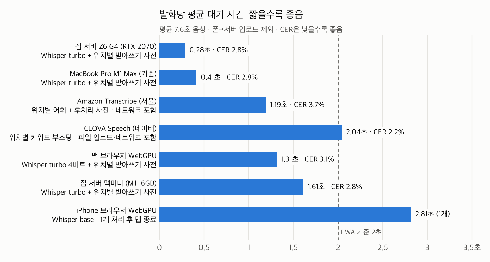
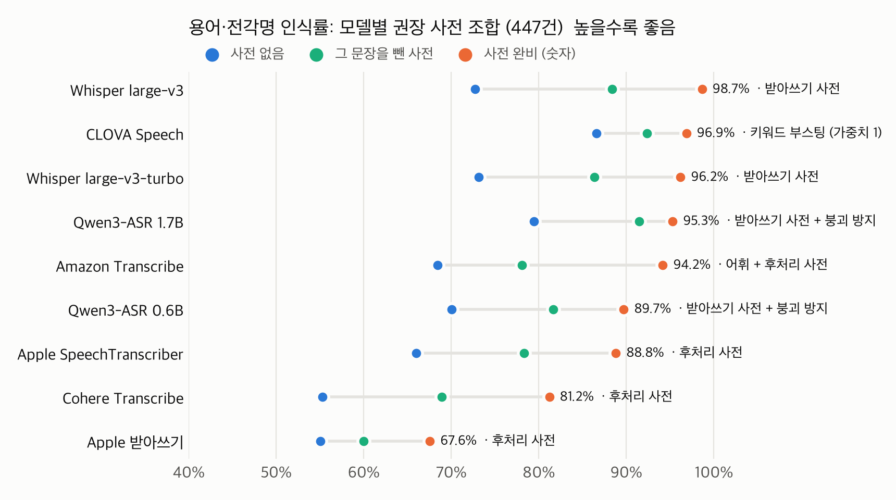
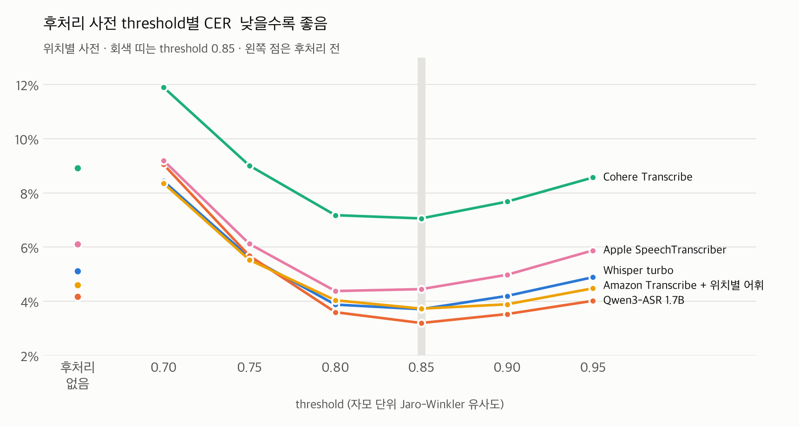

# 궁금(宮今) STT 벤치마크 결과 보고서 v2 — 핸드폰에서 쓰는 경로별 비교

작성 안기겸 · 2026-10-25 · 경복궁 해설 발화 녹음 180개 · 실행 환경 5종(MacBook Pro, Z6 G4, Mac mini, 맥 브라우저, iPhone)

**목차**

[TOC]

---

## 용어 풀이

보고서에 자주 나오는 말을 먼저 정리했습니다.

#### 측정 지표

| 용어 | 뜻 |
|---|---|
| STT | 음성을 글자로 바꾸는 기술(Speech-to-Text) |
| CER (글자 오류율) | 정답 100글자 중 몇 글자를 틀렸는지. 3%면 100글자 중 3글자를 틀린 것 |
| 전각명 인식률 | 정답 문장에 나온 전각 이름(근정전, 경회루 등)을 한 글자도 틀리지 않고 받아쓴 비율 |
| 용어 인식률 | 전각명과 용어집 용어(월대, 품계석 등)를 합쳐서 정확히 받아쓴 비율 |
| 발화당 대기 | 문장 하나를 넣은 뒤 글자가 나올 때까지 걸린 시간 |
| p90 | 10번 중 9번은 이 시간 안에 끝났다는 값. 평균보다 "느린 편인 경우"를 보여 줌 |
| RTF | 처리 시간 ÷ 음성 길이. 0.1이면 10초 음성을 1초에 처리 (1보다 작으면 말하는 속도보다 빠름) |
| 붕괴 발화 | 같은 말을 계속 반복하거나 사전 목록을 그대로 출력하는 등 결과가 크게 망가진 발화 (CER 50% 이상) |

#### 사전

| 용어 | 뜻 |
|---|---|
| 받아쓰기 사전 | 받아쓰는 **도중**에 모델에게 "이런 단어가 나올 수 있다"고 알려 주는 단어 목록 |
| 후처리 사전 | 받아쓰기가 **끝난 뒤**, 사전 단어와 비슷하게 받아쓴 단어를 사전 단어로 고치는 방식 |
| 유사도 (Jaro-Winkler) | 두 단어가 얼마나 닮았는지를 0~1로 나타낸 점수. 1이면 똑같음 |
| threshold | "이 점수 이상 닮았을 때만 바꾼다"는 기준값. 낮추면 많이 바꾸고(잘못 바꾸는 경우도 늘어남), 높이면 적게 바꿈 |
| 자모 단위 비교 | 글자를 초성·중성·종성으로 쪼개서 비교하는 방식. 흑례문과 흥례문은 받침 하나만 달라 점수가 높게 나옴 |
| 위치별 사전 | 해설 위치(근정전, 경회루 등)마다 그 위치에서 나오는 용어만 모은 사전. 앱이 사용자의 위치를 알고 그 구역 사전만 씀 |
| 그 문장을 뺀 위치별 사전 | 위치별 사전에서, 평가하는 그 문장에만 나오는 용어를 뺀 것. "사전에 없는 용어가 섞인" 상황을 흉내 냄 |
| 키워드 부스팅 | CLOVA Speech의 받아쓰기 사전 기능. 단어 목록과 가중치(1~5)를 함께 넘기며, 가중치가 클수록 사전 단어 쪽으로 받아쓰려는 힘이 세짐 |
| 완비 / 누락 | 표에서 쓰는 줄임말. 완비 = 위치별 사전(사전에 용어가 다 있음), 누락 = 그 문장을 뺀 위치별 사전(사전에 없는 용어가 섞임) |

#### 모델·실행

| 용어 | 뜻 |
|---|---|
| 파인튜닝 | 우리 녹음과 정답 문장으로 모델을 추가 학습시키는 것 |
| fp16 / 4비트, 양자화 | 모델의 숫자 하나를 16비트 / 4비트로 저장한 판. fp16보다 적은 비트(8비트·4비트)로 줄이는 것을 양자화라고 하며, 비트가 적을수록 파일과 메모리가 작아짐 |
| WebGPU | 웹 브라우저에서 폰·PC의 GPU를 쓸 수 있게 하는 표준. 앱 설치 없이 폰 안에서 모델을 돌릴 때 필요 |
| 실행 엔진 | 같은 모델을 장비에 맞게 돌리는 프로그램. mlx-whisper(맥), faster-whisper(NVIDIA GPU), PyTorch(맥 GPU는 MPS, NVIDIA GPU는 CUDA), transformers.js(브라우저) |
| 토큰 | 모델이 글을 처리하는 단위(단어 조각) |
| PWA | 설치 없이 브라우저에서 앱처럼 쓰는 웹앱. 궁금 서비스의 형태 |

---

## 1. 결론

| 경로 | 폰에서 사용 | 권장 구성 | CER | 전각명 인식률 | 발화당 대기 |
|---|---|---|---:|---:|---:|
| ① 폰 브라우저 안에서 실행 (WebGPU) | **iPhone 불가** · Android 미측정 | 없음 (가장 작은 Whisper base도 1개 처리 후 탭 종료) | — | — | 2.81초 (1건) |
| ② 집 서버 Z6 G4 (RTX 2070) | 가능 (폰 녹음 → 서버 전송) | Whisper large-v3-turbo + 위치별 받아쓰기 사전 | 2.78% (3.73%) | 99.2% (92.5%) | **0.28초** |
| ③ 집 서버 Mac mini (M1 16GB) | 가능 (폰 녹음 → 서버 전송) | Whisper large-v3-turbo + 위치별 받아쓰기 사전 | 2.76% (3.73%) | 99.2% (92.5%) | 1.61초 |
| ④ 클라우드 CLOVA Speech | 가능 (폰 녹음 → 네이버 클라우드 전송) | 위치별 키워드 부스팅 (가중치 1) | **2.22% (2.69%)** | 96.2% (94.0%) | 2.04초 |
| ④ 클라우드 Amazon Transcribe | 가능 (폰 녹음 → AWS 전송) | 위치별 사용자 지정 어휘 + 후처리 사전 | 3.73% (5.24%) | 96.2% (79.0%) | 1.19초 |
| ⑤ 폰 자체 STT (키보드 받아쓰기) | 가능, 받아쓰는 도중에는 사전을 넣을 수 없음 | Apple 받아쓰기 + 후처리 사전 | 9.18% (9.69%) | 56.4% (54.9%) | 0.93초 |

\* CER, 발화당 대기는 낮을수록 좋음.  
\* 전각명 인식률은 높을수록 좋음.  
\* 괄호 밖은 사전에 그 문장의 용어가 모두 들어 있을 때(위치별 사전), 괄호 안은 사전에 없는 용어가 섞일 때(그 문장을 뺀 위치별 사전)의 값입니다(2.4). 괄호 안은 MacBook Pro에서 잰 값이고, Amazon Transcribe의 괄호 안은 어휘 없이 후처리 사전만 쓴 값입니다.  
\* 발화당 대기: ②③은 서버 처리 시간만이고 폰 → 서버 업로드 시간은 빠져 있습니다. ④는 클라우드까지의 네트워크 왕복을 포함합니다(CLOVA Speech는 녹음 파일 업로드도 포함). ⑤는 같은 계열 엔진을 맥에서 잰 값입니다.
{: .note }

- 이번 수치는 **휴대폰으로 낭독한 녹음**(조용한 실내로 추정) 기준입니다.
- **폰은 녹음만 하고, 인식은 서버에서 합니다.** ② Z6 G4 + Whisper large-v3-turbo + 위치별 받아쓰기 사전을 권장합니다. 전각명 인식률 99.2%인 구성 중 가장 빠릅니다.
- **같은 서버에서 Qwen3-ASR 1.7B + 붕괴 방지를 쓰면 CER이 Whisper turbo보다 낮습니다.** CER 2.55%로 turbo(2.76%, 둘 다 MacBook Pro 기준)보다 낮고, 사전에 없는 용어가 섞이면 2.86%로 turbo(3.73%)보다 훨씬 낮습니다. 대신 Z6 G4에서 약 3배 느립니다(0.93초 대 0.28초, 둘 다 2초 이내). 두 모델의 선택 기준은 4.3에 정리했습니다.
- **CER이 가장 낮은 것은 클라우드 CLOVA Speech입니다.** 위치별 키워드 부스팅으로 CER 2.22%, 사전에 없는 용어가 섞여도 2.69%로 두 조건 모두 가장 낮고, 사전 없이도 3.20%입니다. 대신 녹음 파일을 한 번에 보내는 방식으로 쟀을 때 대기가 평균 2.04초로 2초 기준을 조금 넘었고, 요청 1건에 5원이 듭니다.
- **폰 브라우저 안에서 직접 돌리는 방식(①)은 iPhone에서 쓸 수 없습니다.** 후보 모델(0.5GB 이상)은 모델을 올리는 단계에서 Safari 탭이 강제 종료됐고, 가장 작은 Whisper base(146MB)도 1개를 처리한 뒤 종료됐습니다.
- **같은 모델이면 장비·실행 엔진이 달라도 CER이 거의 같습니다**(차이 최대 0.31%p). 장비가 바꾸는 것은 주로 속도입니다.
- **사전은 넣습니다.** 앱에 위치별 용어 목록을 넣어 두고, Whisper·Qwen3-ASR·CLOVA Speech에는 받아쓰기 사전(CLOVA는 키워드 부스팅)으로, 받아쓰기 사전이 없거나 약한 모델에는 후처리 사전으로 씁니다(3.5).
    - CLOVA Speech: 전각명 87.2%(사전 없음) → 96.2%(위치별 키워드 부스팅)
    - Amazon Transcribe: 전각명 56.4%(사전 없음) → 69.2%(위치별 어휘) → 96.2%(어휘 + 후처리 사전)
    - Cohere Transcribe: 전각명 48.1%(사전 없음) → 84.2%(후처리 사전)
- **사전에 없는 용어는 놓치기 쉽습니다.** 그 문장을 뺀 사전으로 재면 Whisper turbo의 전각명 인식률이 99.2%에서 92.5%로 내려가고, 놓친 용어 61건 중 53건이 사전에 없던 용어였습니다. 그래서 위치별 사전은 그 구역 해설에 나오는 용어를 빠짐없이 담아야 합니다.
- **파인튜닝은 권장 구성(Whisper, Qwen3-ASR)에서는 하지 않습니다.** Whisper·Qwen3-ASR·Cohere는 가중치가 공개돼 있어 파인튜닝이 가능하고, Amazon Transcribe(한국어)·CLOVA Speech·Apple 엔진은 불가능합니다. 모델별 판단은 4.2에 정리했습니다.

---

## 2. 측정 조건

### 2.1 데이터

| 항목 | 값 |
|---|---|
| 발화문 | `경복궁_STT_발화문_300.xlsx` 중 녹음된 U0001~U0180 (180개, 해설 위치 26곳) |
| 녹음 | 5명이 발화문을 소리 내어 읽어 녹음(낭독). 조용한 실내에서 휴대폰으로 녹음한 것으로 추정 (m4a, 48kHz 모노) |
| 길이 | 총 1,363.9초, 발화당 4.2~12.8초 (평균 7.58초) |
| 평가 용어 | 정답 문장에 나온 용어집 용어 314건 + 전각명 133건 = 447건 |
| 녹음 대응 보정 | `U0061~U0069` 파일에는 U0060~U0068 문장이 녹음되어 있어 실제 문장으로 비교. 그래서 U0060 문장은 두 번 녹음됐고 U0069 문장은 녹음이 없음(녹음 180개 = 문장 179종) |

### 2.2 측정 장비

| 장비 | 사양 | 실행 엔진 |
|---|---|---|
| MacBook Pro (기준) | M1 Max, 32GB, macOS 27.0.1 | Whisper: mlx-whisper / Qwen·Cohere: PyTorch MPS, 모두 fp16 |
| Z6 G4 (집) | Xeon Gold 5122(4코어 8스레드), RAM 64GB, RTX 2070 8GB, Ubuntu 26.04 | Whisper: faster-whisper 1.2.1(CTranslate2 4.8.3) / Qwen·Cohere: PyTorch 2.14 CUDA 13, 모두 fp16 |
| Mac mini (집) | M1, 16GB, macOS 26.5.2 | MacBook Pro와 같음. 측정 중에 다른 프로세스가 돌고 있었음(부하 평균 약 2) |
| 맥 브라우저 | MacBook Pro의 Chromium 152 계열 브라우저, WebGPU(Metal) | transformers.js 4.3.1, onnx-community ONNX 모델 |
| iPhone | Safari 27.0.1, WebGPU, shader-f16 지원, GPU 버퍼 최대 1GB | 맥 브라우저와 같은 측정 페이지 |

### 2.3 지표

| 지표 | 계산 방법 | 예 |
|---|---|---|
| **CER** | 틀린 글자 수(빠짐·더해짐·바뀜) ÷ 정답 글자 수. 180개를 합쳐서 계산. 공백·문장부호는 빼고, 숫자는 양쪽 모두 한자어 읽기로 바꿔 비교 | 정답 "근정전 월대"를 "금정전 월대"로 받아쓰면 5글자 중 1글자가 틀려 CER 20% |
| **전각명 인식률 / 용어 인식률** | 정답에 나온 전각명(133건) / 용어집 용어와 전각명(447건) 중, 받아쓴 결과에 정답과 똑같은 표기가 나온 비율 | "흥례문"을 "흑례문"으로 받아쓰면 한 글자 차이여도 놓친 것으로 셈 |
| **발화당 대기** | 발화 하나를 넣고 글자를 받기까지 걸린 시간. 모델을 불러오는 시간은 빼고, 1회 미리 돌려 본 뒤(워밍업) 측정 | — |
| RTF | 처리 시간 합 ÷ 음성 길이 합 | 7.6초 음성을 0.3초에 처리하면 RTF 0.04 |
| 붕괴 발화 | CER이 50% 이상인 발화 수 | "경성전 경성전 경성전 …" 반복 출력 |

\* CER, 발화당 대기, RTF, 붕괴 발화는 낮을수록 좋음. RTF가 1보다 작으면 실시간보다 빠름.  
\* 전각명 인식률, 용어 인식률은 높을수록 좋음.
{: .note }

- **PWA 기준**: 말을 마친 뒤 결과까지 2초 이내.
- **집 서버의 대기 시간에는 폰에서 서버로 녹음을 보내는 시간이 빠져 있습니다.** 7.6초 음성은 WAV(16kHz·16bit)로 약 243KB, Opus 24kbps로 약 23KB입니다.
- **Amazon Transcribe의 대기 시간**에는 서울 리전까지의 연결·네트워크 왕복이 포함됩니다.
- **CLOVA Speech의 대기 시간**에는 녹음 파일(WAV) 업로드와 네트워크 왕복이 포함됩니다. 스트리밍이 아니라 녹음이 끝난 파일을 한 번에 보내는 방식(장문 인식 API, sync)입니다.

### 2.4 사전 조건

사전은 두 단계에서 씁니다.

| 구분 | 쓰는 시점 | 방법 | 조절 값 |
|---|---|---|---|
| **받아쓰기 사전** | STT가 받아쓰는 **도중** | 모델에 단어 목록이나 문장을 힌트로 넘김 (모델별 방법은 아래 표) | 대부분 없음. CLOVA Speech만 키워드 부스팅 가중치(1~5)가 있어 1·3·5를 측정 |
| **후처리 사전** (유사도 threshold 방식) | 받아쓰기가 **끝난 뒤** | 받아쓴 단어와 사전 단어의 유사도(Jaro-Winkler, 0~1)가 threshold 이상이면 사전 단어로 바꿈 | threshold 0.70~0.95 (0.05 간격) |

| 모델 | 받아쓰기 사전을 넘기는 방법 |
|---|---|
| Whisper | `initial_prompt`(앞 문맥으로 넣는 문장) — "경복궁 해설입니다. 근정전, 월대, …" (최대 223토큰) |
| Qwen3-ASR | 시스템 프롬프트(모델에 주는 지시문) — "경복궁 해설 용어: 근정전, 월대, …" |
| Amazon Transcribe | 사용자 지정 어휘 — 단어 목록 |
| Apple 엔진 | 문맥 문자열(`contextualStrings`) — 단어 목록 |
| CLOVA Speech | 키워드 부스팅 — 단어 목록 + 가중치(1~5), 요청마다 넘김 |
| Cohere Transcribe | 방법 없음 (사전 입력 기능 없음) |

- **Qwen3-ASR 붕괴 방지**: Qwen3-ASR은 가끔 받아쓰기 대신 사전 목록("경복궁 해설 용어: …")을 그대로 출력합니다. 출력에 "해설 용어"가 들어 있으면 사전 없이 한 번 더 받아쓰는 조건도 측정했습니다(3.5).

받아쓰기 사전과 후처리 사전은 같은 사전 목록을 씁니다.

| 사전 | 내용 | 평가 문장의 용어가 사전에 있는 비율 |
|---|---|---|
| 없음 | 사전을 쓰지 않음 | — |
| **위치별 사전** | 해설 위치마다 그 위치 발화문(엑셀 300개 기준)에 나온 전각명·용어를 모은 목록. 녹음된 26곳 기준 위치당 5~26개 | 전각명 133/133, 용어 314/314 (모두 있음) |
| **그 문장을 뺀 위치별 사전** | 위치별 사전을 만들 때 평가하는 그 문장만 빼고 만든 목록. 사전에 없는 용어가 섞이는 상황을 흉내 냄 | 전각명 105/133 (79%), 용어 103/314 (33%) |
| 전체 사전 | 용어집과 전각명을 합친 336개 표기 | 모두 있음 |

- **위치별 사전은 평가 문장에서 직접 뽑았습니다.** 그래서 위치별 사전의 결과는 "앱 사전에 사용자가 말한 용어가 모두 들어 있을 때"의 값(가장 좋은 경우)이고, 그 문장을 뺀 위치별 사전의 결과는 "사전에 없는 용어가 많이 섞일 때"의 값(나쁜 경우)입니다. 실제 앱은 이 둘 사이에 있습니다.
- **앱이 해설 위치 26곳 중 어디인지 정확히 안다고 가정했습니다.** 근정전·근정전 내부·근정전 조정처럼 붙어 있는 위치는 GPS로 나누기 어려워, 실제 앱에서는 이런 위치의 사전을 합쳐 써야 합니다.
- 전체 사전은 받아쓰기 사전으로 Qwen3-ASR·Amazon Transcribe·Apple 엔진에서만 쟀습니다. Whisper는 223토큰 제한 때문에 336개를 다 넣을 수 없습니다.

**후처리 사전의 세부 규칙**

- **바꾸는 기준**: threshold 이상인 사전 단어 중 가장 비슷한 것으로 바꿉니다. 여러 어절로 된 용어는 어절마다 모두 threshold 이상이어야 바꿉니다.
- **한국어 보정**:
    - 어절 끝의 조사·어미를 떼기 위해, 어절 앞부분(사전 단어와 같은 길이)만 비교하고 그 부분만 바꿉니다. 예: "홍해문을" → "홍예문을"
    - 1음절 용어(칸 등)는 쓰지 않습니다.
- **유사도 단위**: 음절 단위와 자모 단위(초성·중성·종성으로 쪼개 비교)를 모두 쟀습니다.
- **측정 방식**:
    - 받아 둔 전사 결과(MacBook Pro, 받아쓰기 조건 23개)에 사전 3종 × 유사도 단위 2종 × threshold 6개를 적용했습니다.
    - 주요 구성 9개는 녹음 → STT → 후처리를 처음부터 다시 돌려 확인했습니다(실시간 재측정, 3.5).
    - threshold와 "모델별 권장 사전 조합"은 이 180개 발화로 고르고 같은 180개로 잰 값입니다.

### 2.5 브라우저 실행 보정

transformers.js에는 Python Whisper에 있는 두 기능이 없어서, 측정 페이지에서 직접 구현했습니다.

- **받아쓰기 사전 입력**: Whisper의 `initial_prompt`(`prompt_ids`)가 없어서, 사전 문장을 디코더 시작 토큰(`decoder_input_ids`)으로 직접 넘겼습니다. 이 방식으로 사전이 실제로 반영되는 것을 확인했습니다.
- **반복 방지**: Python 쪽(mlx-whisper·faster-whisper)에는 반복 출력을 감지해 다시 디코딩하는 기능이 있는데, transformers.js에는 없습니다. 그래서 두 가지 장치를 넣었습니다.
    - 출력 길이를 음성 길이에 비례해 제한합니다. 실제 발화는 초당 최대 6토큰이어서, 상한을 초당 12토큰 + 10으로 잡았습니다.
    - 출력이 이 상한에 닿거나 같은 단어가 4번 이상 반복되면, 사전 없이 한 번 더 디코딩합니다. 이 재디코딩 시간도 대기 시간에 포함했습니다.

---

## 3. 결과

3.1~3.4는 경로별 결과이고, 표의 "사전"은 받아쓰기 사전입니다. 후처리 사전의 결과는 3.5에 모았습니다.

### 3.1 ① 폰 브라우저 안에서 실행 (WebGPU)

#### 브라우저 실행 지원과 모델 크기

| 모델 | 브라우저 실행 | 가장 작은 버전 크기 |
|---|---|---:|
| Whisper large-v3-turbo | transformers.js 지원 | 563MB (4비트 q4f16) |
| Whisper large-v3 | transformers.js 지원 | 980MB (q4f16) |
| Cohere Transcribe | transformers.js 지원 (v4.0.0부터) | 1,535MB (q4f16) |
| Qwen3-ASR 1.7B·0.6B | **transformers.js 미지원** (커뮤니티 포트만 있음) | — |
| (참고) Whisper small | transformers.js 지원 | 485MB (fp16) |
| (참고) Whisper base | transformers.js 지원 | 146MB (fp16) |

#### iPhone Safari 실측

| 시도 | 크기 | 결과 |
|---|---:|---|
| Whisper large-v3-turbo 4비트 | 563MB | 디코더(193MB)를 받은 뒤 인코더(370MB)를 불러오는 중 탭 강제 종료 (2회) |
| 같은 모델, 브라우저 캐시 저장 끔 | 563MB | 인코더를 받는 도중 탭 강제 종료 |
| Whisper small fp16 | 485MB | 두 파일을 다 받은 뒤 GPU에 올리는 단계에서 탭 강제 종료 |
| Whisper base fp16 | 146MB | 모델 준비 14.2초, U0001(6.7초 음성)을 **2.81초(RTF 0.42)** 에 처리한 뒤 다음 발화에서 탭 강제 종료 |

- 탭 강제 종료는 Safari의 "문제가 반복적으로 발생했습니다" 화면으로 나타났습니다. 탭이 메모리 한도를 넘었을 때 나오는 화면입니다.
- iPhone Safari가 웹사이트 하나에 허용하는 메모리는 약 1.5~1.88GB로 보고되어 있습니다(부록 B의 WebKit 버그 268816, 324370).
- 브라우저는 모델 파일을 받아서 GPU에 올리기까지 여러 벌의 사본을 메모리에 두기 때문에, 파일 크기보다 훨씬 많은 메모리를 씁니다.
- iPhone에서 base로 U0001을 처리한 시간(2.81초)은, 같은 발화를 맥 브라우저에서 처리한 시간(0.85초)의 약 3.3배였습니다.
- Android Chrome은 측정하지 않았습니다. WebGPU는 Chrome 121 이상, Android 12 이상에서 일부 GPU만 지원합니다.

#### 맥 브라우저(M1 Max) 측정 — 같은 페이지, 모델 크기별 정확도

| 모델·정밀도 | 받아쓰기 사전 | 반복 방지 | CER | 용어 | 전각명 | 붕괴 | 발화당 대기 |
|---|---|---|---:|---:|---:|---:|---:|
| Whisper turbo 4비트 | 없음 | 없음 | 5.32% | 71.4% | 63.2% | 0 | 1.52초 |
| Whisper turbo 4비트 | 위치별 | 없음 | 7.45% | 94.4% | 99.2% | 1 | 1.36초 |
| **Whisper turbo 4비트** | **위치별** | **있음** | **3.10%** | **94.4%** | **98.5%** | **0** | **1.31초** |
| Whisper turbo fp16 | 위치별 | 없음 | 2.79% | 95.3% | 99.2% | 0 | 1.33초 |
| Whisper small fp16 | 위치별 | 있음 | 5.44% | 96.2% | 98.5% | 0 | 1.20초 |
| Whisper base fp16 | 위치별 | 있음 | 10.61% | 90.6% | 89.5% | 0 | 0.71초 |

\* CER, 붕괴, 발화당 대기는 낮을수록 좋음.  
\* 용어·전각명 인식률은 높을수록 좋음.
{: .note }

- 같은 측정 페이지를 맥 브라우저에서 연 결과입니다. 한 줄 요약: 브라우저에서도 turbo는 정확하지만, iPhone에 올라가는 크기(base)로 줄이면 CER이 10%를 넘습니다.
- 4비트로 줄여도 정확도 손실은 작습니다. 사전 없는 turbo가 4비트에서 5.32%, MLX fp16에서 5.12%였습니다.
- 반복 방지가 없으면 사전 단어("경성전")를 끝없이 반복하는 붕괴가 1건 나왔습니다. 반복 방지를 넣은 뒤에는 재디코딩 1건으로 붕괴가 사라졌습니다.
- 모델이 작을수록 받아쓰기가 거칠어집니다. iPhone에서 그나마 올라가는 base는 위치별 사전을 넣어도 CER 10.6%입니다.

### 3.2 ②③ 집 서버 (Z6 G4, Mac mini)

한 줄 요약: 같은 모델이면 정확도는 장비가 달라도 거의 같고, 속도는 Z6 G4가 가장 빠릅니다(Whisper 기준 Mac mini보다 약 5~6배).

**정밀도: 집 서버의 모든 모델은 양자화(8비트·4비트) 없이 fp16으로 돌렸습니다.**

- Z6 G4: Whisper는 faster-whisper `float16`, Qwen3-ASR·Cohere는 PyTorch CUDA `float16`
- Mac mini: Whisper는 mlx-whisper `float16`, Qwen3-ASR·Cohere는 PyTorch MPS `float16`
- 양자화는 브라우저 측정(3.1)에서만 했습니다(Whisper turbo 4비트). 집 서버에서 양자화한 모델의 속도·정확도는 이번 표에 없습니다.

| 모델 | 받아쓰기 사전 | CER (Z6 G4 / Mac mini) | 전각명 | 붕괴 (Z6 G4 / Mac mini) | Z6 G4 대기 (평균 / p90) | Mac mini 대기 (평균 / p90) | 참고: MacBook Pro 평균 |
|---|---|---|---:|---|---|---|---:|
| **Whisper turbo** | **위치별** | **2.78% / 2.76%** | **99.2%** | **0 / 0** | **0.28 / 0.29초** | **1.61 / 1.66초** | 0.41초 |
| Whisper turbo | 없음 | 5.09% / 5.12% | 66.2% | 0 / 0 | 0.27 / 0.29초 | 1.54 / 1.62초 | 0.40초 |
| Whisper large-v3 | 위치별 | 2.45% / 2.43% | 99.2% | 0 / 0 | 0.55 / 0.63초 | 2.95 / 3.37초 | 0.78초 |
| Whisper large-v3 | 없음 | 5.98% / 5.67% | 62.4% | 2 / 1 | 0.53 / 0.62초 | 2.85 / 3.25초 | 0.77초 |
| Qwen3-ASR 1.7B | 위치별 | 3.33% / 3.33% | 94.7% | 1 / 1 | 0.93 / 1.23초 | 3.00 / 3.88초 | 0.70초 |
| Qwen3-ASR 1.7B | 없음 | 4.17% / 4.17% | 72.2% | 0 / 0 | 0.92 / 1.22초 | 2.83 / 3.71초 | 0.67초 |
| Qwen3-ASR 0.6B | 위치별 | 4.01% / 4.01% | 92.5% | 0 / 0 | 0.89 / 1.22초 | 1.33 / 1.76초 | 0.43초 |
| Qwen3-ASR 0.6B | 없음 | 6.35% / 6.42% | 58.6% | 0 / 0 | 0.89 / 1.20초 | 1.24 / 1.62초 | 0.43초 |
| Cohere Transcribe | 없음 (사전 기능 없음) | 8.95% / 9.05% | 48.1% | 0 / 0 | 0.22 / 0.27초 | 0.94 / 1.22초 | 0.42초 |

\* CER, 붕괴, 대기 시간은 낮을수록 좋음.  
\* 전각명 인식률은 높을수록 좋음.
{: .note }

- 전각명 인식률은 Z6 G4 기준입니다. Mac mini는 Qwen3-ASR 0.6B 사전 없음(57.1%)만 1.5%p 낮았고, 나머지는 같았습니다.
- **장비마다 실행 엔진이 다릅니다**(Z6 G4의 Whisper는 faster-whisper, 맥은 mlx-whisper). Whisper large-v3 사전 없음의 CER 차이(5.98% / 5.67%)는 Z6 G4에서만 붕괴가 1건 더 나왔기 때문입니다. 문장 끝에 "이 영상은 제작지원으로 제작되었습니다"라는 엉뚱한 문장이 붙었습니다. 같은 문장을 반복한 붕괴 1건은 세 장비 공통입니다.
- Qwen3-ASR 1.7B + 위치별 사전의 붕괴 1건은 세 장비 모두 같은 발화(U0073)에서 사전 목록을 그대로 출력한 것입니다(붕괴 방지 결과는 3.5).
- **Z6 G4**는 Whisper와 Cohere가 가장 빨랐습니다. Whisper turbo + 위치별 사전이 RTF 0.038로, 7.6초 음성을 0.3초 안에 처리합니다.
    - 다만 180개 중 1개(U0066)는 2.27초가 걸렸습니다. 나머지 179개는 모두 0.5초 이내였습니다. 같은 발화가 MacBook Pro에서 2.38초, Mac mini에서 9.76초, 실시간 재측정에서 3.10초였고, 사전 없음·그 문장을 뺀 사전 조건에서는 0.4초대였습니다.
    - Qwen3-ASR은 Z6 G4에서 MacBook Pro보다 느렸습니다(1.7B 기준 0.92초 대 0.67초).
- **Mac mini**는 측정 중 다른 프로세스가 돌고 있던 상태(부하 평균 약 2)의 값이라, 비어 있을 때보다 느리게 나왔을 수 있습니다. 이 상태에서 평균과 p90이 모두 2초 안에 든 모델은 Whisper turbo, Qwen3-ASR 0.6B, Cohere Transcribe입니다.

### 3.3 ④ 클라우드 STT (CLOVA Speech, Amazon Transcribe)

#### CLOVA Speech (네이버 클라우드)

한 줄 요약: 사전 없는 조건끼리 비교하면 다른 모델보다 정확하고, 위치별 키워드 부스팅(가중치 1)을 넣으면 CER 2.22%로 이번 측정에서 가장 낮습니다. 대기는 평균 2.04초입니다.

| 키워드 부스팅 | CER | 용어 | 전각명 | 붕괴 | 발화당 대기 (평균 / p90) |
|---|---:|---:|---:|---:|---|
| 없음 | 3.20% | 86.6% | 87.2% | 0 | 1.95 / 2.07초 |
| **위치별 사전, 가중치 1** | **2.22%** | **96.9%** | **96.2%** | **0** | **2.04 / 2.27초** |
| 위치별 사전, 가중치 3 | 7.39% | 94.9% | 94.7% | 8 | 2.21 / 2.39초 |
| 위치별 사전, 가중치 5 | 9.16% | 93.5% | 94.0% | 11 | 2.44 / 2.68초 |
| 그 문장을 뺀 위치별 사전, 가중치 1 | 2.69% | 92.4% | 94.0% | 0 | 2.05 / 2.48초 |

\* CER, 붕괴, 발화당 대기는 낮을수록 좋음.  
\* 용어·전각명 인식률은 높을수록 좋음.
{: .note }

- **측정 방식**: 장문 인식 API(sync)에 녹음 파일(16kHz WAV)을 한 번에 올리고, 결과를 받을 때까지의 시간을 쟀습니다. 키워드 부스팅 단어는 요청마다 넘길 수 있어서, 위치별 사전과 그 문장을 뺀 사전을 모두 쟀습니다. 부스팅에는 1음절 단어를 넣을 수 없어 빼고 넣었습니다(최대 1,000개). 단문 인식 API는 부스팅 단어가 3글자 이상이어야 해서(월대·드므 등을 넣을 수 없음) 쓰지 않았습니다.
- **가중치는 1이 가장 좋았습니다.** 3·5로 올리면 결과가 빈 문자열로 돌아오는 발화가 8개, 11개 생겨 CER이 크게 나빠졌습니다. 가중치도 이 180개 발화로 고른 값입니다.
- **대기 시간은 음성 길이와 거의 상관없이 약 2초입니다**(최소 1.66초). 가중치 1 조건에서 180개 중 86개가 2초를 넘었습니다. CLOVA Speech는 실시간 스트리밍 인식 API(gRPC)도 제공하지만, 이번에는 재지 않았습니다.
- **요금**: 장문 인식 Basic 플랜은 15초당 5원이고 과금 단위가 15초라서, 10초 질문 1건도 5원입니다. 요금표에 키워드 부스팅 항목은 따로 없습니다. Free 플랜은 월 20분까지 무료입니다(부록 B).
- **파인튜닝은 할 수 없습니다.** 콘솔 빌더 메뉴는 데모, 키워드 부스팅, 인식 결과 보정, 설정이고, 우리 데이터로 학습시키는 기능은 없습니다.

#### Amazon Transcribe

| 사전 | CER | 용어 | 전각명 | 발화당 대기 (평균 / p90) |
|---|---:|---:|---:|---|
| 없음 | 5.78% | 68.5% | 56.4% | 1.09 / 1.50초 |
| 전체 사용자 지정 어휘 (336개) | 5.09% | 75.8% | 63.9% | 1.20 / 1.59초 |
| 위치별 사용자 지정 어휘 (위치마다 어휘 1개, 5~26단어) | 4.60% | 79.6% | 69.2% | 1.19 / 1.59초 |
| **위치별 어휘 + 후처리 사전 (자모 유사도 0.85)** | **3.73%** | **94.2%** | **96.2%** | **1.19 / 1.59초** |

\* CER, 발화당 대기는 낮을수록 좋음.  
\* 용어·전각명 인식률은 높을수록 좋음.
{: .note }

- 서울 리전 스트리밍 요금은 초당 $0.0001667(분당 약 $0.01)이고, 1초 단위로 청구되며 최소 요금이 없습니다. 사용자 지정 어휘는 추가 요금이 없습니다. 10초 질문 1건은 약 $0.0017입니다(부록 B).
- 한국어는 사용자 지정 언어 모델(Transcribe의 파인튜닝)을 지원하지 않습니다. 어휘의 발음 정보(SoundsLike·IPA) 입력도 지원이 종료됐습니다. 그래서 위치별 어휘가 Amazon Transcribe **서비스 안에서** 쓸 수 있는 커스텀의 전부입니다.
- 어휘를 넣은 뒤에도 흥례문 → 흑례문, 신무문 → 신문문처럼 틀린 전각명은, 받아쓰기 뒤의 후처리 사전으로 대부분 바로잡혔습니다(3.5).

### 3.4 ⑤ 폰 자체 STT (Apple 엔진을 MacBook Pro에서 측정)

| 엔진 | PWA에서 쓰는 방법 | 받아쓰기 사전 | CER | 용어 | 전각명 |
|---|---|---|---:|---:|---:|
| Apple 받아쓰기 (DictationTranscriber, 키보드 받아쓰기 계열) | 입력창에서 키보드 받아쓰기 | 앱이 넘길 수 없음 | 9.98% | 55.0% | 48.1% |
| Apple SpeechTranscriber | **쓸 수 없음** (네이티브 앱 전용, 브라우저·JavaScript 노출 없음) | 넣어도 반영 안 됨 | 6.11% | 66.0% | 58.6% |

\* CER은 낮을수록 좋음.  
\* 용어·전각명 인식률은 높을수록 좋음.
{: .note }

- iPhone에서 직접 잰 값이 아니라, Apple이 키보드 받아쓰기 계열로 제공하는 엔진(DictationTranscriber)을 맥에서 잰 값입니다.
- PWA에서 쓸 수 있는 폰 자체 경로는 키보드 받아쓰기와 Safari Web Speech API입니다. Web Speech API는 예전 엔진(SFSpeechRecognizer 계열)을 쓰며, 이번 측정에는 포함하지 않았습니다.
- 키보드 받아쓰기 결과도 앱이 받은 뒤 후처리 사전으로 고칠 수는 있습니다. 하지만 Apple 받아쓰기는 후처리 뒤에도 CER 9.18%, 전각명 56.4%에 그쳤습니다(3.5).

### 3.5 사전 효과 (받아쓰기 사전 · 후처리 사전)

#### 모델별 권장 사전 조합

권장 조합은 이렇게 정했습니다. 받아쓰기 사전이 잘 듣는 모델(Whisper, Qwen3-ASR, CLOVA Speech)은 받아쓰기 사전만 쓰고, 받아쓰기 사전이 없거나 약한 모델(Amazon Transcribe, Cohere Transcribe, Apple 엔진)은 후처리 사전을 더합니다. 이렇게 고른 이유는 아래 "후처리 사전: 모델별 효과"에 있습니다.

한 줄 요약: CER은 두 조건 모두 CLOVA Speech가 가장 낮습니다. 사전에 용어가 다 들어 있으면 Whisper가 전각명을 가장 잘 받아쓰고, 사전에 없는 용어가 섞이면 CLOVA Speech와 Qwen3-ASR 1.7B가 강합니다.

| 모델 | 권장 사전 조합 | CER (완비 / 누락) | 전각명 (완비 / 누락) | 용어 (완비 / 누락) | 놓친 용어 447건 중 (완비 / 누락) |
|---|---|---|---|---|---|
| **CLOVA Speech** | **키워드 부스팅 (가중치 1)** | **2.22% / 2.69%** | 96.2% / 94.0% | 96.9% / 92.4% | 14 / 34 |
| Whisper large-v3 | 받아쓰기 사전 | 2.43% / 3.38% | 99.2% / 90.2% | 98.7% / 88.4% | 6 / 52 |
| Whisper large-v3-turbo | 받아쓰기 사전 | 2.76% / 3.73% | 99.2% / 92.5% | 96.2% / 86.4% | 17 / 61 |
| Qwen3-ASR 1.7B | 받아쓰기 사전 + 붕괴 방지 | 2.55% / 2.86% | 94.0% / 91.7% | 95.3% / 91.5% | 21 / 38 |
| Qwen3-ASR 0.6B | 받아쓰기 사전 + 붕괴 방지 | 3.94% / 4.99% | 92.5% / 85.7% | 89.7% / 81.7% | 46 / 82 |
| Amazon Transcribe | 어휘 + 후처리 사전 | 3.73% / 5.24% | 96.2% / 79.0% | 94.2% / 78.1% | 26 / 98 |
| Apple SpeechTranscriber | 후처리 사전 | 4.45% / 5.25% | 94.0% / 83.5% | 88.8% / 78.3% | 50 / 97 |
| Cohere Transcribe | 후처리 사전 | 7.06% / 7.98% | 84.2% / 74.4% | 81.2% / 68.9% | 84 / 139 |
| Apple 받아쓰기 | 후처리 사전 | 9.18% / 9.69% | 56.4% / 54.9% | 67.6% / 60.0% | 145 / 179 |

\* CER, 놓친 용어는 낮을수록 좋음.  
\* 전각명·용어 인식률은 높을수록 좋음.  
\* 완비 = 위치별 사전, 누락 = 그 문장을 뺀 위치별 사전. 후처리 사전은 자모 단위·threshold 0.85. 모두 MacBook Pro에서 같은 180개 발화로 잰 값입니다.  
\* Amazon Transcribe의 누락 값은 어휘 없이 후처리 사전만 쓴 값입니다. 어휘까지 그 문장을 빼려면 발화마다 어휘를 따로 만들어야 해서 측정하지 않았습니다.  
\* Apple 받아쓰기는 PWA에서 받아쓰는 도중 사전을 넣을 수 없어 후처리 사전만 씁니다. 맥에서 문맥 문자열까지 넣으면 CER 8.13%입니다.
{: .note }

- **Whisper는 사전에 있는 용어에 강합니다.** 사전 완비 때 전각명 99.2%이지만, 그 문장을 뺀 사전에서는 90~92%로 내려갑니다. turbo가 놓친 용어 61건 중 53건이 사전에 없던 용어였습니다.
- **CLOVA Speech와 Qwen3-ASR 1.7B는 사전에 없는 용어에도 강합니다.** 사전 조건이 바뀌어도 CER 변화가 작고(CLOVA 2.22% → 2.69%, Qwen 2.55% → 2.86%), 사전에 없던 용어 239건 중 CLOVA는 212건, Qwen은 211건을 맞혀 Whisper turbo(186건)보다 많았습니다.
- 사전이 없으면 용어 인식률이 CLOVA Speech는 86.6%, 나머지 모델은 55~79%에 그칩니다(파란 점).

#### Qwen3-ASR 붕괴 방지

Qwen3-ASR은 가끔 받아쓰기 대신 받아쓰기 사전(시스템 프롬프트)을 그대로 출력합니다. 출력에 "해설 용어"가 들어 있으면 사전 없이 한 번 더 받아쓰도록 했습니다.

| 조건 | CER | 전각명 | 붕괴 | 다시 받아쓴 발화 | 발화당 대기 (평균 / 최대) |
|---|---:|---:|---:|---:|---|
| Qwen3-ASR 1.7B + 위치별 사전 | 3.38% | 94.7% | 1 | — | 0.70 / 1.56초 |
| Qwen3-ASR 1.7B + 위치별 사전 + 붕괴 방지 | **2.55%** | 94.0% | 0 | 1 | 0.72 / 2.52초 |
| Qwen3-ASR 1.7B + 그 문장을 뺀 사전 + 붕괴 방지 | 2.86% | 91.7% | 0 | 2 | 0.71 / 2.37초 |
| Qwen3-ASR 0.6B + 위치별 사전 + 붕괴 방지 | 3.94% | 92.5% | 0 | 0 | 0.42 / 0.72초 |

\* CER, 붕괴, 다시 받아쓴 발화, 대기 시간은 낮을수록 좋음.  
\* 전각명 인식률은 높을수록 좋음.
{: .note }

- 1.7B는 U0073에서 사전 목록을 출력했고(이 발화 CER 115%), 붕괴 방지로 다시 받아쓰자 전체 CER이 3.38%에서 2.55%로 내려갔습니다. 이 1건이 CER을 0.8%p 올리고 있었습니다.
- 다시 받아쓴 발화(180개 중 1~2개)는 받아쓰기를 두 번 하므로 대기가 늘었습니다(최대 2.52초).
- 붕괴 방지를 넣으면 1.7B도 받아쓰기 사전(2.55%)이 후처리 사전만 쓸 때(3.20%)보다 좋습니다.

#### 후처리 사전: 유사도 단위·사전 종류·threshold별 결과

Whisper turbo가 받아쓰기 사전 없이 받아쓴 결과에 후처리 사전을 적용했습니다.

한 줄 요약: 자모 단위 · threshold 0.85가 CER이 가장 낮고, 음절 단위는 0.85에서 거의 고치지 못합니다.

| 방식 | 0.70 | 0.75 | 0.80 | 0.85 | 0.90 | 0.95 |
|---|---|---|---|---|---|---|
| 음절 단위 · 위치별 사전 | 5.02% / 88.0% | 4.45% / 88.0% | 4.91% / 69.9% | 4.99% / 66.2% | 5.07% / 66.2% | 5.12% / 66.2% |
| **자모 단위 · 위치별 사전** | 8.44% / 98.5% | 5.62% / 97.0% | 3.88% / 97.0% | **3.71% / 96.2%** | 4.20% / 88.0% | 4.89% / 69.2% |
| 자모 단위 · 그 문장을 뺀 사전 | 10.00% / 87.2% | 6.80% / 87.2% | 4.93% / 88.0% | **4.42% / 87.2%** | 4.63% / 80.5% | 4.98% / 68.4% |
| 자모 단위 · 전체 사전 (336개) | 28.98% / 92.5% | 20.23% / 92.5% | 10.23% / 92.5% | 6.12% / 91.7% | 4.98% / 85.0% | 5.12% / 69.2% |

\* 칸 안은 CER / 전각명 인식률입니다. 후처리 전은 5.12% / 66.2%입니다.  
\* CER은 낮을수록, 전각명 인식률은 높을수록 좋음.
{: .note }

- **음절 단위로 비교하면 threshold 0.85에서 거의 바뀌지 않습니다.**
    - 3음절 단어에서 한 음절만 틀려도 음절 단위 유사도는 0.78~0.80입니다(흑례문 ↔ 흥례문 0.78, 건축문 ↔ 건춘문 0.80).
    - 같은 쌍을 자모 단위로 비교하면 0.92~0.93이 됩니다.
- **자모 단위는 threshold 0.80~0.85에서 CER이 가장 낮습니다.** 0.70~0.75로 낮추면 일반 단어까지 바꿔서(과감 → 관아 등) 오히려 나빠집니다.
- 0.85는 이 180개 발화로 고른 값입니다. 그 문장을 뺀 사전으로 바꿔도 0.85에서 CER이 가장 낮았고, 위치별 사전에서 Qwen3-ASR 1.7B·Cohere Transcribe·Amazon Transcribe + 위치별 어휘·CLOVA Speech도 0.85가 가장 낮았습니다(받아쓰기 사전 없이 받아쓴 결과 기준, Amazon Transcribe만 어휘 포함). 어휘 없는 Amazon Transcribe와 Apple SpeechTranscriber는 0.80이 0.85보다 0.03~0.07%p 낮았습니다.
- **사전은 위치별이어야 합니다.** 전체 사전은 후보가 많아 잘못 바꾸는 경우가 크게 늘었습니다. 자모 0.85 기준으로 CER이 나빠진 발화가 위치별 사전은 14개, 전체 사전은 77개였습니다.

#### 후처리 사전: 모델별 효과 (자모 단위 · threshold 0.85)

**받아쓰기 사전 없이 받아쓴 결과에 후처리 사전을 더했을 때**

한 줄 요약: 모든 모델에서 CER이 낮아지고 인식률이 오릅니다. 사전에 없는 용어가 섞이면 효과가 줄지만 그래도 좋아집니다.

| 모델 | CER (전 → 후) | 전각명 (전 → 후) | 용어 (전 → 후) | 좋아진 / 나빠진 발화 | 그 문장을 뺀 사전으로 후처리 (CER / 전각명) |
|---|---|---|---|---|---|
| Whisper large-v3 | 5.67% → 4.30% | 62.4% → 94.0% | 72.7% → 92.0% | 71 / 14 | 4.94% / 83.5% |
| Whisper large-v3-turbo | 5.12% → 3.71% | 66.2% → 96.2% | 73.2% → 92.4% | 69 / 14 | 4.42% / 87.2% |
| Qwen3-ASR 1.7B | 4.17% → 3.20% | 72.2% → 94.7% | 79.4% → 94.4% | 57 / 14 | 3.56% / 90.2% |
| Qwen3-ASR 0.6B | 6.49% → 4.99% | 57.1% → 91.7% | 70.0% → 90.4% | 72 / 15 | 5.70% / 83.5% |
| Cohere Transcribe | 8.92% → 7.06% | 48.1% → 84.2% | 55.3% → 81.2% | 91 / 15 | 7.98% / 74.4% |
| Amazon Transcribe | 5.78% → 4.55% | 56.4% → 88.7% | 68.5% → 87.0% | 66 / 14 | 5.24% / 79.0% |
| CLOVA Speech | 3.20% → 2.78% | 87.2% → 98.5% | 86.6% → 95.1% | 38 / 16 | 3.05% / 94.7% |
| Apple 받아쓰기 | 9.98% → 9.18% | 48.1% → 56.4% | 55.0% → 67.6% | 50 / 12 | 9.69% / 54.9% |
| Apple SpeechTranscriber | 6.11% → 4.45% | 58.6% → 94.0% | 66.0% → 88.8% | 82 / 12 | 5.25% / 83.5% |

\* CER, 나빠진 발화는 낮을수록 좋음.  
\* 전각명·용어 인식률, 좋아진 발화는 높을수록 좋음.  
\* "전 → 후"는 위치별 사전으로 후처리한 값입니다.
{: .note }

**받아쓰기 사전을 넣고 받아쓴 결과에 후처리 사전을 더했을 때**

한 줄 요약: Whisper·Qwen3-ASR 1.7B·CLOVA Speech는 CER이 조금 나빠지고 용어 인식률만 오릅니다. Qwen3-ASR 0.6B는 조금 좋아지고, Amazon Transcribe는 둘 다 크게 좋아집니다.

| 받아쓰기 조건 | CER (전 → 후) | 전각명 (전 → 후) | 용어 (전 → 후) | 좋아진 / 나빠진 발화 | 그 문장을 뺀 사전 (CER 전 → 후 / 전각명 전 → 후) |
|---|---|---|---|---|---|
| Whisper large-v3 + 받아쓰기 사전 | 2.43% → 2.73% | 99.2% → 99.2% | 98.7% → 99.5% | 4 / 19 | 3.38% → 3.71% / 90.2% → 88.7% |
| Whisper turbo + 받아쓰기 사전 | 2.76% → 2.84% | 99.2% → 99.2% | 96.2% → 99.1% | 15 / 19 | 3.73% → 3.97% / 92.5% → 91.0% |
| Qwen3-ASR 1.7B + 받아쓰기 사전 + 붕괴 방지 | 2.55% → 2.61% | 94.0% → 98.5% | 95.3% → 98.4% | 15 / 18 | 2.86% → 3.10% / 91.7% → 93.2% |
| Qwen3-ASR 0.6B + 받아쓰기 사전 + 붕괴 방지 | 3.94% → 3.84% | 92.5% → 97.0% | 89.7% → 94.8% | 21 / 17 | 4.99% → 5.09% / 85.7% → 86.5% |
| CLOVA Speech + 위치별 키워드 부스팅 (가중치 1) | 2.22% → 2.36% | 96.2% → 98.5% | 96.9% → 98.9% | 9 / 16 | 2.69% → 2.89% / 94.0% → 94.7% |
| **Amazon Transcribe + 위치별 어휘** | 4.60% → **3.73%** | 69.2% → **96.2%** | 79.6% → 94.2% | 56 / 15 | — |
| Apple 받아쓰기 + 위치별 문맥 문자열 | 8.87% → 8.13% | 65.4% → 71.4% | 66.4% → 77.6% | 42 / 11 | — |

\* CER, 나빠진 발화는 낮을수록 좋음.  
\* 전각명·용어 인식률, 좋아진 발화는 높을수록 좋음.  
\* Amazon Transcribe와 Apple의 그 문장을 뺀 사전 조건은 어휘·문맥 문자열을 발화마다 따로 만들어야 해서 측정하지 않았습니다.
{: .note }

- **Whisper·Qwen3-ASR 1.7B·CLOVA Speech에 받아쓰기 사전을 넣었으면 후처리를 더하지 않습니다.** 잘못 바꾼 발화(16~19개)가 바로잡은 발화보다 많아 CER이 조금 나빠집니다. 용어 인식률은 오르지만(Whisper turbo 96.2% → 99.1%), 사전에 없는 용어가 섞이면 Whisper는 전각명이 오히려 내려갑니다(92.5% → 91.0%).
- Qwen3-ASR 0.6B는 사전 완비 때 CER이 3.94% → 3.84%로 조금 좋아지지만, 사전에 없는 용어가 섞이면 4.99% → 5.09%로 나빠집니다. 그래서 권장 조합은 받아쓰기 사전만으로 두었습니다.
- threshold를 0.95로 올리면 받아쓰기 사전을 넣은 모델도 CER이 조금 좋아집니다(CLOVA Speech 2.22% → 2.18%, Whisper turbo 2.76% → 2.74%, Qwen3-ASR 1.7B 2.55% → 2.51%). 차이가 0.02~0.04%p로 작아서, 권장 조합에서는 후처리를 더하지 않았습니다.
- **Amazon Transcribe는 어휘에 후처리를 더하면 전각명이 69.2%에서 96.2%가 됩니다.** 어휘만으로는 반영이 약하기 때문입니다.
- 바로잡은 예(Amazon Transcribe + 위치별 어휘): 흑례문 → 흥례문 7회, 신문문 → 신무문 4회, 경회로 → 경회루 4회, 건축문 → 건춘문 3회.
- 잘못 바꾼 예(같은 조건): 생각 → 행각, 소식 → 소실, 피하 → 피휘처럼 일반 단어를 비슷한 용어로 바꾼 경우와, 향원지 → 향원정(3회)처럼 실제로 있는 다른 이름을 바꾼 경우입니다(향원지는 향원정이 있는 연못).
- 후처리에 걸리는 시간은 발화당 약 0.5ms라 대기 시간에 영향이 없습니다.

#### 실시간 재측정 (녹음 → STT → 후처리)

주요 구성 9개를 녹음부터 처음부터 다시 돌렸습니다(MacBook Pro). 받아쓰기 직후 후처리 사전(위치별·자모 단위·threshold 0.85)을 바로 적용했고, 대기 시간에는 후처리 시간이 포함됩니다.

| 구성 | 저장된 전사로 계산 (CER / 전각명) | 실시간 재측정 (CER / 전각명) | 실시간 대기 (평균 / p90) | 받아쓰기 결과가 같은 발화 |
|---|---|---|---|---:|
| Whisper turbo + 후처리 사전 | 3.71% / 96.2% | 3.71% / 96.2% | 0.41 / 0.43초 | 180 / 180 |
| Whisper turbo + 받아쓰기 사전 + 후처리 사전 | 2.84% / 99.2% | 2.84% / 99.2% | 0.43 / 0.44초 | 180 / 180 |
| Qwen3-ASR 1.7B + 후처리 사전 | 3.20% / 94.7% | 3.20% / 94.7% | 0.68 / 0.89초 | 180 / 180 |
| Qwen3-ASR 0.6B + 받아쓰기 사전 + 후처리 사전 | 3.84% / 97.0% | 3.84% / 97.0% | 0.45 / 0.58초 | 180 / 180 |
| Cohere Transcribe + 후처리 사전 | 7.06% / 84.2% | 7.06% / 84.2% | 0.40 / 0.49초 | 180 / 180 |
| Apple SpeechTranscriber + 후처리 사전 | 4.45% / 94.0% | 4.45% / 94.0% | 0.14 / 0.17초 | 180 / 180 |
| Apple 받아쓰기 + 후처리 사전 | 9.18% / 56.4% | 9.18% / 56.4% | 0.92 / 1.31초 | 180 / 180 |
| Amazon Transcribe + 후처리 사전 | 4.55% / 88.7% | 4.56% / 88.7% | 1.10 / 1.50초 | 179 / 180 |
| Amazon Transcribe + 위치별 어휘 + 후처리 사전 | 3.73% / 96.2% | 3.73% / 96.2% | 1.21 / 1.59초 | 180 / 180 |

\* CER, 대기 시간은 낮을수록 좋음.  
\* 전각명 인식률, 받아쓰기 결과가 같은 발화 수는 높을수록 좋음.
{: .note }

- 저장된 전사에 후처리를 적용한 값이 실제로 이어서 돌린 값과 같은지 확인한 표입니다.
- **로컬 모델과 Apple 엔진은 다시 받아쓴 결과가 180개 모두 이전과 같았고**, 후처리 뒤 수치도 같았습니다.
- Amazon Transcribe는 클라우드 서비스라 어휘 없는 구성에서 1개 발화가 다르게 받아써졌고, CER 차이는 0.01%p였습니다.
- 받아쓰기와 후처리를 이어서 돌려도 대기 시간은 받아쓰기만 할 때와 거의 같았습니다. 처음 측정(1장·3.3)과의 차이는 0.03초 이내입니다.

---

## 4. 판단

### 4.1 사전 등록: 합니다

- **앱에 위치별 사전을 넣고, 받아쓰기 사전을 기본으로 씁니다.** 사전이 없으면 전각명 인식률이 48~72%이고(CLOVA Speech만 87.2%), 위치별 받아쓰기 사전을 넣으면 Whisper가 99.2%로 오릅니다.
- **위치별 사전은 그 구역 해설에 나오는 전각명·용어를 빠짐없이 담습니다.** 사전에 없는 용어가 섞이면 Whisper turbo의 전각명은 92.5%로 내려가고, 놓친 용어의 대부분(61건 중 53건)이 사전에 없던 용어였습니다.
- **받아쓰기 사전이 없거나 약한 모델에는 후처리 사전(위치별·자모 단위·threshold 0.85)을 더합니다.** Amazon Transcribe는 전각명이 69.2%에서 96.2%로, Cohere는 48.1%에서 84.2%로 오릅니다.
- **받아쓰기 사전을 넣은 Whisper·Qwen3-ASR·CLOVA Speech에는 후처리를 더하지 않습니다.** Whisper·Qwen3-ASR 1.7B·CLOVA Speech는 CER이 조금 나빠지고, Qwen3-ASR 0.6B는 사전에 없는 용어가 섞이면 나빠집니다. 오르는 용어 인식률도 사전 완비일 때만 확실합니다.
- **Qwen3-ASR을 쓰면 붕괴 방지를 반드시 넣습니다.** 사전 목록 출력 1건이 CER을 0.8%p 올렸습니다.
- **사전은 위치별로 나눕니다.** 전체 사전(336개)은 받아쓰기 사전에서 위치별보다 효과가 작거나 오히려 나빴고(Amazon Transcribe 전각명 63.9% 대 위치별 69.2%, Qwen3-ASR 1.7B는 CER 8.56%에 붕괴 2건), 후처리 사전에서는 잘못 바꾸는 발화가 크게 늘었습니다(나빠진 발화 77개 대 14개).

### 4.2 파인튜닝: 모델별 판단

| 모델 | 파인튜닝 가능 여부 | 권장 사전 조합 | 놓친 용어 (447건 중, 완비 / 누락) | 파인튜닝 필요성 |
|---|---|---|---|---|
| Whisper large-v3 | 가능 (가중치 공개) | 받아쓰기 사전 | 6 / 52 | **필요 없음**. 놓친 용어 대부분이 사전에 없던 용어라 사전을 채우는 것으로 해결 |
| Whisper large-v3-turbo | 가능 (가중치 공개) | 받아쓰기 사전 | 17 / 61 | **필요 없음**. 이유는 위와 같음 |
| Qwen3-ASR 1.7B | 가능 (가중치 공개) | 받아쓰기 사전 + 붕괴 방지 | 21 / 38 | **필요 없음** |
| Qwen3-ASR 0.6B | 가능 (가중치 공개) | 받아쓰기 사전 + 붕괴 방지 | 46 / 82 | 사전으로 대부분 해결 |
| CLOVA Speech | **불가** (빌더에 학습 기능 없음. 키워드 부스팅·인식 결과 보정만 제공) | 키워드 부스팅 (가중치 1) | 14 / 34 | 파인튜닝은 불가하지만, 키워드 부스팅만으로 CER이 가장 낮음 |
| Cohere Transcribe | 가능 (가중치 공개) | 후처리 사전 (받아쓰기 사전 기능 없음) | 84 / 139 | 이 모델을 쓰면 필요. 사전 완비에서도 전각명을 6건 중 1건꼴로 놓침 |
| Amazon Transcribe | **한국어 불가** (사용자 지정 언어 모델 미지원) | 어휘 + 후처리 사전 | 26 / 98 | 파인튜닝은 불가하지만, 사전 완비 때는 후처리로 대부분 해결 |
| Apple 받아쓰기 | 불가 | 후처리 사전 (PWA에서는 받아쓰는 도중 사전을 넣을 수 없음) | 145 / 179 | 파인튜닝 불가, 후처리로도 부족 |
| Apple SpeechTranscriber | 불가 | 후처리 사전 | 50 / 97 | 파인튜닝 불가 (PWA에서는 쓸 수 없음) |

\* 놓친 용어는 낮을수록 좋음.  
\* CER·인식률은 3.5의 "모델별 권장 사전 조합" 표에 있습니다.
{: .note }

- "가능 (가중치 공개)"는 모델 가중치가 공개되어 있어, 우리 음성과 정답 데이터로 직접 추가 학습시킬 수 있다는 뜻입니다. 학습에는 데이터와 GPU가 필요하고, 이번에 녹음한 데이터는 180개(약 23분)입니다.

**결론**

- **권장 구성(Whisper turbo, Qwen3-ASR 1.7B)은 파인튜닝하지 않습니다.**
    - 사전 완비 때 남는 용어 오류는 turbo 17건, Qwen3-ASR 1.7B 21건입니다. 그 밖의 오류는 숫자 표기(서른 단 ↔ 30단), 어미(돼 ↔ 되어) 차이와 일반 단어 오인식(즉위식 → 직위식, 지반 → 집안 등)입니다.
    - 사전에 없는 용어가 섞일 때 늘어나는 오류는 대부분 사전에 없던 용어라서, 위치별 사전을 채우면 줄어듭니다.
- **다른 모델을 고르면 판단이 달라집니다.**
    - CLOVA Speech는 파인튜닝이 불가능하지만, 키워드 부스팅만으로 CER 2.22%로 가장 낮습니다.
    - Cohere Transcribe는 후처리로 전각명 84.2%까지 오르고, 그 이상은 파인튜닝이 필요합니다.
    - Amazon Transcribe는 파인튜닝이 불가능하지만, 어휘와 후처리 사전으로 전각명 96.2%까지 오릅니다.
    - Apple 받아쓰기는 파인튜닝도 불가능하고, 후처리를 해도 전각명 56.4%입니다.

### 4.3 권장 구성

순위는 집 서버(1안)를 먼저, 클라우드(2안)를 다음에 두었습니다. 정확도(CER)만 보면 CLOVA Speech가 가장 좋습니다.

| 순위 | 구성 | CER / 전각명 (완비) | CER / 전각명 (누락) | 발화당 대기 | 조건 |
|---|---|---|---|---:|---|
| 1 | **Z6 G4 + Whisper large-v3-turbo(faster-whisper fp16) + 위치별 받아쓰기 사전** | 2.78% / 99.2% | 3.73% / 92.5% | 0.28초 + 업로드 | 폰에서 집 장비로 들어오는 접속 경로 필요 |
| 1 대안 | Z6 G4 + Qwen3-ASR 1.7B(PyTorch fp16) + 위치별 받아쓰기 사전 + 붕괴 방지 | 2.55% / 94.0% | 2.86% / 91.7% | 0.93초 + 업로드 | 1안과 같은 서버. CER이 turbo보다 낮고, 사전에 없는 용어가 섞여도 CER이 크게 오르지 않음 |
| 2 | CLOVA Speech + 위치별 키워드 부스팅(가중치 1) | **2.22% / 96.2%** | **2.69% / 94.0%** | 2.04초 (파일 업로드·네트워크 포함) | 집 장비 없이 구성. CER이 가장 낮음. 요청 1건 5원(15초 단위). 대기가 2초 기준을 조금 넘음 |
| 2 대안 | Amazon Transcribe + 위치별 사용자 지정 어휘 + 후처리 사전(자모 0.85) | 3.73% / 96.2% | 5.24% / 79.0% (어휘 없이) | 1.19초 (네트워크 포함) | 집 장비 없이 구성. 2초 기준 안에 듦. 10초 질문 약 $0.0017. 후처리는 앱 서버에서 발화당 약 0.5ms |
| 3 | Mac mini + Whisper large-v3-turbo(mlx-whisper fp16) + 위치별 받아쓰기 사전 | 2.76% / 99.2% | 3.73% / 92.5% | 1.61초 + 업로드 | 1안 장비가 멈췄을 때의 대체용 |
| 쓰지 않음 | 폰 브라우저 안 실행(WebGPU), 키보드 받아쓰기 | — / 56.4% 이하 | — | — | iPhone 탭 강제 종료(Android 미측정), 또는 후처리 사전을 써도 전각명 56.4% |

\* CER, 발화당 대기는 낮을수록 좋음.  
\* 전각명 인식률은 높을수록 좋음.  
\* 완비·누락의 뜻은 3.5와 같습니다. 1안·3안의 완비 값은 각 장비, 누락 값과 1 대안의 정확도는 MacBook Pro에서 잰 값입니다. 1 대안의 대기 시간은 Z6 G4에서 붕괴 방지 없이 잰 값입니다.
{: .note }

- **1안을 Whisper turbo로 두는 이유**
    - 사전에 용어가 들어 있으면 전각명 인식률이 99.2%로 가장 높습니다(large-v3와 같음).
    - 전각명 99.2%인 구성 중 가장 빠르고(0.28초), 같은 모델을 Mac mini 대체용(1.61초)으로도 쓸 수 있습니다.
    - CLOVA Speech보다 CER은 조금 높지만(2.78% 대 2.22%), 요청마다 내는 요금이 없습니다. 대기는 서버 처리 시간 0.28초에 폰 → 서버 업로드(압축하면 약 23KB)가 더해지는 정도라, CLOVA Speech(업로드 포함 2.04초)보다 2초 기준에 여유가 큽니다. Qwen3-ASR 1.7B는 Mac mini(부하 상태)에서 3.00초로 2초 기준을 넘었습니다.
- **Whisper large-v3를 1안으로 두지 않는 이유**
    - 정확도는 turbo보다 조금 좋습니다(Z6 G4 CER 2.45% 대 2.78%, 놓친 용어 6건 대 17건).
    - 하지만 Z6 G4에서 약 2배 느리고(0.55초), Mac mini(부하 상태)에서는 2.95초로 2초 기준을 넘어 대체용으로 쓸 수 없습니다.
- **1 대안(Qwen3-ASR 1.7B)으로 바꾸는 경우**
    - 사용자가 위치별 사전에 없는 말을 많이 할 것 같을 때입니다. 사전에 없는 용어가 섞이면 CER 2.86%로 Whisper turbo(3.73%)보다 낮고, 용어 인식률도 91.5%로 더 높습니다(Whisper turbo 86.4%).
    - 같은 서버에서 모델만 바꾸면 되고, Z6 G4에서 0.93초로 2초 기준 안에 듭니다.
- **집 장비 없이 클라우드로 간다면 2안 CLOVA Speech**
    - CER이 두 조건 모두 가장 낮고(2.22%, 2.69%), 사전에 없는 용어가 섞여도 전각명 94.0%입니다.
    - 대신 대기가 평균 2.04초(파일 업로드 방식)로 2초 기준을 조금 넘고, 요청 1건에 5원입니다. 2초 기준을 꼭 지켜야 하면 2 대안 Amazon Transcribe(1.19초)입니다.

---

## 부록

### A. 산출물 (`STT학습데이터/Benchmark/`)

| 경로 | 내용 |
|---|---|
| `results/` | MacBook Pro 결과 (Amazon Transcribe·Apple 포함, 그 문장을 뺀 사전 `+loo`·붕괴 방지 `-guard` 조건 포함) |
| `data/hints_by_location.json`, `data/hints_loo.json` | 위치별 사전, 그 문장을 뺀 위치별 사전(녹음 ID별) — `prepare.py`가 만듦 |
| `results_z6g4/`, `results_macmini/` | 집 서버 결과 (`summary.csv`, `per_utterance.csv`, `term_misses.csv`, 원본 jsonl) |
| `results_webgpu/` | 맥 브라우저 WebGPU 결과와 실행 로그 |
| `results_iphone/` | iPhone 시도 로그(탭 종료 지점)와 base 1건 결과 |
| `run_device.sh` | 집 장비용 실행 스크립트 (Linux CUDA·macOS 공용) |
| `webgpu/index.html`, `webgpu/serve.py` | 브라우저 측정 페이지와 로컬 서버 (받아쓰기 사전 입력·반복 방지·원격 로그 포함) |
| `devices_table.py` | 장비별 결과를 한 표로 합치는 스크립트 (`results_devices.csv`) |
| `postcorrect.py`, `results_postcorrect/` | 후처리 사전 (유사도 threshold 방식) 코드와 결과 (`summary.csv`, `changes.csv`: 조건별 교정 횟수·좋아진/나빠진 발화) |
| `run_live.sh`, `results_live/`, `compare_live.py` | 녹음 → STT → 후처리를 처음부터 다시 돌린 실시간 측정 (`hyp_raw`: 후처리 전 전사, `compare.csv`: 저장된 전사와 비교) |
| `run_loo.sh` | 그 문장을 뺀 사전·Qwen3-ASR 붕괴 방지 조건 측정 스크립트 |
| `run_clova.py` | CLOVA Speech 장문 인식(sync) 측정 스크립트 (`--hint none\|location\|loo\|global`, `--weight` 부스팅 가중치) |
| `charts.py`, `report_assets/` | 보고서 그래프 |

### B. 출처

- WebKit, Safari 26 WebGPU: https://webkit.org/blog/17333/webkit-features-in-safari-26-0/
- WebKit 버그 268816 (iPhone 메모리 한도 1.5GB 언급): https://bugs.webkit.org/show_bug.cgi?id=268816
- WebKit 버그 324370 (웹사이트당 1.88GB): https://bugs.webkit.org/show_bug.cgi?id=324370
- Chrome WebGPU (Android): https://developer.chrome.com/blog/new-in-webgpu-121
- transformers.js 4.3.0 (Safari WebGPU 지원): https://github.com/huggingface/transformers.js/releases/tag/4.3.0
- transformers.js Whisper `prompt_ids` 미지원 이슈: https://github.com/huggingface/transformers.js/issues/923
- Cohere Transcribe 브라우저 지원: https://github.com/huggingface/transformers.js/pull/1610
- Apple SpeechAnalyzer 브라우저 노출 없음: https://blog.addpipe.com/apple-speechanalyzer-api/
- Amazon Transcribe 언어별 지원 기능: https://docs.aws.amazon.com/transcribe/latest/dg/supported-languages.html
- Amazon Transcribe 요금(1초 단위 청구, 최소 요금 없음, 사용자 지정 어휘 포함): https://aws.amazon.com/transcribe/pricing/
- Amazon Transcribe 서울 리전 스트리밍 단가(초당 $0.0001667, AWS Price List): https://pricing.us-east-1.amazonaws.com/offers/v1.0/aws/transcribe/current/ap-northeast-2/index.json
- CLOVA Speech 요금(장문 인식 Basic 15초당 5원, Free 플랜 월 20분): https://www.ncloud.com/product/aiService/clovaSpeech
- CLOVA Speech 장문 인식 로컬 파일 API(키워드 부스팅 `boostings`): https://api.ncloud-docs.com/docs/ai-application-service-clovaspeech-longsentence-local
- CLOVA Speech 단문 인식 API(부스팅 단어 3글자 이상): https://api.ncloud-docs.com/docs/ai-application-service-clovaspeech-shortsentence
- 모델: `onnx-community/whisper-large-v3-turbo`, `onnx-community/whisper-small`, `onnx-community/whisper-base`, `mobiuslabsgmbh/faster-whisper-large-v3-turbo`, `Systran/faster-whisper-large-v3`, `mlx-community/whisper-large-v3-*`, `Qwen/Qwen3-ASR-*-hf`, `CohereLabs/cohere-transcribe-03-2026`
