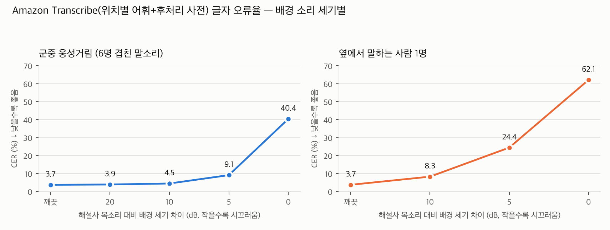
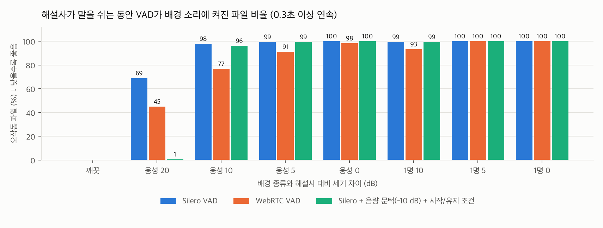

# 궁금(宮今) STT 소음·동시 발화·VAD 측정 보고서

작성 안기겸 · 2026-11-02 · 경복궁 해설 발화 녹음 180개에 배경 소리를 합성해 측정 · Amazon Transcribe(위치별 어휘 + 후처리 사전) 기준

**목차**

[TOC]

---

## 용어 풀이

| 용어 | 뜻 |
|---|---|
| CER | 글자 오류율. 정답 문장과 비교해 틀린 글자 비율. 낮을수록 좋음 |
| 전각명 인식률 | 광화문·근정전 같은 건물 이름을 맞게 받아쓴 비율 |
| 붕괴 발화 | 글자 절반 이상이 틀린(CER 50% 이상) 발화. 자막으로 쓸 수 없는 수준 |
| 배경 세기 차이(dB) | 해설사 목소리가 배경 소리보다 얼마나 큰지. 20 dB = 목소리가 10배 큼(조용한 편), 0 dB = 같은 크기(매우 시끄러움) |
| 웅성거림 | 여러 사람 말소리가 겹친 군중 소음. 다른 낭독자 6명의 녹음을 겹쳐 만듦 |
| 옆 사람 1명 | 해설사 바로 옆에서 다른 사람 1명이 계속 말하는 상황. 다른 낭독자 1명의 녹음을 같은 구간에 겹쳐 만듦 |
| VAD | 음성 구간 검출. 마이크 소리에서 "지금 말하는 중인가"를 판단해 STT로 보낼 구간을 자르는 장치 |
| 무음 구간 오작동 | 해설사가 말을 쉬는 동안 VAD가 배경 소리를 말로 착각해 켜진 경우 |

---

## 1. 요약

- **웅성거림은 해설사 목소리보다 10 dB 이상 작으면 문제가 없습니다.** CER 3.73%(깨끗) → 3.89%(20 dB) → 4.45%(10 dB)로 거의 그대로이고 전각명 인식률도 95% 수준을 지킵니다. 5 dB부터 전각명 84%로 떨어지고, 0 dB에서는 발화 3분의 1이 붕괴합니다.
- **옆에서 다른 사람이 말하는 것이 군중 소음보다 훨씬 해롭습니다.** 10 dB 차이에서 이미 CER이 2배(8.26%)가 되고, 5 dB면 붕괴 29건, 0 dB면 거의 전부 못 씁니다.
- **VAD는 "말소리인지"만 가리고 "해설사 목소리인지"는 가리지 못합니다.** Silero·WebRTC 모두 배경 말소리에 켜져서, 20 dB 웅성거림에서도 해설사가 쉬는 동안 파일의 45~69%가 오작동했습니다. 음량 문턱(−10 dB)과 시작 0.1초·유지 0.3초 조건을 붙이면 20 dB 환경에서는 오작동 0.6%·검출률 96.7%로 막을 수 있으나, 10 dB 이하에서는 어떤 방법도 막지 못합니다.
- **설계 반영**: ① 해설사 입 가까이의 마이크(헤드셋·핀마이크)로 배경 대비 10 dB 이상을 확보하는 것이 가장 효과가 큽니다. ② VAD는 Silero + 음량 문턱 + 시작/유지 조건으로 "조용할 때 전송 차단" 용도로만 쓰고, ③ 시끄러운 곳에서는 VAD 자동 판단 대신 해설사가 말하기 버튼으로 켜고 끄는 방식을 기본으로 둡니다. ④ 11월 8일 현장 테스트에서 실제 배경 세기 차이를 재어 어느 조건에 해당하는지 확인합니다.

---

## 2. 왜 쟀나

앞선 STT 엔진 비교(10월 25일)는 전부 조용한 실내에서 낭독한 녹음이었습니다. 실제 해설은 관광객이 많은 야외에서 이루어지고, 옆 팀 해설사나 관람객 말소리가 섞입니다. 상세개발계획서의 "STT→번역 스트리밍 파이프라인(VAD 포함)" 항목을 만들기 전에 다음 두 가지를 알아야 했습니다.

1. 배경 소리가 커질수록 Transcribe의 인식률이 얼마나 떨어지는가.
2. 해설사가 말을 쉬는 동안 VAD가 배경 소리를 말로 착각하는가(착각하면 엉뚱한 자막이 나가고 비용이 듭니다).

---

## 3. 어떻게 쟀나

### 3.1 배경 소리 합성

현장 녹음 대신 기존 180개 녹음에 배경을 섞었습니다. 단계별 비교가 되고, 정답 문장이 그대로 있어 기존 지표와 바로 비교할 수 있기 때문입니다.

| 항목 | 방법 |
|---|---|
| 원 녹음 | 10월 벤치마크와 같은 180개(16 kHz 모노) |
| 웅성거림 | 같은 낭독자·같은 해설 위치를 뺀 다른 녹음 6개를 겹쳐 만든 군중 소음 |
| 옆 사람 1명 | 다른 낭독자 1명의 녹음을 이어 붙여 해설사 발화 구간 전체에 겹침 |
| 세기 맞추기 | 해설사 발화 구간(Silero VAD로 찾음)의 음량을 재고, 배경을 그보다 20·10·5·0 dB(웅성거림) / 10·5·0 dB(옆 사람) 작게 맞춤 |
| 인식 정확도용 | 원 녹음과 같은 구간만 (180개 × 7조건) |
| VAD용 | 앞 1.5초·뒤 2.5초 무음을 붙이고 배경은 그 구간에도 깔아, "해설사가 쉬는 동안" 배경에 켜지는지 봄 |

### 3.2 측정 구성

| 항목 | 내용 |
|---|---|
| STT | Amazon Transcribe 스트리밍(서울, ko-KR) + 위치별 사용자 지정 어휘 + 후처리 사전(자모·0.85). 팀이 결정한 구성 그대로 |
| VAD 후보 | Silero VAD(문턱 0.5·0.7), WebRTC VAD(가장 엄격한 모드 3), Silero + 음량 문턱(−10·−15 dB), Silero + 음량 문턱(−15·−10 dB) + 시작 0.1초/유지 0.3초 |
| VAD 정답 | 깨끗한 녹음에서 Silero VAD가 찾은 발화 구간 |
| 지표 | 인식: CER·완전 일치·붕괴 발화·용어/전각명 인식률. VAD: 발화 검출률, 비발화 오검출률, 무음 구간 오작동 파일 비율(0.3초 이상 연속으로 켜짐), 시작 지연 |
| 비용 | Transcribe 7조건 약 1.6달러. VAD는 맥북에서 처리 |

"음량 문턱"은 해설사 발화 세기(깨끗한 녹음에서 잰 값)보다 10 또는 15 dB 이상 작은 프레임은 말로 치지 않는 것입니다. 앱에서는 해설사가 처음 몇 초 말할 때 세기를 재 두는 방식으로 구현할 수 있습니다.

---

## 4. 결과

### 4.1 인식 정확도

<!--STT_TABLE-->
| 배경 | 해설사 대비 세기 차이 (dB) | CER (%) ↓ | 완전 일치 (%) ↑ | 붕괴 발화 (개, CER≥50%) ↓ | 용어 인식률 (%) ↑ | 전각명 인식률 (%) ↑ |
|---|---|---|---|---|---|---|
| 깨끗한 녹음(기준) | — | 3.73 | 41.1 | 0 | 94.2 | 96.2 |
| 웅성거림 | 20 | 3.89 | 40.6 | 0 | 93.1 | 96.2 |
| 웅성거림 | 10 | 4.45 | 33.3 | 0 | 92.2 | 94.7 |
| 웅성거림 | 5 | 9.11 | 17.8 | 0 | 82.8 | 84.2 |
| 웅성거림 | 0 | 40.39 | 7.8 | 63 | 53.5 | 57.9 |
| 옆 사람 1명 | 10 | 8.26 | 27.8 | 4 | 88.6 | 88.7 |
| 옆 사람 1명 | 5 | 24.42 | 12.8 | 29 | 74.0 | 79.0 |
| 옆 사람 1명 | 0 | 62.07 | 0.6 | 107 | 43.0 | 47.4 |
<!--/STT_TABLE-->



- 웅성거림 20·10 dB는 깨끗한 녹음과 사실상 같습니다(CER 차이 0.2~0.7%p, 붕괴 0건).
- 웅성거림 5 dB에서 전각명이 84%로 떨어지고, 0 dB에서는 180개 중 63개가 붕괴합니다.
- 옆 사람 1명은 10 dB에서 이미 CER 8.26%(붕괴 4건), 5 dB에서 24.4%(붕괴 29건), 0 dB에서 62%(붕괴 107건)입니다. 같은 세기 차이의 웅성거림보다 2~3배 나쁩니다. 겹친 말소리가 또렷한 한국어라 Transcribe가 두 사람의 말을 섞어 받아쓰기 때문입니다(전사 길이는 정답과 같은데 내용이 섞임).
- 대기 시간은 조건과 무관하게 평균 1.25초, p90 1.7초로 깨끗한 녹음(1.19초·1.59초)과 같습니다.

### 4.2 VAD

<!--VAD_TABLE-->
**해설사가 쉬는 동안 배경에 켜진 파일 (%) ↓**
| 검출기 | 깨끗 | 웅성거림 20 | 웅성거림 10 | 웅성거림 5 | 웅성거림 0 | 옆 사람 1명 10 | 옆 사람 1명 5 | 옆 사람 1명 0 |
|---|---|---|---|---|---|---|---|---|
| Silero VAD (문턱 0.5) | 0.0 | 68.9 | 97.8 | 99.4 | 100.0 | 99.4 | 100.0 | 100.0 |
| Silero VAD (문턱 0.7) | 0.0 | 60.0 | 95.0 | 99.4 | 100.0 | 99.4 | 100.0 | 100.0 |
| WebRTC VAD (모드 3) | 0.0 | 45.0 | 76.7 | 91.1 | 98.3 | 93.3 | 100.0 | 100.0 |
| Silero + 음량 문턱 −10 dB | 0.0 | 0.0 | 37.2 | 97.2 | 100.0 | 28.3 | 84.4 | 95.0 |
| Silero + 음량 문턱 −15 dB | 0.0 | 0.0 | 93.3 | 99.4 | 100.0 | 82.2 | 97.8 | 100.0 |
| Silero + 음량 문턱 −15 dB + 시작 0.1초/유지 0.3초 | 0.0 | 14.4 | 98.3 | 99.4 | 100.0 | 100.0 | 100.0 | 100.0 |
| Silero + 음량 문턱 −10 dB + 시작 0.1초/유지 0.3초 | 0.0 | 0.6 | 96.1 | 99.4 | 100.0 | 99.4 | 100.0 | 100.0 |

**해설사 발화 프레임 검출률 (%) ↑**
| 검출기 | 깨끗 | 웅성거림 20 | 웅성거림 10 | 웅성거림 5 | 웅성거림 0 | 옆 사람 1명 10 | 옆 사람 1명 5 | 옆 사람 1명 0 |
|---|---|---|---|---|---|---|---|---|
| Silero VAD (문턱 0.5) | 96.7 | 98.6 | 99.8 | 99.9 | 100.0 | 99.5 | 99.5 | 99.2 |
| Silero VAD (문턱 0.7) | 95.6 | 97.6 | 99.5 | 99.8 | 99.9 | 99.2 | 99.1 | 98.9 |
| WebRTC VAD (모드 3) | 91.4 | 91.7 | 93.2 | 94.4 | 96.7 | 96.2 | 96.8 | 96.6 |
| Silero + 음량 문턱 −10 dB | 70.1 | 71.1 | 85.0 | 94.0 | 97.5 | 80.9 | 85.4 | 86.4 |
| Silero + 음량 문턱 −15 dB | 79.5 | 82.5 | 95.9 | 98.6 | 99.5 | 89.9 | 92.2 | 92.0 |
| Silero + 음량 문턱 −15 dB + 시작 0.1초/유지 0.3초 | 98.3 | 98.5 | 99.9 | 100.0 | 100.0 | 99.5 | 99.7 | 99.6 |
| Silero + 음량 문턱 −10 dB + 시작 0.1초/유지 0.3초 | 96.4 | 96.7 | 99.2 | 99.9 | 100.0 | 98.6 | 99.1 | 99.1 |

**비발화 프레임 오검출률 (%) ↓**
| 검출기 | 깨끗 | 웅성거림 20 | 웅성거림 10 | 웅성거림 5 | 웅성거림 0 | 옆 사람 1명 10 | 옆 사람 1명 5 | 옆 사람 1명 0 |
|---|---|---|---|---|---|---|---|---|
| Silero VAD (문턱 0.5) | 0.2 | 44.7 | 86.0 | 95.1 | 97.0 | 76.0 | 76.9 | 75.6 |
| Silero VAD (문턱 0.7) | 0.1 | 37.5 | 80.3 | 93.1 | 95.5 | 74.0 | 75.4 | 74.2 |
| WebRTC VAD (모드 3) | 0.7 | 25.3 | 56.4 | 70.4 | 84.7 | 56.7 | 66.0 | 69.0 |
| Silero + 음량 문턱 −10 dB | 0.1 | 0.1 | 33.0 | 70.1 | 87.9 | 28.7 | 46.6 | 54.6 |
| Silero + 음량 문턱 −15 dB | 0.1 | 2.6 | 64.6 | 86.4 | 94.5 | 46.1 | 57.5 | 62.2 |
| Silero + 음량 문턱 −15 dB + 시작 0.1초/유지 0.3초 | 5.2 | 7.9 | 83.9 | 94.4 | 97.4 | 74.0 | 80.1 | 80.8 |
| Silero + 음량 문턱 −10 dB + 시작 0.1초/유지 0.3초 | 3.9 | 4.1 | 56.9 | 89.3 | 96.4 | 53.4 | 74.3 | 78.0 |

처리 시간(맥북 CPU, 10초 파일 1개): Silero 계열 약 46 ms, WebRTC 1.1 ms — 둘 다 실시간보다 100배 이상 빠릅니다.
<!--/VAD_TABLE-->



- 깨끗한 녹음에서는 세 VAD 모두 오작동 0%, 검출률 91~97%입니다.
- 배경이 말소리이면 Silero·WebRTC는 그것도 "말"로 봅니다. 20 dB 웅성거림에서 이미 Silero 69%, WebRTC 45%의 파일이 쉬는 구간에서 켜졌고, 10 dB 이하에서는 거의 전부 켜졌습니다. 문턱을 0.7로 올려도 거의 달라지지 않습니다.
- 음량 문턱은 20 dB 환경에서만 듣습니다. 문턱만 붙이면(−10 dB) 작은 음절이 잘려 검출률이 70%로 떨어지지만, 시작 0.1초/유지 0.3초 조건을 더하면 검출률 96~97%를 되찾으면서 20 dB 웅성거림의 오작동을 0.6%로 막습니다(−15 dB는 14%). 10 dB부터는 배경이 문턱을 넘어 어느 조합이든 다시 켜집니다.
- 시작 지연은 깨끗한 녹음에서 5~25 ms로 세 후보 모두 문제없습니다(배경이 있을 때 음수로 나오는 것은 배경 때문에 이미 켜져 있던 것입니다).

### 4.3 전사 예시 (옆 사람 1명, 10 dB)

| 정답 | Transcribe 결과 |
|---|---|
| 광화문은 석축 기단에 홍예문 세 개를 내고, 그 위에 2층 문루를 올린 구조입니다. | 광화문은 석축 기단에 홍예문 세 개를 내고 그 위에 이층 문루를 올린 구조입니다. |
| 가운데 홍예는 임금이 드나드는 문이었고, 그 천장에는 남쪽을 지키는 주작이 그려져 있습니다. | 가운데 홍해는 임금이 드나드는 문이었고 그 천장에는 남쪽을 지키는 주작이 그려져 있습니다. |

같은 문장을 웅성거림 5 dB에서 받아쓰면 "가운데 홍해는 곰곰히 드다르는 문이 없고 … 주장이 그려져 있습니다"처럼 조사와 용어가 함께 무너집니다.

---

## 5. 설계에 반영할 것

| 순서 | 할 일 | 근거 |
|---|---|---|
| 1 | **해설사 마이크를 입 가까이(헤드셋·핀마이크)로 두어 배경 대비 10 dB 이상 확보** | 10 dB 이상이면 CER·전각명이 깨끗한 녹음과 같음. 폰을 손에 들고 말하면 배경 대비가 작아짐 |
| 2 | **VAD는 Silero + 음량 문턱 −10 dB + 시작 0.1초/유지 0.3초로, "조용할 때 전송 차단" 용도로만** | 20 dB 환경에서 오작동 0.6%·검출 97%. 비용 절감(쉬는 동안 Transcribe 과금 없음)과 엉뚱한 자막 방지 |
| 3 | **시끄러운 곳에서는 해설사가 말하기 버튼으로 켜고 끄는 수동 방식을 기본으로** | 10 dB 이하에서는 어떤 VAD도 배경 말소리와 해설사를 구분 못 함 |
| 4 | **옆 팀 해설사와 거리를 두는 운영 안내** | 옆 사람 1명이 웅성거림보다 2~3배 해로움 |
| 5 | **11월 8일 현장 테스트에서 앱이 해설사 발화 세기와 배경 세기를 로그로 남기도록** | 실제 현장이 20·10·5 dB 중 어디인지 알아야 2·3번의 기본값을 정할 수 있음 |

---

## 6. 한계와 다음 측정

- 배경이 같은 녹음 세트의 한국어 낭독을 합성한 것이라, 실제 현장의 외국어 관람객 말소리·바람·안내 방송·발소리와는 다릅니다. 외국어 말소리는 Transcribe(ko-KR)가 섞어 받아쓸 가능성이 한국어보다 낮을 수 있습니다.
- 옆 사람 1명 조건은 발화 구간 전체가 겹치는 최악의 경우입니다. 실제로는 부분적으로 겹칩니다.
- VAD 정답을 Silero로 만들었으므로 Silero에 약간 유리합니다. 음량 문턱의 기준 세기도 정답에서 가져왔으므로 앱에서는 해설사 목소리 보정 단계가 필요합니다.
- 다음 측정: 현장 테스트(11월 8일)에서 실제 배경 세기 차이 분포와 녹음을 얻어 이 표의 어느 열에 해당하는지 확인하고, 필요하면 그 녹음으로 재측정합니다.

---

## 부록. 파일과 재현 방법

| 파일 | 내용 |
|---|---|
| `mix_noise.py` | 배경 합성(7조건 × 180개, VAD용 무음 구간 포함). 결과 `.cache/noisy/` |
| `run_noise.sh` | 7조건 Transcribe 전사(`run_transcribe.py --wav-dir … --tag …`) |
| `results_noise/summary.csv` | 조건별 인식 지표 (`evaluate.py results_noise`) |
| `vad_eval.py` | VAD 측정. 결과 `results_noise/vad_summary.csv`, `vad_per_file.csv` |
| `noise_charts.py` | 그래프 2개 (`report_assets/noise_cer.png`, `vad_false.png`) |
| `noise_report_tables.py` | 이 보고서의 표를 CSV에서 갱신 |

```
python mix_noise.py && ./run_noise.sh && python evaluate.py results_noise
python vad_eval.py && python noise_charts.py && python noise_report_tables.py && python make_pdf.py STT_소음_VAD_측정_보고서.md
```
