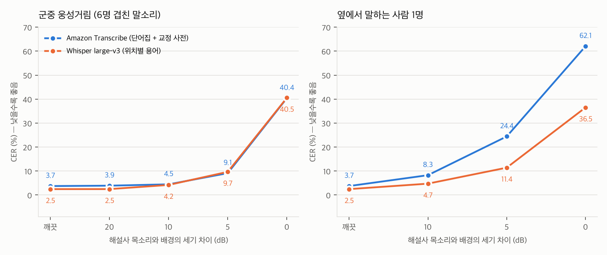

# 궁금(宮今) 중간발표 이후 STT·공지 번역 점검 보고서

작성 안기겸 · 2026-11-17 · 조용한 녹음 180문장, 배경 소리를 합성한 7조건, 경복궁 현장 녹음 15문장으로 측정 · Amazon Transcribe(위치별 단어집 + 교정 사전)와 Whisper large-v3(위치별 용어) 비교 · 공지 예문 30개로 앱 내 공지 번역(Amazon Translate) 점검

**목차**

[TOC]

---

## 용어 풀이

| 용어 | 뜻 |
|---|---|
| CER | 글자 오류율. 정답 문장과 비교해 틀린 글자 비율. 낮을수록 좋음 |
| 전각명 인식률 | 광화문·근정전 같은 건물 이름을 맞게 받아쓴 비율. 높을수록 좋음 |
| 붕괴 발화 | 글자 절반 이상이 틀린(CER 50% 이상) 발화. 자막으로 쓸 수 없는 수준 |
| 위치별 단어집 (위치별 용어) | 해설 위치마다 그곳의 용어를 담아 받아쓰기 엔진에 함께 넘기는 목록. Transcribe는 사용자 지정 어휘(단어집)로, Whisper는 앞 문맥 문장으로 넣음 |
| 교정 사전 | 받아쓴 글에서 위치별 용어와 소리가 비슷한 낱말을 용어로 바꾸는 단계. 자모 단위 유사도 0.85 이상이면 바꿈 |
| 배경 세기 차이(dB) | 해설사 목소리가 배경 소리보다 얼마나 큰지. 20 dB = 목소리가 10배 큼(조용한 편), 0 dB = 같은 크기(매우 시끄러움) |
| 웅성거림 | 여러 사람 말소리가 겹친 군중 소음. 다른 낭독자 6명의 녹음을 겹쳐 만듦 |
| 옆 사람 1명 | 해설사 바로 옆에서 다른 사람 1명이 계속 말하는 상황. 다른 낭독자 1명의 녹음을 같은 구간에 겹쳐 만듦 |
| VAD | 음성 구간 검출. 마이크 소리에서 "지금 말하는 중인가"를 판단하는 장치 |
| 탐색 폭 | 받아쓰기 엔진이 글자를 고를 때 후보를 몇 갈래까지 함께 따져 보는지(beam size). 1이면 매 순간 가장 그럴듯한 하나만 고름 |
| 정해진 표기 | 번역에서 용어마다 미리 정해 둔 외국어 표기. 백엔드의 용어 표에 들어 있음. 예: 근정전 → Geunjeongjeon (Throne Hall) |

---

## 1. 요약

- **중간발표 뒤 프론트엔드 시연에서 '임진왜란'이 네 번 모두 인식되지 않았다는 공유가 있었습니다.** 우리 녹음에서도 같은 모양의 오류가 한 문장에서 반복해서 나옵니다. 광화문 문장 녹음에서 Transcribe가 "임진왜란 때"를 "임진왜한테"로 받아씁니다.
- **원인은 그 녹음의 "란 때" 소리입니다.** '란'의 ㄴ 받침 콧소리가 다른 녹음보다 20 dB 이상 약하고, '때'가 터질 때 숨소리가 약 7 dB 셉니다. 같은 녹음을 CLOVA Speech·Whisper·Qwen3-ASR·Cohere·Apple SpeechTranscriber는 "임진왜란 때"로 받아썼고, Transcribe와 Apple 받아쓰기만 "한테"로 받아썼습니다.
- **Transcribe 쪽 설정으로는 고쳐지지 않았습니다.** 단어집 추가, 부분 결과 활용, 부분 결과 안정화, 어절별 확신 점수를 시험했고 모두 효과가 없었습니다. 지금 서버 방식(위치별 단어집 + 교정 사전)에서는 "임진왜란테"까지 돌아오고 '때' 한 글자가 남습니다.
- **지금 Transcribe 구성에서 더 올릴 방법은 찾지 못했습니다.** Transcribe 실시간 방식에는 단어집 말고 정확도를 조절하는 설정이 없습니다.
- **교정 사전은 지금 설정이 가장 좋았습니다.** 기준값(0.85)은 조용한 조건과 소음 6조건 모두에서 최선이었고, 교정 규칙을 바꾸거나 용어를 더 넣은 안은 지금(CER 3.73%)과 같거나 나빴습니다.
- **Whisper large-v3를 같은 녹음으로 쟀습니다.** 현장 녹음 15문장의 CER은 3.9%(Transcribe 7.4%)였습니다. 소음 합성에서는 옆 사람 1명 조건에서 차이가 컸고(5 dB: 11.4% 대 24.4%), 웅성거림에서는 비슷했습니다. '임진왜란' 문장은 용어 목록 없이도 세 문장 모두 맞게 받아썼습니다.
- **엔진을 바꾸는 경우의 장단점을 7장에 정리했습니다.** CLOVA Speech는 조용한 녹음 CER이 가장 낮고(2.22%) 실시간 방식이 있지만 AWS 밖이고 소음·현장 수치가 없습니다. Whisper는 소음·현장 수치가 있고 요청 요금이 없지만 GPU 서버를 직접 운영해야 합니다.
- **두 엔진의 측정 방식은 다릅니다.** Transcribe는 실시간으로 흘려보낸 결과이고, Whisper는 문장 단위로 잘라 통째로 넣은 결과입니다. Whisper는 AWS가 운영하는 서비스가 아니어서 GPU 서버와, 말소리를 끊어 보내는 단계가 따로 필요합니다.
- **앱 내 공지 번역을 공지 예문 30개로 점검했습니다(8장).** 건물·장소 이름이 정해진 표기로 나온 비율은 영어 79.3%, 태국어 79.5%였습니다. 줄바꿈·기호 바로 뒤의 이름을 찾지 못한 것이 원인이고, 고친 코드에서는 둘 다 100%입니다. 일반 낱말 '대비'가 "Daebi (Queen Dowager)"로 바뀌는 것을 포함해 다섯 가지 문제가 남아 있습니다.

---

## 2. 중간발표 이후 나온 이슈: '임진왜란' 인식

**결론: 원인은 광화문 문장 녹음의 "란 때" 소리이고, Transcribe의 설정으로는 고쳐지지 않았습니다.** 지금 서버 방식(위치별 단어집 + 교정 사전)에서는 '임진왜란'까지는 돌아오고 '때'가 '테'로 남습니다. 같은 녹음을 다른 7개 엔진은 맞게 받아썼습니다.

### 2.1 공유된 현상

| 항목 | 내용 |
|---|---|
| 언제 | 중간발표(2026-11-13) 이후 프론트엔드 시연 |
| 현상 | 여러 문장을 이어 읽었을 때 '임진왜란'이 네 번 모두 인식되지 않음. 여러 번 다시 해도 같음 |
| 기기·장소 | 노트북(그램), 경복궁 밖. 위치를 경복궁으로 지정해 위치별 단어집이 걸린 상태 |

시연 때의 소리와 화면에 나온 글자는 남아 있지 않아, 아래 분석은 같은 문장을 읽은 우리 녹음으로 했습니다.

### 2.2 우리 녹음에서 나온 같은 모양의 오류

**단어가 아니라 녹음 하나에서 생기는 오류입니다.** 조용한 녹음 180문장 가운데 '임진왜란'이 든 문장은 3개이고, 모두 "임진왜란 때"로 읽습니다. Transcribe는 이 가운데 광화문 문장 하나만 매번 같은 모양으로 틀렸고, 단어집을 넣어도 달라지지 않았습니다.

| 문장 | 단어집 없음 | 전체 단어집 | 위치별 단어집 |
|---|---|---|---|
| 광화문: "광화문은 임진왜란 때 소실됐다가 …" | 임진왜한테 | 임진왜한테 | 임진왜한테 |
| 사정전: "… 임진왜란 때 다시 불탔습니다" | 임진왜란 때 | 임진왜란 때 | 임진왜란 때 |
| 경회루: "경회루는 임진왜란 때 불에 타서 …" | 임진왜란때 | 임진왜란때 | 임진왜란때 |

- '임진왜란'은 전체 단어집과 광화문·사정전·경회루 단어집에 들어 있는데도 광화문 문장은 세 조건에서 똑같이 틀렸습니다.
- 같은 광화문 문장을 경복궁 현장에서 다시 읽은 녹음은 "임진왜란 때"로 맞게 나왔습니다.

### 2.3 같은 녹음을 다른 엔진으로 받아쓴 결과

**9개 엔진 가운데 Transcribe와 Apple 받아쓰기 둘만 "한테"로 틀렸고, 나머지 일곱은 맞게 받아썼습니다.** 광화문 문장 녹음을 9개 엔진이 받아쓴 결과입니다(10월 엔진 비교 측정의 기록, 단어집·사전 없음).

| 엔진 | 받아쓴 글 |
|---|---|
| Amazon Transcribe | 임진왜한테 소실됐다가 |
| Apple 받아쓰기 | 임진 왜한테 소실… |
| CLOVA Speech | 임진왜란 때 소실… |
| Whisper large-v3 | 임진왜란 때 소실… |
| Whisper large-v3-turbo | 임진왜란 때 소실… |
| Qwen3-ASR 1.7B | 임진왜란 때 소실… |
| Qwen3-ASR 0.6B | 임진왜란 때 소실… |
| Cohere Transcribe | 임진왜란 때 소실… |
| Apple SpeechTranscriber | 임진왜란 때 소실… |

### 2.4 원인: 그 녹음의 "란 때" 소리

**틀린 녹음은 '란' 끝과 '때' 양쪽 소리가 모두 다른 녹음과 다르게 났습니다. 뒤에 오는 말과 단어집은 원인이 아닙니다.** 아래 세 가지 측정이 근거입니다.

**소리 측정.** 조용한 녹음 3개에서 "란 때" 자리의 소리를 쟀습니다.

| 녹음 | Transcribe 결과 | "란"과 "때" 사이 막힌 시간 (ms) | "때"가 터진 뒤 목소리가 나기까지 (ms) | "란" 끝의 콧소리 세기 (dB) | "때"가 터질 때 숨소리 세기 (dB) |
|---|---|---|---|---|---|
| 광화문 | 틀림 | 72 | 21 | +9.1 | −22.3 |
| 사정전 | 맞음 | 55 | 17 | +28.7 | −29.4 |
| 경회루 | 맞음 | 61 | 15 | +36.8 | −29.5 |

\* 콧소리 세기는 클수록 ㄴ 받침이 뚜렷함. 숨소리 세기는 클수록 ㅌ에 가까움.
{: .note }

틀린 녹음은 '란'의 ㄴ 받침 콧소리가 20 dB 이상 약하고, '때'가 터질 때 숨소리가 약 7 dB 셉니다.

**소리를 바꿔 끼운 시험.** '란'과 '때' 사이 소리가 막힌 곳에서 잘라 다른 녹음의 소리와 이어 붙인 뒤 Transcribe에 넣었습니다(단어집 없음).

| '란'까지의 소리 | '때'의 소리 | Transcribe 결과 |
|---|---|---|
| 광화문 녹음 | 광화문 녹음 | 임진왜한테 |
| 광화문 녹음 | 경회루 녹음 | 임진왜란 ('때' 빠짐) |
| 광화문 녹음 | 사정전 녹음 | 임진왜란한테 |
| 경회루 녹음 | 광화문 녹음 | 임진왜란 ('때' 빠짐) |
| 경회루 녹음 | 경회루 녹음 | 임진왜란때 (맞음) |

**뒤에 오는 말을 바꾼 시험.** 소리를 바꿔 끼우지 않고 뒤의 말만 바꿨습니다.

| 보낸 소리 | Transcribe 결과 |
|---|---|
| 광화문 녹음을 "임진왜란 때"까지만 | 광화문은 임진왜한테 |
| 경회루 녹음 "… 임진왜란 때" + 광화문 녹음 "소실됐다가 …" | 경회로는 임진왜란때 소실됐다가 … |

- 뒤의 "소실됐다가"를 잘라 내도 그대로 틀렸고, 맞는 녹음 뒤에 "소실됐다가"를 붙여도 그대로 맞았습니다. 뒤에 오는 말은 원인이 아닙니다.
- 광화문 녹음의 '란' 뒤에는 어떤 '때'를 붙여도 '때'로 나오지 않았고, 광화문 녹음의 '때'는 맞는 녹음 뒤에 붙여도 '때'로 나오지 않았습니다. 그 녹음은 '란' 끝과 '때' 양쪽 소리가 모두 다르게 났고, 이는 위 소리 측정과 맞습니다.
- Transcribe와 Apple 받아쓰기는 그 소리를 들리는 대로 "한테"로 적었고, 나머지 엔진은 같은 소리를 "임진왜란 때"로 적었습니다.

### 2.5 Transcribe에서 시험한 방법

**일곱 가지를 시험했고, Transcribe 설정으로 고쳐진 것은 없습니다.** 교정 사전에 꼬리 규칙을 더하는 안만 그 문장을 "임진왜란 때"로 고쳤는데, 해당하는 문장이 180개 중 1개여서 전체 수치는 그대로입니다.

| 방법 | 결과 |
|---|---|
| 단어집에 '임진왜란' 넣기 (이미 들어 있음) | 그대로 "임진왜한테" |
| 단어집에 "임진왜란 때"를 한 덩어리로 추가 | 그대로 "임진왜한테". 다른 문장에는 "임진왜란-때"처럼 줄표가 생김 |
| 확정 전에 오는 부분 결과에서 되살리기 | 부분 결과에 '임진왜란'이 한 번도 나오지 않아 되살릴 글자가 없음 ("임진" 다음이 바로 "한테") |
| 부분 결과 안정화 설정 '높음' | 한국어에서 작동함. 중간의 "임진열한테"가 굳어 결과가 더 나빠짐 |
| 어절별 확신 점수(0~1)가 낮은 어절만 골라 고치기 | 단어집 없이는 "임진왜한테"가 0.45로 낮게 나오나, 위치별 단어집을 넣으면 0.75로 올라 맞게 받아쓴 어절(0.42)보다 높아짐. 서버 조건에서는 구분이 되지 않음 |
| 교정 사전에 '용어 뒤에 남은 꼬리' 규칙 추가 | "임진왜란테"가 "임진왜란 때"로 고쳐지나 해당 문장이 1개뿐. CER 3.73% → 3.71% |
| 여러 위치에 공통으로 나오는 용어를 모든 위치 목록에 넣기 | CER 4.35~4.61%로 나빠짐 (지금 3.73%) |

\* CER은 낮을수록 좋음.
{: .note }

'임진왜란'은 지금 위치 37곳 가운데 광화문·사정전·경회루 3곳의 목록에만 들어 있습니다. 서버의 틀린 표기 표(`stt_corrections.json`)에 "임진왜한테"를 한 줄 넣는 방법은 글자가 정확히 같을 때만 고쳐져, 다른 모양("임진열한테" 등)이나 다른 용어로 넓힐 수 없습니다.

### 2.6 지금 서버 방식에서의 결과

**광화문·사정전·경회루 위치에서는 "임진왜란테"까지 돌아오고, 그 밖의 위치에서는 "임진왜한테"가 그대로 나옵니다.** 위치별 단어집과 교정 사전을 모두 켜고 실제 말하는 속도로 보낸 결과입니다.

| 문장 | Transcribe가 받아쓴 글 | 교정 사전을 거친 뒤 | 남은 곳 |
|---|---|---|---|
| 광화문 | 임진왜한테 소실됐다가 … 경복궁을 중간하면서 | **임진왜란테** 소실됐다가 … 경복궁 중건하면서 | '때'가 '테'로 남음 |
| 사정전 | 강녕전 함경각과 함께 소질됐다가 … 임진왜란 때 | 강녕전 흠경각과 함께 소실됐다가 … 임진왜란 때 | 없음 |
| 경회루 | 경회로는 임진왜란때 불에 타 | 경회루는 임진왜란때 불에 타 | 띄어쓰기만 |

- 위치가 광화문·사정전·경회루이면 교정 사전이 "임진왜한테"의 앞부분을 '임진왜란'으로 고칩니다. 영어 자막에도 임진왜란 표기가 들어갑니다.
- 그 밖의 위치에서는 목록에 '임진왜란'이 없어 교정이 걸리지 않고, "임진왜한테"가 그대로 나옵니다.

---

## 3. Transcribe 구성에서 더 올릴 수 있는가

**결론: 지금 구성에서 더 올릴 방법은 찾지 못했습니다.** Transcribe 실시간 방식에는 정확도를 조절하는 설정이 없고(4장), 받아쓴 뒤 고치는 교정 사전은 기준값과 규칙 모두 지금 설정이 가장 좋았습니다. 남은 오류는 Transcribe가 소리를 글자로 받아쓰는 단계에서 생기는데, 이 단계는 단어집 말고는 손댈 수 있는 곳이 없습니다.

| 확인한 것 | 결과 | 더 올릴 수 있는가 |
|---|---|---|
| Transcribe 실시간 설정 (4장) | 단어집 말고는 정확도를 조절하는 값이 없음 | 아니오 |
| 교정 사전 기준값 (3.1) | 조용한 조건과 소음 5조건 모두 지금 값 0.85가 최저 | 아니오 |
| 교정 규칙을 바꾼 안 5가지 (3.2) | 3.71~4.61%. 지금 3.73% | 아니오 |
| 16 kHz 변환 (3.3) | 48 kHz 그대로 보낸 것과 차이 없음 | 아니오 |
| 현장 녹음 (3.4) | 같은 문장인데 조용한 녹음 4.1%, 현장 7.4% | 현장에서 늘어난 3.3%p는 위 방법으로 줄지 않음 |
| 서버를 거친 시험 (3.5) | 같은 문장을 직접 넣으면 4.4%, 서버를 거치면 20.4% | Transcribe 앞 단계의 손실. 이 보고서의 범위 밖 |

\* CER은 낮을수록 좋음.
{: .note }

### 3.1 교정 사전 기준값

**모든 조건에서 지금 값(0.85)이 가장 낮았습니다. 기준값을 바꿔서 올릴 수 없습니다.** 소음이 있으면 용어가 더 심하게 뭉개지므로 기준을 낮추면 나아지는지 확인한 것입니다. 이미 받아 둔 Transcribe 결과(위치별 단어집)에 기준값만 바꿔 적용한 CER(%)입니다.

| 조건 | 교정 없음 | 기준 0.75 | 기준 0.80 | 기준 0.85 (지금) | 기준 0.90 |
|---|---|---|---|---|---|
| 조용함 | 4.60 | 5.53 | 4.04 | **3.73** | 3.89 |
| 웅성거림 20 dB | 4.86 | 5.52 | 4.15 | **3.89** | 4.11 |
| 웅성거림 10 dB | 5.53 | 6.27 | 4.78 | **4.45** | 4.83 |
| 웅성거림 5 dB | 10.39 | 10.74 | 9.24 | **9.11** | 9.51 |
| 옆 사람 1명 10 dB | 9.31 | 9.98 | 8.54 | **8.26** | 8.60 |
| 옆 사람 1명 5 dB | 25.14 | 25.67 | 24.60 | **24.42** | 24.56 |

\* CER은 낮을수록 좋음. 굵은 글씨는 조건별 최저.
{: .note }

### 3.2 교정 규칙을 바꾼 안

**지금 규칙(3.73%)보다 나아진 안은 없습니다.** 꼬리 고치기만 지금과 같은 수준(3.71%)이고 나머지는 모두 나빠졌습니다. 조용한 녹음 180문장 기준입니다.

| 구성 | CER |
|---|---|
| 단어집 없음 | 5.78% |
| 위치별 단어집 | 4.60% |
| 위치별 단어집 + 교정 사전 (지금 서버 방식, 중간발표 수치) | **3.73%** |
| 지금 방식 + 용어 뒤에 남은 꼬리 고치기 | 3.71% |
| 비슷한 소리(ㄸ·ㅌ, ㅐ·ㅔ 등)를 같은 것으로 보고 맞추기 | 3.99% |
| 지금 방식 + 용어집 전체로 한 번 더 (기준 0.95) | 3.94% |
| 지금 방식 + 용어집 전체로 한 번 더 (기준 0.90) | 4.45% |
| 여러 위치에 공통으로 나오는 용어를 모든 위치 목록에 추가 | 4.35~4.61% |
| 교정 사전에 다른 위치의 목록이 걸린 경우 | 4.50% |

\* CER은 낮을수록 좋음.
{: .note }

- 교정 사전은 목록이 작고 그 위치에 맞을 때 효과가 납니다. 용어를 더 넣을수록 멀쩡한 말을 잘못 고칩니다.

### 3.3 16 kHz 변환의 영향

**16 kHz 변환은 정확도를 떨어뜨리지 않습니다. 48 kHz로 보내도 올라가지 않습니다.** 프론트엔드는 마이크의 48 kHz 소리를 16 kHz로 바꿔 서버로 보냅니다. 72초 현장 녹음을 두 방식으로 Transcribe에 보내 비교했습니다(위치별 단어집 없음).

| 보낸 방식 | CER | 영어 번역에서 정해진 표기로 나온 용어 |
|---|---|---|
| 48 kHz 그대로 | 7.0% | 27개 중 19개 |
| 프론트엔드와 같은 방식으로 16 kHz 변환 | 6.7% | 27개 중 19개 |

\* CER은 낮을수록 좋음. 용어 수는 많을수록 좋음.
{: .note }

### 3.4 현장 녹음과 조용한 녹음, 같은 15문장

**같은 15문장인데 현장 녹음의 CER이 3.3%p(18자) 높았고, 건춘문과 근정전 조정 구간에 몰려 있습니다.** 현장에서 읽은 15문장을 조용한 녹음의 같은 문장과 비교했습니다(위치별 단어집 + 교정 사전).

| 구간 | 조용한 녹음 CER | 현장 녹음 CER |
|---|---|---|
| 광화문 (3문장) | 2.6% | 3.5% |
| 흥례문 (3문장) | 3.3% | 4.1% |
| 건춘문 (2문장) | 1.3% | 11.5% |
| 근정전 조정 (3문장) | 2.9% | 9.6% |
| 근정전 (3문장) | 8.8% | 12.1% |
| 근정전 내부 (1문장) | 9.1% | 3.0% |
| **전체 (15문장)** | **4.1%** | **7.4%** |

\* CER은 낮을수록 좋음.
{: .note }

- 현장 녹음은 말할 때와 쉴 때의 소리 크기 차이가 약 16~20 dB였습니다.

### 3.5 서버를 거친 시험 (11월 11일)

**서버를 거친 시험의 CER은 20.4%로, 같은 문장을 직접 넣었을 때(4.4%)보다 크게 높았습니다. 차이의 대부분은 단어집과 무관하게 말이 통째로 빠진 것입니다.** 폰 스피커로 재생한 소리를 노트북 마이크로 받아 실제 서버로 보낸 시험입니다(12문장 427자, 위치 정보 없음). 같은 문장의 녹음 파일을 Transcribe에 직접 넣은 결과와 비교했습니다.

| 조건 | 틀린 글자 (개) | CER |
|---|---|---|
| 서버를 거친 시험 (스피커 → 노트북 마이크, 위치 없음) | 87 | 20.4% |
| 녹음 파일 그대로, 단어집 없음 | 25 | 5.9% |
| 녹음 파일 그대로, 위치별 단어집 | 19 | 4.4% |
| 녹음 파일 그대로, 위치별 단어집 + 교정 사전 | 14 | 3.3% |

\* 틀린 글자, CER은 낮을수록 좋음.
{: .note }

- 위치가 있고 없고의 차이는 25개 → 14개입니다. 건축문 → 건춘문, 홍례문 → 홍예문 같은 궁궐 용어가 여기에 해당합니다.
- 나머지 62개는 단어집으로 설명되지 않습니다. "이층 문루를 올린"이 "이층. 올린"으로, "옮겨졌습니다"가 "좋습니다"로 나오는 등 말의 일부가 통째로 빠졌습니다.
- 이 시험은 스피커로 재생한 소리를 받은 것이어서, 사람이 마이크에 직접 말한 경우의 수치는 아닙니다.

---

## 4. 엔진별로 조절할 수 있는 설정

**결론: 세 엔진 모두 Top-p / Top-k는 없습니다. Transcribe 실시간 방식에서 정확도에 영향을 주는 값은 단어집 하나뿐이고, CLOVA Speech에는 끊는 간격과 단어별 가중치가, Whisper에는 탐색 폭·반복 억제 같은 디코딩 설정이 있습니다.**

| 항목 | Amazon Transcribe (실시간) | CLOVA Speech (실시간) | Whisper large-v3 (faster-whisper) |
|---|---|---|---|
| 후보를 고르는 폭 (Top-p / Top-k) | 없음 | 없음 | 없음. 대신 탐색 폭(`beam_size`), 무작위 정도(`temperature`)가 있음 |
| 후보 문장 여러 개 받기 | 없음 (파일 방식에서만 최대 10개) | 없음 (결과에 받아쓴 글 하나만 옴) | 없음 (안에서 여러 후보를 따져도 가장 좋은 하나만 돌려줌) |
| 문장을 끊는 간격 | 없음 | 있음 (`semanticEpd`, 아래 표) | 모델에는 없음. 소리를 잘라 넣는 단계에서 정함 |
| 용어 넣기 | 사용자 지정 어휘 (한 번에 1개) | 키워드 부스팅 | 앞 문맥 문장(`initial_prompt`, 최대 223토큰) 또는 `hotwords` |
| 단어별 가중치 | 없음 | 있음 (0~5.0) | 없음 |
| 발음 적어 주기 | 없음 (적어도 무시됨) | 없음 (실시간은 단어와 가중치만 받음. '표기\|발음' 형식은 파일 방식에만 있음) | 없음 (글자로 된 힌트만 받음) |
| 어절별 확신 점수 | 있음 (0~1) | 있음 (0~1) | 있음 (`word_timestamps`를 켜면 단어별 `probability`) |
| 말하는 도중의 중간 결과 | 있음. 안정화 정도를 낮음·중간·높음으로 조절 | 중간 결과·안정화 설정 없음. 끊는 조건이 찰 때마다 결과가 옴 | 없음 (소리를 통째로 넣는 방식. 실시간으로 쓰려면 별도 프로그램이 필요) |
| 소음 걸러내기 설정 | 없음 | 없음 (`noiseFiltering`은 파일 방식에만 있음) | 없음 |
| 우리 문장으로 모델 맞추기 | 한국어 미지원 | 없음 (맞춤 기능은 키워드 부스팅·금칙어·인식 후 보정) | 가능 (모델 공개) |

\* 확인한 곳(2026-11-16~17): Transcribe는 AWS 공식 문서. CLOVA Speech는 공식 API 문서의 설정·응답 항목 전체와 상품 안내·사용 가이드·릴리스 노트. Whisper는 faster-whisper 소스 코드의 설정·결과 항목.
{: .note }

**CLOVA Speech 실시간 방식의 끊는 간격 설정**

| 설정 | 하는 일 | 단위 | 기본값 |
|---|---|---|---|
| `gapThreshold` | 이만큼 말이 끊기면 결과를 내보냄 | ms | 0 (사용 안 함) |
| `durationThreshold` | 이 길이가 차면 결과를 내보냄 | ms | 0 (서버 기본값) |
| `syllableThreshold` | 이 글자 수가 차면 결과를 내보냄 | 글자 수 | 0 (사용 안 함) |
| `useWordEpd` | 단어 경계에서만 끊음 | 켬/끔 | 끔 |
| `usePeriodEpd` | 마침표에서 끊음 | 켬/끔 | 끔 |

- CLOVA Speech의 가중치는 높인다고 좋아지지 않았습니다. 10월 측정(파일 방식)에서 가중치 1일 때 CER 2.22%, 3일 때 7.39%(붕괴 8건), 5일 때 9.16%(붕괴 11건)였습니다.
- Whisper 측정은 탐색 폭 1로 했습니다. 이 실행 프로그램의 기본값은 5입니다.

---

## 5. 모델 비교

**결론: 조용한 녹음에서는 CLOVA Speech(2.22%)와 Whisper large-v3(2.43%)가 지금 서버의 Transcribe(3.73%)보다 CER이 낮습니다. 소음과 현장 녹음까지 잰 Whisper는 현장 녹음에서 3.9%(Transcribe 7.4%)였고, 조용함을 포함한 8조건 가운데 6조건에서 Transcribe보다 낮았습니다.** CLOVA Speech는 소음과 현장 녹음으로는 재지 않았습니다.

### 5.1 조용한 녹음 180문장 (10월 측정)

**CER은 CLOVA Speech가 가장 낮고, 전각명 인식률은 Whisper가 가장 높습니다. Transcribe는 9개 가운데 다섯째입니다.** 엔진마다 가장 잘 맞는 사전 조합으로 잰 값입니다. "완비"는 그 위치의 용어가 목록에 모두 있는 경우, "누락"은 평가하는 문장의 용어를 목록에서 뺀 경우입니다.

| 모델 | 사전 조합 | CER (완비 / 누락) | 전각명 (완비 / 누락) | 용어 (완비 / 누락) |
|---|---|---|---|---|
| CLOVA Speech | 키워드 부스팅 (가중치 1) | 2.22% / 2.69% | 96.2% / 94.0% | 96.9% / 92.4% |
| Whisper large-v3 | 위치별 용어 | 2.43% / 3.38% | 99.2% / 90.2% | 98.7% / 88.4% |
| Qwen3-ASR 1.7B | 위치별 용어 + 붕괴 방지 | 2.55% / 2.86% | 94.0% / 91.7% | 95.3% / 91.5% |
| Whisper large-v3-turbo | 위치별 용어 | 2.76% / 3.73% | 99.2% / 92.5% | 96.2% / 86.4% |
| **Amazon Transcribe (지금 서버)** | 위치별 단어집 + 교정 사전 | **3.73% / 5.24%** | **96.2% / 79.0%** | **94.2% / 78.1%** |
| Qwen3-ASR 0.6B | 위치별 용어 + 붕괴 방지 | 3.94% / 4.99% | 92.5% / 85.7% | 89.7% / 81.7% |
| Apple SpeechTranscriber | 교정 사전 | 4.45% / 5.25% | 94.0% / 83.5% | 88.8% / 78.3% |
| Cohere Transcribe | 교정 사전 | 7.06% / 7.98% | 84.2% / 74.4% | 81.2% / 68.9% |
| Apple 받아쓰기 | 교정 사전 | 9.18% / 9.69% | 56.4% / 54.9% | 67.6% / 60.0% |

\* CER은 낮을수록 좋음. 전각명·용어 인식률은 높을수록 좋음.  
\* Amazon Transcribe의 누락 값은 단어집 없이 교정 사전만 쓴 값입니다.  
\* 출처: STT 엔진 선정 보고서(2026-10-27) 5.2절.
{: .note }

### 5.2 소음 합성 조건: Amazon Transcribe와 Whisper large-v3

**옆 사람 1명 조건에서는 Whisper의 CER이 Transcribe의 절반 수준이고, 웅성거림 10 dB 이하에서는 두 엔진이 비슷합니다. 전각명 인식률은 모든 조건에서 Whisper가 높습니다.** 같은 180문장에 배경 소리를 합성한 녹음입니다. Whisper는 조용한 녹음에서 2.43%를 낸 것과 같은 스크립트·같은 설정으로 녹음만 바꿔 돌렸습니다.

| 조건 | CER Transcribe | CER Whisper | 전각명 Transcribe | 전각명 Whisper | 붕괴 Transcribe | 붕괴 Whisper |
|---|---|---|---|---|---|---|
| 조용함 | 3.73% | **2.45%** | 96.2% | **99.2%** | 0 | 0 |
| 웅성거림 20 dB | 3.89% | **2.46%** | 96.2% | **99.2%** | 0 | 0 |
| 웅성거림 10 dB | 4.45% | **4.19%** | 94.7% | **99.2%** | 0 | 0 |
| 웅성거림 5 dB | **9.11%** | 9.66% | 84.2% | **97.7%** | **0** | 3 |
| 웅성거림 0 dB | **40.39%** | 40.54% | 57.9% | **88.0%** | 63 | **59** |
| 옆 사람 1명 10 dB | 8.26% | **4.73%** | 88.7% | **98.5%** | 4 | **2** |
| 옆 사람 1명 5 dB | 24.42% | **11.40%** | 78.9% | **96.2%** | 29 | **11** |
| 옆 사람 1명 0 dB | 62.07% | **36.52%** | 47.4% | **77.4%** | 107 | **54** |

\* CER, 붕괴 발화 수(180개 중)는 낮을수록 좋음. 전각명 인식률은 높을수록 좋음. 굵은 글씨는 조건별로 더 좋은 쪽.  
\* Transcribe는 위치별 단어집 + 교정 사전, Whisper는 위치별 용어만 넣은 값입니다. Whisper에 교정 사전을 더하면 모든 조건에서 CER이 0.1~0.3%p 높아졌습니다.
{: .note }

- Whisper의 조용한 녹음 값(2.45%)은 10월에 다른 장비 두 대에서 잰 값(2.43%, 2.45%)과 거의 같습니다.

### 5.3 경복궁 현장 녹음 15문장

**현장 녹음 15문장의 CER은 Whisper 3.9%, Transcribe 7.4%입니다. 6구간 가운데 4구간에서 Whisper가 낮고, 광화문 구간만 Transcribe가 낮습니다.** 11월 8일 현장 녹음 2개(72.4초, 54.1초)를 11월 9일 Transcribe 측정과 같은 지점에서 6구간으로 잘랐습니다.

| 구간 | 글자 수 | Transcribe (단어집 + 교정 사전) | Whisper large-v3 (위치별 용어) |
|---|---|---|---|
| 광화문 (3문장) | 115 | **3.5%** | 5.2% |
| 흥례문 (3문장) | 121 | 4.1% | **0.0%** |
| 건춘문 (2문장) | 78 | 11.5% | **6.4%** |
| 근정전 조정 (3문장) | 104 | 9.6% | **3.8%** |
| 근정전 (3문장) | 91 | 12.1% | **5.5%** |
| 근정전 내부 (1문장) | 33 | 3.0% | 3.0% |
| **전체 (15문장)** | 542 | 7.4% | **3.9%** |

\* CER은 낮을수록 좋음. Whisper에 교정 사전을 더하면 전체 3.7%입니다.
{: .note }

**어떤 단어가 달라졌는가**

| 구간 | 정답 | Transcribe (교정 사전 적용 뒤) | Whisper |
|---|---|---|---|
| 광화문 | 홍예문 | 통회문 | 통일문 |
| 광화문 | 문루 | 문루 | 문두 |
| 광화문 | 임진왜란 때 | 임진왜란 때 | 임진왜란 때 |
| 흥례문 | 흥례문 (3번) | 흥례문 2번, 흑미문 1번 | 흥례문 3번 |
| 흥례문 | 예가 | 얘가 | 예가 |
| 흥례문 | 헐렸습니다 | 걸렸습니다 | 헐렸습니다 |
| 건춘문 | 건춘문 (2번) | 건춘문 2번 | 건춘문 2번 |
| 건춘문 | 관원들이 | (빠짐) | 왕들이 |
| 근정전 조정 | 신년 하례 | 10년 하례 | 신년 하례 |
| 근정전 조정 | 사신 접견 | 사신접경 | 사신 접경 |
| 근정전 조정 | 의례 | 의뢰 | 의례 |
| 근정전 조정 | 품계석 | 통계석 | 품계석 |
| 근정전 | 다포계 | 다포계 | 다포계 |
| 근정전 | 팔작지붕 | 팔짝 지붕 | 팔작지붕 |
| 근정전 | 십이지신상 | 시위 지신상 | 십이지신상 |
| 근정전 | 사신 접견 | 사신접변 | 사신 접경 |

- Whisper에 남은 오류는 홍예문 → 통일문, 문루 → 문두, 관원들이 → 왕들이, 접견 → 접경(2번)입니다.
- 15문장 542자여서 한 글자가 0.2%에 해당합니다. 전체 차이 3.5%p는 글자로 19자입니다.
- 정답은 읽기 문장 기준이고, 실제 낭독이 다른 곳("전해집니다"를 "합니다"로, "근정문에서"를 "근정전에서"로 읽음)은 두 엔진 모두 오류로 계산됩니다.

### 5.4 '임진왜란' 문장

**Whisper는 용어 목록에 '임진왜란'이 없어도 세 문장을 모두 맞게 받아썼습니다. 놓친 경우는 0 dB에서 문장 전체가 붕괴한 두 번뿐입니다.** '임진왜란'이 든 3문장(광화문·사정전·경회루) 가운데 맞게 받아쓴 문장 수입니다.

| 조건 | Transcribe | Whisper large-v3 |
|---|---|---|
| 조용함, 용어를 넣지 않음 | 2 | 3 |
| 조용함, 목록에서 '임진왜란'을 뺌 | — | 3 |
| 조용함, 위치별 용어 | 2 (교정 사전을 거치면 3) | 3 |
| 웅성거림 20 dB | 3 | 3 |
| 웅성거림 10 dB | 2 | 3 |
| 웅성거림 5 dB | 3 | 3 |
| 웅성거림 0 dB | 2 | 2 |
| 옆 사람 1명 10 dB | 3 | 3 |
| 옆 사람 1명 5 dB | 2 | 3 |
| 옆 사람 1명 0 dB | 3 | 2 |

\* 3문장 중 맞은 수. 많을수록 좋음. 소음 조건은 Transcribe는 단어집 + 교정 사전, Whisper는 위치별 용어입니다.  
\* 교정 사전을 거친 Transcribe 값은 광화문 문장이 "임진왜란테"로 나온 경우를 맞은 것으로 센 값입니다.
{: .note }

### 5.5 운영 조건

**Transcribe와 CLOVA Speech는 서비스가 운영하고 쓴 만큼 요금을 냅니다. Whisper는 요청 요금이 없는 대신 GPU 서버를 직접 운영합니다.**

| 항목 | Amazon Transcribe | CLOVA Speech | Whisper large-v3 |
|---|---|---|---|
| 받아쓰는 방식 | 실시간 (말하는 동안 계속 전송) | 실시간 방식과 파일 방식이 있음 | 소리를 잘라 한 덩어리씩 넣음 |
| 발화당 대기 | 1.19초 (네트워크 포함) | 2.04초 (파일 방식, 업로드 포함) | 0.55초 (RTX 2070, 업로드 제외) |
| 요금 | 초당 0.0001667달러 (서울 리전, 1초 단위) | 15초당 5원 (실시간·파일 모두, Basic 플랜, 15초 단위 올림, 부가세 별도) | 요청마다 내는 요금 없음. 서버 비용 |
| 운영 | AWS가 운영 | 네이버 클라우드가 운영 (한국 리전) | GPU 서버를 직접 운영 |
| 말소리를 끊어 보내는 단계 | 필요 없음 | 실시간 방식은 필요 없음 | 필요함 |

\* 발화당 대기는 낮을수록 좋음. Transcribe·CLOVA Speech의 대기는 10월 측정, Whisper는 이번 측정입니다. CLOVA Speech 실시간 방식의 대기는 재지 않았습니다.  
\* 요금은 2026-11-17 AWS 요금 자료와 네이버 클라우드 상품 페이지 기준입니다.
{: .note }

10월 25일 팀 회의에서 Amazon Transcribe로 정한 이유는 개인 장비 의존을 없애고, 팀 전체를 AWS 하나로 관리하며, 서버 운영 부담을 지지 않기 위해서였습니다.

---

## 6. Whisper가 틀린 유형

**결론: Whisper의 오류는 네 유형입니다. 세 유형은 조절할 설정이 있고(바꿨을 때의 수치는 재지 않음), 옆 사람의 말을 대신 받아쓰는 유형은 설정으로도 VAD로도 거를 수 없습니다.**

현장 녹음에 남은 오류와 소음 조건에서 붕괴한 문장을 읽어 유형을 나눴습니다.

| 유형 | 예 | 관련 설정 |
|---|---|---|
| 한 단어를 비슷한 소리로 잘못 들음 | 홍예문 → 통일문, 문루 → 문두, 접견 → 접경 | 탐색 폭(`beam_size`, `patience`) |
| 같은 말을 반복함 | "천장문 순서대로"를 세 번 반복 (웅성거림 5 dB, 1건) | 반복 억제(`repetition_penalty`, `no_repeat_ngram_size`) |
| 넣어 준 용어 목록을 그대로 내보냄 | "십장생 굴뚝, 자경전, 십장생, 길상무늬 …" (옆 사람 1명 5 dB, 1건) | 용어 넣는 방식(`initial_prompt`, `hotwords`) |
| 옆 사람의 말을 대신 받아씀 | 옆 사람 1명 5 dB의 붕괴 11건 중 9건 (전부 또는 일부) | 없음 |

- 이번 측정은 탐색 폭 1, 반복 억제 없음으로 했습니다. 이 설정들을 바꿨을 때의 수치는 재지 않았습니다.
- 옆 사람의 말을 받아쓰는 경우는 VAD로 거를 수 없습니다. VAD는 "말소리인지"만 가리고 누구의 목소리인지는 가리지 못하며, 두 사람이 같은 순간에 말하면 그 구간을 통과시킬 때 두 목소리가 함께 들어갑니다. 11월 2일 측정에서 해설사가 쉬는 동안 옆 사람 말소리에 VAD가 잘못 켜진 비율은 아래와 같습니다.

| 검출 방식 | 옆 사람 1명 10 dB | 옆 사람 1명 5 dB | 옆 사람 1명 0 dB |
|---|---|---|---|
| Silero VAD (문턱 0.5) | 99.4% | 100.0% | 100.0% |
| Silero VAD (문턱 0.7) | 99.4% | 100.0% | 100.0% |
| Silero + 음량 문턱 −10 dB | 28.3% | 84.4% | 95.0% |
| Silero + 음량 문턱 −15 dB | 82.2% | 97.8% | 100.0% |
| Silero + 음량 문턱 −10 dB + 시작 0.1초/유지 0.3초 | 99.4% | 100.0% | 100.0% |

\* 잘못 켜진 파일의 비율. 낮을수록 좋음. 출처: STT 소음·동시 발화·VAD 측정 보고서(2026-11-02) 4.2절.
{: .note }

- 옆 사람 1명 조건은 다른 사람의 말이 해설사 문장 전체에 겹치는 가장 나쁜 경우로 만든 것입니다. 현장 녹음(말할 때와 쉴 때 차이 약 16~20 dB)에서는 Whisper가 옆 사람 말을 받아쓴 구간이 없었습니다.

---

## 7. 엔진을 바꾸는 경우의 기대 효과와 장단점

**결론: CLOVA Speech와 Whisper large-v3 모두 조용한 녹음의 CER이 지금보다 1.3~1.5%p 낮고, '임진왜란' 문장을 세 개 모두 맞게 받아썼습니다. CLOVA Speech는 실시간 방식이 있고 서버를 운영하지 않아도 되지만 AWS 밖 서비스이고, 소음·현장 녹음 수치가 없습니다. Whisper는 소음·현장 녹음까지 수치가 있고 요청 요금이 없지만, GPU 서버와 말소리를 끊어 넣는 단계를 직접 만들어야 합니다.**

### 7.1 기대 효과 (측정값 기준)

| 항목 | Amazon Transcribe (지금) | CLOVA Speech | Whisper large-v3 |
|---|---|---|---|
| 조용한 녹음 CER (완비 / 누락) | 3.73% / 5.24% | **2.22% / 2.69%** | 2.43% / 3.38% |
| 전각명 인식률 (완비 / 누락) | 96.2% / 79.0% | 96.2% / **94.0%** | **99.2%** / 90.2% |
| 용어를 넣지 않았을 때 CER | 5.78% | **3.20%** | 5.67% |
| 용어를 넣지 않았을 때 전각명 인식률 | 56.4% | **87.2%** | 62.4% |
| '임진왜란' 3문장 (조용함) | 2개 맞음 | **3개 맞음** | **3개 맞음** |
| 현장 녹음 15문장 CER | 7.4% | 재지 않음 | **3.9%** |
| 옆 사람 1명 5 dB CER | 24.42% | 재지 않음 | **11.40%** |
| 웅성거림 5 dB CER | **9.11%** | 재지 않음 | 9.66% |
| 발화당 대기 | 1.19초 | 2.04초 (파일 방식) | **0.55초** (업로드 제외) |

\* CER, 대기는 낮을수록 좋음. 전각명 인식률, 맞은 문장 수는 높을수록 좋음. 굵은 글씨는 항목별로 가장 좋은 값.  
\* 완비 = 그 위치의 용어가 목록에 모두 있는 경우, 누락 = 평가하는 문장의 용어를 목록에서 뺀 경우.  
\* CLOVA Speech의 값은 모두 파일 방식(키워드 부스팅 가중치 1)으로 잰 10월 측정입니다. 실시간 방식의 정확도와 대기는 재지 않았습니다.
{: .note }

- **CLOVA Speech로 바꾸면**: 조용한 녹음 CER이 3.73% → 2.22%가 됩니다. 용어 목록에 없는 말이 섞여도 수치가 거의 유지되는 것(2.69%)이 가장 큰 차이입니다. 해설사가 목록에 없는 용어를 말하는 경우에 유리합니다.
- **Whisper large-v3로 바꾸면**: 조용한 녹음 CER이 3.73% → 2.43%, 현장 녹음이 7.4% → 3.9%가 됩니다. 옆에서 다른 사람이 말하는 조건에서 오류가 절반으로 줄어듭니다. 용어 목록에 없는 말이 섞이면 3.38%로 올라갑니다.

### 7.2 장단점

| | CLOVA Speech | Whisper large-v3 |
|---|---|---|
| 장점 | ① 조용한 녹음 CER이 9개 엔진 중 가장 낮음 | ① 소음·현장 녹음까지 잰 수치가 있고, 현장 녹음 CER이 Transcribe의 절반 |
| | ② 용어 목록에 없는 말에도 강함 (누락 조건 2.69%, 전각명 94.0%) | ② 전각명 인식률이 가장 높음 (99.2%) |
| | ③ 실시간 방식이 있어 말소리를 끊어 넣는 단계가 필요 없음 | ③ 옆 사람 말소리가 겹치는 조건에 강함 |
| | ④ 끊는 간격과 단어별 가중치를 조절할 수 있음 | ④ 요청마다 내는 요금이 없음 |
| | ⑤ 서버를 운영하지 않아도 됨 | ⑤ 모델이 공개되어 우리 문장으로 맞출 수 있고, 탐색 폭·반복 억제 등 조절할 설정이 남아 있음 |
| | ⑥ 실시간 설정 안에 번역(Papago) 연동과 용어집 지정이 들어 있음 | ⑥ 발화당 처리 0.55초로 가장 빠름 |
| 단점 | ① AWS 밖 서비스. 10월 25일에 Transcribe로 정한 이유(AWS 하나로 관리)와 어긋남 | ① GPU 서버를 직접 운영해야 함. 10월 25일 결정의 이유(운영 부담)와 어긋남 |
| | ② 실시간 방식으로는 정확도와 대기를 재지 않음 (잰 것은 파일 방식, 대기 2.04초) | ② 실시간 방식이 아니어서 말소리를 끊어 넣는 단계를 만들어야 하고, 말 중간에서 잘리면 수치가 나빠짐 |
| | ③ 소음·현장 녹음으로 재지 않음 | ③ 용어 목록에 없는 말에 약함 (누락 조건 3.38%, 전각명 90.2%) |
| | ④ 가중치를 높이면 오히려 나빠짐 (가중치 3에서 CER 7.39%) | ④ 같은 말 반복, 넣어 준 용어 목록을 그대로 내보내는 오류가 소음 조건에서 나옴 (6장) |
| | ⑤ 15초 단위로 올려 과금. 도메인당 동시 연결 15개 | ⑤ 용어를 223토큰까지만 넣을 수 있음 |
| | ⑥ 우리 문장으로 모델을 맞출 수 없음 | ⑥ AWS에 올려도 쓴 만큼 내는 서비스가 아니라 GPU 인스턴스를 켜 둔 시간만큼 과금 |

### 7.3 요금

| 엔진 | 과금 단위 | 단가 | 1시간 받아쓸 때 |
|---|---|---|---|
| Amazon Transcribe 실시간 (서울 리전) | 1초, 최소 과금 없음 | 초당 0.0001667달러 | 0.60달러 |
| CLOVA Speech 실시간 (Basic 플랜) | 15초, 올림 | 15초당 5원 (부가세 별도) | 1,200원 |
| Whisper, AWS EC2 g4dn.xlarge (서울 리전, GPU T4 16GB) | 켜 둔 시간 | 시간당 0.647달러 | 0.647달러 (받아쓴 양과 무관) |
| Whisper, AWS EC2 g5.xlarge (서울 리전, GPU A10G 24GB) | 켜 둔 시간 | 시간당 1.237달러 | 1.237달러 (받아쓴 양과 무관) |

\* 2026-11-17 기준. AWS 요금 자료와 네이버 클라우드 상품 페이지에서 읽은 값입니다.  
\* 환율을 1달러 = 1,400원으로 놓으면 Transcribe 1시간은 약 840원입니다.
{: .note }

- GPU 인스턴스는 받아쓰는 양과 관계없이 켜 둔 시간만큼 요금이 나옵니다. g4dn.xlarge를 한 달 내내 켜 두면 약 466달러이고, 이는 Transcribe로 약 776시간을 받아쓰는 요금과 같습니다.
- Whisper large-v3는 이번 측정에서 GPU 메모리를 약 4.1GB 썼습니다(RTX 2070 8GB, fp16). 위 인스턴스에서의 처리 속도는 재지 않았습니다.

### 7.4 바꾸는 경우 필요한 작업

| 항목 | CLOVA Speech | Whisper large-v3 |
|---|---|---|
| 계정·서버 | 네이버 클라우드 계정과 Basic 플랜 도메인 | GPU 서버 (AWS 인스턴스 또는 별도 장비) |
| 백엔드 연결 | Transcribe 실시간 연결을 CLOVA Speech gRPC 연결로 교체 | 말소리를 문장 경계에 가깝게 잘라 Whisper에 넣는 단계를 새로 만듦 |
| 용어 | 위치별 단어집을 키워드 부스팅 목록으로 옮김 | 위치별 용어를 앞 문맥 문장으로 넣음 (223토큰 이내) |
| 교정 사전 | 10월 측정에서는 더하면 CER이 2.22% → 2.36%로 높아짐 | 더하면 모든 조건에서 CER이 0.1~0.3%p 높아짐 |
| 먼저 재야 하는 것 | 실시간 방식의 정확도·대기, 소음·현장 녹음 | 끊어 넣는 구성에서의 정확도·대기 |

---

## 8. 앱 내 공지 번역 점검

**결론: 공지 자동 번역은 백엔드에 이미 들어 있고, 공지 예문 30개를 번역해 보니 건물·장소 이름이 정해진 표기로 나온 비율이 영어 79.3%, 태국어 79.5%였습니다. 줄바꿈이나 기호 바로 뒤에 오는 이름을 찾지 못한 것이 원인이고, 이 부분을 고친 코드에서는 두 언어 모두 100%입니다. 번역문을 읽어 보면 그 밖에 다섯 가지 문제가 남아 있습니다.** 11월 16일 회의에서 공지 번역 작업자가 안기겸으로 바뀌었고, Amazon Translate로 진행합니다.

### 8.1 지금 백엔드에 있는 기능

**공지를 등록할 때 번역을 켜면 영어·태국어가 자동으로 채워지고, 번역 코드는 실시간 자막과 같은 것을 씁니다.** 백엔드 저장소(gunggeum-be)의 develop 브랜치 기준입니다.

| 항목 | 내용 |
|---|---|
| 공지 등록 | `POST /api/admin/notices`. 제목, 본문, 유형(해설 취소·날씨·행사 변경), 링크를 받음 |
| 자동 번역 | 등록할 때 `translate: true`를 보내면, 번역문을 직접 넣지 않은 언어를 서버가 번역해 채움 |
| 번역 언어 | 영어, 태국어 |
| 번역 방식 | 실시간 자막과 같은 코드. 용어 표(332행)에 있는 낱말은 번역기가 건드리지 않게 표시해서 보낸 뒤, 돌아온 글에서 정해진 표기로 바꿈 |
| 공지 조회 | `GET /api/notices?lang=`. 요청한 언어의 번역을 내려 줌 |
| 등록한 뒤 번역만 고치기 | 없음. 번역이 어색하면 공지를 지우고 다시 등록해야 함 |

### 8.2 측정 방법

**공지는 여러 줄에 기호·날짜·전화번호가 섞여 자막 문장과 모양이 달라서, 공지 모양의 예문을 따로 만들어 쟀습니다.**

| 항목 | 내용 |
|---|---|
| 예문 | 30개 (해설 취소 10, 날씨 10, 행사 변경 10). 제목과 본문 합계 4,158자. 본문이 여러 줄인 공지 25개 |
| 번역 | 백엔드 develop 브랜치의 번역 코드 그대로, Amazon Translate(서울 리전), 영어·태국어 |
| 세는 단위 | 제목과 본문을 따로 번역하므로 언어마다 60칸 |
| 이름·용어 표기 | 원문에 나온 용어가 번역문에 정해진 표기 그대로 들어 있는지 (영어 92개, 태국어 83개) |
| 한글 남음 | 번역문에 한글이 남았는지 |
| 숫자·주소 보존 | 시각(16개), 전화번호(5개), 인터넷 주소(5개)가 그대로 있는지 |
| 줄바꿈 | 줄 수가 원문과 같은지 |

### 8.3 측정 결과

**정해진 표기로 나온 비율은 지금 코드에서 영어 79.3%, 태국어 79.5%이고, 고친 코드에서는 둘 다 100%입니다. 시각·전화번호·인터넷 주소·줄바꿈은 고치기 전에도 모두 그대로 보존됐습니다.**

| 지표 | 영어, 지금 코드 | 영어, 고친 코드 | 태국어, 지금 코드 | 태국어, 고친 코드 |
|---|---|---|---|---|
| 정해진 표기로 나온 용어 | 73 / 92 (79.3%) | **92 / 92 (100%)** | 66 / 83 (79.5%) | **83 / 83 (100%)** |
| 한글이 남은 칸 (60칸 중) | 2 | 2 | 2 | 2 |
| 번역기용 표시가 남은 칸 (60칸 중) | 0 | 0 | 0 | 0 |
| 시각 보존 | 16 / 16 | 16 / 16 | 16 / 16 | 16 / 16 |
| 전화번호 보존 | 5 / 5 | 5 / 5 | 5 / 5 | 5 / 5 |
| 인터넷 주소 보존 | 5 / 5 | 5 / 5 | 5 / 5 | 5 / 5 |
| 줄바꿈이 달라진 칸 (60칸 중) | 0 | 0 | 0 | 0 |

\* 정해진 표기로 나온 용어, 보존된 수는 많을수록 좋음. 한글·표시가 남은 칸, 줄바꿈이 달라진 칸은 적을수록 좋음.  
\* 용어 수에는 용어와 글자가 같은 일반 낱말 6개(대비 4, 조정 2)가 들어 있습니다. 이 6개는 고치기 전후 모두 용어 표기로 나왔고, 8.5절의 첫째 문제에 해당합니다.  
\* 2026-11-17 측정. 고친 코드는 8.4절의 내용입니다.
{: .note }

### 8.4 표기가 빠진 원인과 고친 내용

**원인은 번역 코드가 글을 띄어쓰기로만 나눠 용어를 찾는 것입니다. 줄바꿈·가운뎃점·쉼표·괄호 바로 뒤에 붙은 이름은 용어로 잡히지 않아 번역기가 마음대로 옮겼습니다.** 자막은 한 줄짜리 문장이라 드러나지 않았고, 여러 줄에 기호가 섞인 공지에서 드러났습니다. 영어에서 19개(14칸), 태국어에서 17개(14칸)가 여기에 해당합니다.

| 원문 | 지금 코드의 영어 번역 | 고친 코드의 영어 번역 |
|---|---|---|
| (줄바꿈 뒤) 근정전·경회루 일대는 | the Geunjeongjeon and Gyeonghoe-ro areas | the Geunjeongjeon (Throne Hall) and Gyeonghoeru (Banquet Pavilion) areas |
| (줄바꿈 뒤) 근정전, 사정전, 강녕전 앞 | before Geunjeong, Sajeongjeon (Royal Council Hall), and … | before Geunjeongjeon (Throne Hall), Sajeongjeon (Royal Council Hall), and … |
| (줄바꿈 뒤) 경회루 & 향원정 일대는 | the Gyeonghoe-ro & Hyangwonjeong (Pond Pavilion) area | the Gyeonghoeru (Banquet Pavilion) & Hyangwonjeong (Pond Pavilion) area |
| (줄바꿈 뒤) 흥례문 앞 안내판에서 | in front of Heungnyemun Gate | in front of Heungnyemun (Palace Gate) |

- 고친 내용: 글을 글자 덩어리(한글·영문·숫자)와 그 사이의 공백·줄바꿈·기호로 나눠 용어를 찾습니다. 공백·줄바꿈·기호는 원문 그대로 둡니다.
- 실시간 자막도 같은 코드를 씁니다. 자막 문장 480개(300 + 180)는 고치기 전과 후의 처리 결과가 같았습니다.
- 백엔드 테스트는 10개를 더해 전체 통과했습니다(103개 통과, 37개 건너뜀).
- 고친 코드는 아직 백엔드 저장소에 올라가지 않았습니다. 백엔드 저장소의 코드여서 이슈와 PR로 전달합니다.

### 8.5 번역문을 읽어 찾은 남은 문제

**표기가 100%로 나와도 번역문에는 다섯 가지 문제가 남습니다. 모두 고치기 전부터 있던 것이고, 뜻이 틀리게 전달되는 것은 일반 낱말이 용어로 바뀌는 첫째 문제입니다.** 영어 번역문 60칸을 읽어 찾았습니다.

| | 문제 | 예 (원문 → 영어 번역) | 곳 수 | 검토할 방법 |
|---|---|---|---|---|
| 1 | 용어와 글자가 같은 일반 낱말이 용어 표기로 바뀜 | "폭염 대비 무더위 쉼터를" → "Heatwave Daebi (Queen Dowager) We operate a shelter", "오후 2시로 조정됩니다" → "… at 2 p.m. Jojeong (Royal Court / Main Courtyard)." | 6 | 공지에서는 건물·장소 이름만 표기를 고정하고 나머지는 번역기에 맡김 |
| 2 | 꺾쇠로 쓴 머리말이 한글로 남음 | "&lt;긴급&gt; 태풍 접근에 따른 …" → "&lt;긴급&gt;Commentary completely cancelled …" | 2 | 번역 전에 꺾쇠를 다른 기호로 바꿔 보내고 번역 뒤 되돌림 |
| 3 | 점을 찍는 날짜에서 문장이 나뉨 | "2026. 8. 12.(수) 오후 2시부로 … 발효되었습니다" → "2026. 8. 12. The Seoul heatwave warning went into effect at 2:00 p.m. (Wednesday)." | 4 | 번역 전에 "2026년 8월 12일(수)" 형식으로 바꿈 |
| 4 | 조사 없이 뒤 낱말을 꾸미는 이름이 문장 앞에 따로 나옴 | "근정전 지붕 보수 공사로 …" → "Geunjeongjeon (Throne Hall) due to roof repair work …" | 약 8 | 정해지지 않음 |
| 5 | 이름에 다른 낱말이 붙은 말 | "광화문광장 행사로 인한 해설 집결지 변경" → "Gwanghwamun (Palace Gate) Change of meeting place due to the Plaza event" | 3 | 정해지지 않음 |

\* 곳 수는 적을수록 좋음.
{: .note }

- 첫째 문제의 배경: 용어 표에는 2글자 이하 용어가 142개 있고, 그 가운데 대비·조정처럼 공지에 흔한 낱말과 글자가 같은 것이 있습니다. "근정전앞 조정에서는"처럼 실제로 궁궐의 조정을 가리키는 경우(1곳)는 맞게 나왔습니다.
- '해설'은 문장에 따라 commentary, explanation으로 다르게 옮겨졌습니다.
- 위 방법들은 아직 적용하지 않았습니다. 적용한 뒤 같은 예문 30개로 다시 잽니다.

---

## 9. 정리

**결론: '임진왜란' 오류의 원인은 녹음의 소리이고, 지금 Transcribe 구성에서는 더 올릴 방법을 찾지 못했습니다. 같은 녹음에서 CLOVA Speech와 Whisper large-v3는 더 낮은 CER을 냈고, 각각 7장의 장단점이 있습니다. 공지 번역은 줄바꿈·기호 뒤의 이름을 찾도록 고치면 표기 일치가 79%에서 100%가 되고, 다섯 가지 문제가 남아 있습니다.**

### 9.1 확인된 것

| 항목 | 결과 |
|---|---|
| '임진왜란' 오류의 모양 | Transcribe가 광화문 문장 녹음의 "임진왜란 때"를 "임진왜한테"로 받아씀 |
| 원인 | 그 녹음의 '란' 끝과 '때' 소리. 뒤에 오는 말이나 단어집과는 무관 |
| Transcribe 설정으로 고치기 | 단어집 추가, 부분 결과, 부분 결과 안정화, 확신 점수 모두 효과 없음 |
| 지금 서버 방식의 결과 | 광화문·사정전·경회루 위치에서는 "임진왜란테"까지 돌아옴 |
| 교정 사전 | 기준값 0.85와 지금 규칙이 조용한 조건·소음 조건 모두에서 최선 |
| 16 kHz 변환 | 영향 없음 |
| Whisper large-v3, 현장 녹음 | CER 3.9% (Transcribe 7.4%) |
| Whisper large-v3, 소음 합성 | 옆 사람 1명 조건에서 CER이 절반 수준, 웅성거림 10 dB 이하에서는 비슷함 |
| Whisper large-v3, '임진왜란' | 용어 목록 없이도 3문장 모두 맞음 |
| CLOVA Speech, 조용한 녹음 | CER 2.22%로 9개 엔진 중 최저. '임진왜란' 3문장 모두 맞음 |
| 공지 번역, 지금 코드 | 정해진 표기로 나온 용어 영어 79.3%, 태국어 79.5%. 시각·전화번호·인터넷 주소·줄바꿈은 모두 보존 |
| 공지 번역, 고친 코드 | 줄바꿈·기호 뒤의 이름도 찾게 하면 영어·태국어 모두 100%. 자막 문장의 처리 결과는 그대로 |
| 공지 번역에 남은 문제 | 일반 낱말이 용어로 바뀜(6곳), 꺾쇠 머리말(2곳), 점 찍는 날짜(4곳), 꾸미는 자리의 이름(약 8곳), 이름에 붙은 낱말(3곳) |

### 9.2 이번 측정의 범위

- Whisper는 문장(현장 녹음은 20~28초 구간) 단위로 잘라 넣은 결과입니다. 실시간으로 들어오는 소리를 끊어 넣는 구성으로는 재지 않았습니다.
- Whisper의 탐색 폭, 반복 억제 등 설정은 10월 측정과 같은 값으로 두었습니다.
- CLOVA Speech는 조용한 녹음 180문장을 파일 방식으로 잰 10월 측정만 있습니다.
- 세 엔진 모두 그 위치의 용어가 목록에 모두 들어 있는 조건이 기준입니다.
- 현장 녹음은 15문장 542자, '임진왜란' 문장은 3개입니다.
- 모든 수치는 녹음 파일을 엔진에 직접 넣은 값입니다. 브라우저 마이크를 거쳐 서버로 들어온 소리로는 3.5절의 시험 한 번만 있습니다.
- 공지 번역은 유형별로 만든 예문 30개로 쟀습니다. 표기·한글·숫자·줄바꿈은 프로그램으로 세었고, 8.5절의 문제는 영어 번역문을 읽어 찾았습니다.

---

## 부록. 측정 조건과 파일

### A.1 측정 조건

| 항목 | Amazon Transcribe | Whisper large-v3 |
|---|---|---|
| 실행 | 실시간 스트리밍 (ko-KR, 서울 리전, 16 kHz PCM, 0.1초씩 실제 속도로 전송) | faster-whisper 1.2.1, CTranslate2 4.9.0, fp16, RTX 2070 8GB |
| 용어 | 위치별 단어집(사용자 지정 어휘) | 위치별 용어를 앞 문맥 문장으로 넣음("경복궁 해설입니다. 근정전, 월대, …", 최대 223토큰) |
| 받아쓴 뒤 | 교정 사전 (위치별 목록, 자모 단위 유사도 0.85) | 없음 |
| 디코딩 | — | 탐색 폭 1, 앞 문맥 이어 쓰기 켬, VAD 끔 |
| 입력 단위 | 문장 1개(현장 녹음은 구간 1개)를 한 스트림으로 | 문장 1개(현장 녹음은 구간 1개)를 한 번에 |
| CER 계산 | 공백·문장부호 제거, 숫자는 한글 읽기로 통일 | 같음 |

### A.2 파일

| 파일 | 내용 |
|---|---|
| `results/`, `results_postcorrect/` | 조용한 녹음 180문장, 엔진별 결과(10월 측정) |
| `results_noise/` | 소음 합성 7조건, Transcribe 결과와 VAD 결과(11월 2일 측정) |
| `results_noise_whisper/` | 조용한 녹음과 소음 합성 7조건, 현장 녹음의 Whisper large-v3 결과. 돌린 스크립트 포함 |
| `run_asr.py` | Whisper 측정 스크립트 (10월과 같은 파일) |
| `evaluate.py`, `metrics.py`, `postcorrect.py` | 채점과 교정 사전 |
| `STT_엔진_선정_보고서.md` | 10월 엔진 비교와 10월 25일 결정 |
| `STT_소음_VAD_측정_보고서.md` | 소음·VAD 측정 |
| `STT_현장녹음_번역용어집_측정_보고서.md` | 현장 녹음의 Transcribe 측정 |
| `data/notice_samples.jsonl` | 공지 예문 30개 |
| `notice_translate_eval.py` | 공지 예문을 백엔드 번역 코드로 번역하고 채점하는 스크립트 |
| `results_notice/` | 공지 번역 결과(원문, 번역기에 보낸 글, 번역문)와 채점 표 |
