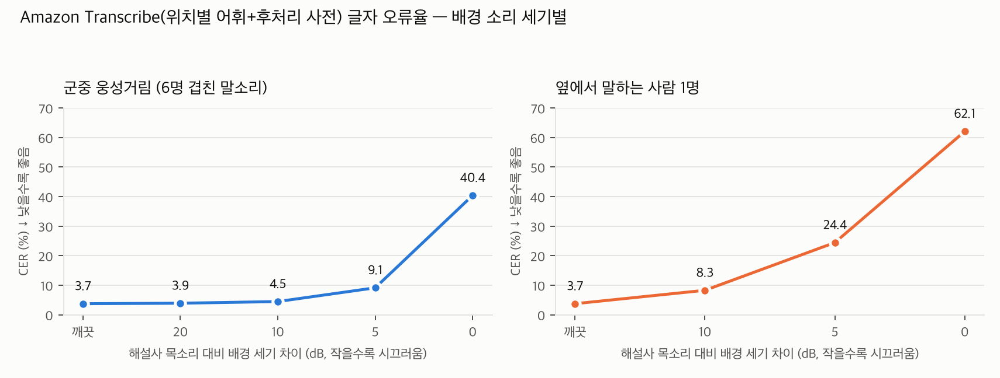
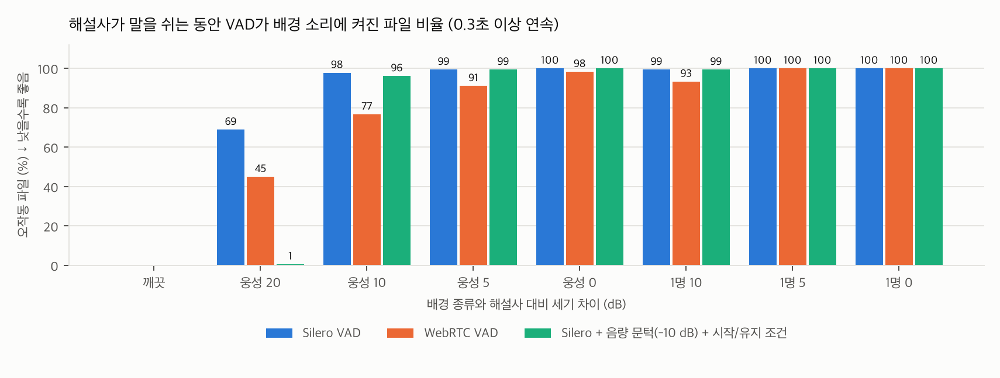
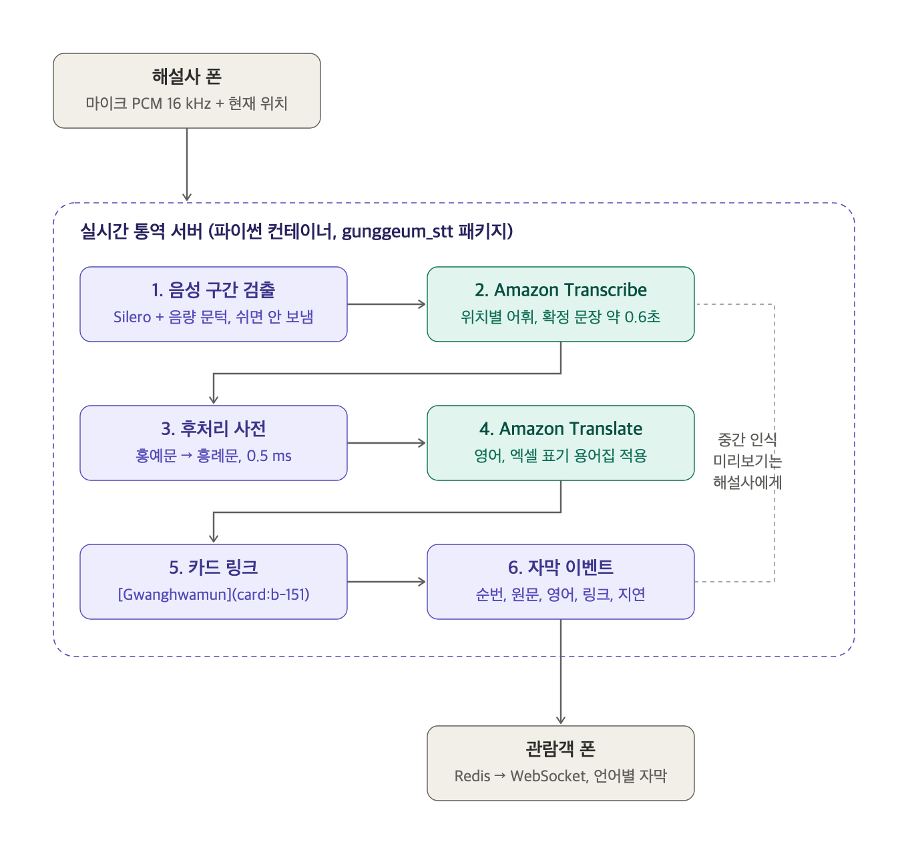

# 宮今 주간 보고서 — STT 파트 (안기겸)

보고 기간 2026. 10. 29 (목) ~ 11. 4 (수) · 작성 안기겸 · PM 통합본의 6장·부록 C 자리에 넣는 원고

## 1. 이번 보고서 요약 (STT 항목)

- STT: 소음·동시 발화 환경에서 Amazon Transcribe 인식률과 VAD(음성 구간 검출) 성능을 녹음 180개 합성 데이터로 측정. 웅성거림은 해설사 목소리보다 10 dB 작으면 CER 4.45%(깨끗 3.73%)로 유지되나, 옆 사람 1명이 10 dB 차이로 말하면 CER 8.26%로 2배. VAD는 Silero + 음량 문턱 구성으로 확정
- STT→번역 스트리밍 파이프라인(VAD → Transcribe → 후처리 사전 → Translate → 카드 링크) 패키지 `gunggeum_stt` 구축 완료(영어 우선, 단위 테스트 13개 통과). 자막 지연·번역 품질 측정은 해커톤 참가로 미진행, 다음 주 수행

## 6. STT 소음·VAD 측정 및 실시간 자막 파이프라인 구축 (안기겸)

### 6-1. 수행 내용

- 10/25 확정한 Amazon Transcribe 구성(위치별 사용자 지정 어휘 + 후처리 사전)이 현장 소음에서 얼마나 버티는지 측정함. 기존 녹음 180개가 모두 조용한 실내 낭독이라, 녹음끼리 합성해 배경 소리를 만듦: 군중 웅성거림(다른 낭독자 6명 녹음을 겹침)을 해설사 목소리보다 20·10·5·0 dB 작게, 옆 사람 1명(다른 낭독자 1명 녹음을 같은 구간에 겹침)을 10·5·0 dB 작게 섞은 7조건 × 180개.
- VAD 후보 비교: Silero VAD(문턱 0.5·0.7), WebRTC VAD(모드 3), Silero + 음량 문턱(−10·−15 dB), Silero + 음량 문턱 + 시작 0.1초/유지 0.3초. 녹음 앞뒤에 무음 구간을 붙이고 배경을 깔아 "해설사가 쉬는 동안 배경에 켜지는지"를 측정함.
- 아키텍처 v0.3(6.3 실시간 통역 처리 흐름)에 맞춰 STT→번역 스트리밍 파이프라인을 파이썬 패키지 `gunggeum_stt`로 구현함(gunggeum-ai-stt 저장소). 실시간 통역 컨테이너(김병진)가 import해 쓰는 형태이며, 시험용 WebSocket 서버와 지연 측정 클라이언트, 단위 테스트 13개를 포함함.
- 자막 번역·카드 링크의 영문 표기는 `경복궁_전각.xlsx`(name_en)·`경복궁_용어.xlsx`("영문 표기 (작성용)")를 원본으로 삼고, 엑셀 → 데이터 변환 스크립트와 일치 검사를 넣음(전각 71 + 용어 231 = 카드 302장, Translate 용어집 329행). RAG DB의 표기와 302장 모두 일치함을 확인함.
- 자막 지연(문장 끝 → 자막 3초, N4)·태국어 용어집 품질·현장 소음 측정은 해커톤 참가로 진행하지 못함. 파이프라인 동작 확인(녹음 20개, 번역 제외)만 수행함.

### 6-2. 결과: 배경 소리 세기별 인식률 (Amazon Transcribe + 위치별 어휘 + 후처리 사전)

| 배경 | 해설사 대비 세기 차이 (dB) | CER (%) ↓ | 완전 일치 (%) ↑ | 붕괴 발화 (개, CER≥50%) ↓ | 용어 인식률 (%) ↑ | 전각명 인식률 (%) ↑ |
|---|---|---|---|---|---|---|
| 깨끗한 녹음 (기준) | — | 3.73 | 41.1 | 0 | 94.2 | 96.2 |
| 웅성거림 | 20 | 3.89 | 40.6 | 0 | 93.1 | 96.2 |
| 웅성거림 | 10 | 4.45 | 33.3 | 0 | 92.2 | 94.7 |
| 웅성거림 | 5 | 9.11 | 17.8 | 0 | 82.8 | 84.2 |
| 웅성거림 | 0 | 40.39 | 7.8 | 63 | 53.5 | 57.9 |
| 옆 사람 1명 | 10 | 8.26 | 27.8 | 4 | 88.6 | 88.7 |
| 옆 사람 1명 | 5 | 24.42 | 12.8 | 29 | 74.1 | 78.9 |
| 옆 사람 1명 | 0 | 62.07 | 0.6 | 107 | 43.0 | 47.4 |

그림 1. 배경 소리 세기별 CER (왼쪽 웅성거림, 오른쪽 옆 사람 1명)

- 웅성거림은 10 dB까지 깨끗한 녹음과 사실상 같음(CER 차이 0.7%p 이내, 붕괴 0건). 5 dB부터 전각명 84%, 0 dB에서는 180개 중 63개 붕괴.
- 옆 사람 1명은 같은 세기 차이의 웅성거림보다 2~3배 나쁨. 또렷한 한국어라 Transcribe가 두 사람의 말을 섞어 받아쓰기 때문(전사 길이는 정답과 같은데 내용이 섞임).
- 대기 시간은 조건과 무관하게 평균 1.25초, p90 1.7초로 깨끗한 녹음과 같음.

### 6-3. 결과: VAD — 배경 말소리는 어떤 VAD도 해설사와 구분하지 못함

해설사가 쉬는 동안 배경 소리에 켜진 파일 비율 (%, 0.3초 이상 연속) ↓

| 검출기 | 깨끗 | 웅성 20 | 웅성 10 | 웅성 5 | 웅성 0 | 옆 사람 10 | 옆 사람 5 | 옆 사람 0 |
|---|---|---|---|---|---|---|---|---|
| Silero VAD (문턱 0.5) | 0.0 | 68.9 | 97.8 | 99.4 | 100.0 | 99.4 | 100.0 | 100.0 |
| WebRTC VAD (모드 3) | 0.0 | 45.0 | 76.7 | 91.1 | 98.3 | 93.3 | 100.0 | 100.0 |
| Silero + 음량 문턱 −10 dB | 0.0 | 0.0 | 37.2 | 97.2 | 100.0 | 28.3 | 84.4 | 95.0 |
| Silero + 음량 문턱 −10 dB + 시작 0.1초/유지 0.3초 | 0.0 | 0.6 | 96.1 | 99.4 | 100.0 | 99.4 | 100.0 | 100.0 |

해설사 발화 프레임 검출률 (%) ↑

| 검출기 | 깨끗 | 웅성 20 | 웅성 10 | 옆 사람 10 |
|---|---|---|---|---|
| Silero VAD (문턱 0.5) | 96.7 | 98.6 | 99.8 | 99.5 |
| WebRTC VAD (모드 3) | 91.4 | 91.7 | 93.2 | 96.2 |
| Silero + 음량 문턱 −10 dB | 70.1 | 71.1 | 85.0 | 80.9 |
| Silero + 음량 문턱 −10 dB + 시작 0.1초/유지 0.3초 | 96.4 | 96.7 | 99.2 | 98.6 |

그림 2. 해설사가 쉬는 동안 VAD가 배경 소리에 켜진 파일 비율

- Silero·WebRTC 모두 배경 말소리를 "말"로 봄. 20 dB 웅성거림에서도 쉬는 구간의 45~69%가 오작동.
- 음량 문턱(해설사 발화 세기 기준 −10 dB)만 붙이면 오작동은 막히나 작은 음절이 잘려 검출률 70%. 시작 0.1초/유지 0.3초 조건을 더하면 검출률 96~97%를 되찾으면서 20 dB에서 오작동 0.6%.
- 10 dB 이하에서는 어떤 조합도 배경 말소리를 막지 못함. 처리 속도는 Silero 46 ms, WebRTC 1 ms(10초 파일, CPU)로 둘 다 실시간에 문제없음.

### 6-4. 결정: 설계 반영 사항

| 순서 | 할 일 | 근거 |
|---|---|---|
| 1 | 해설사 마이크를 입 가까이(헤드셋·핀마이크)로 두어 배경 대비 10 dB 이상 확보 | 10 dB 이상이면 CER·전각명이 깨끗한 녹음과 같음 |
| 2 | VAD는 Silero + 음량 문턱 −10 dB + 시작/유지 조건으로, "조용할 때 전송 차단" 용도로만 사용 | 20 dB 환경에서 오작동 0.6%·검출 97%. 쉬는 동안 Transcribe 과금 없음, 엉뚱한 자막 방지 |
| 3 | 시끄러운 곳에서는 해설사가 말하기 버튼으로 켜고 끄는 수동 방식을 기본으로 | 10 dB 이하에서는 어떤 VAD도 화자 구분 불가 |
| 4 | 11/8 현장 테스트에서 앱이 해설사 발화 세기·배경 세기를 로그로 남김 | 실제 현장이 20·10·5 dB 중 어디인지 알아야 2·3의 기본값 확정 가능 |

### 6-5. 결과: STT→번역 스트리밍 파이프라인 구축

그림 3. 실시간 자막 파이프라인 (보라색: 서버 안 파이썬 코드, 청록색: AWS 서비스 호출)

| 단계 | 모듈 | 하는 일 | 걸리는 시간 |
|---|---|---|---|
| 1. 음성 구간 검출 | `vad.py` | Silero VAD(onnx, torch 불필요) + 음량 문턱 −10 dB + 시작 0.1초/유지 1.5초. 말이 시작되면 0.3초 전부터 Transcribe로 보내고, 1.5초 넘게 조용하면 연결을 닫음(쉬는 동안 과금 없음, 마지막 문장 확정) | 조각당 1 ms 미만 |
| 2. Amazon Transcribe | `transcribe.py` | 서울 리전 스트리밍 ko-KR, 위치별 사용자 지정 어휘(`gungeum-loc-00~25`). 해설 위치가 바뀌면 다음 연결부터 그 위치 어휘. 중간 결과는 해설사 미리보기로 | 말 끝 뒤 약 0.6초 |
| 3. 후처리 사전 | `postcorrect.py` | 위치별 용어와 자모 단위 유사도 0.85 이상이면 교정 (벤치마크 v2 설정 그대로) | 0.5 ms |
| 4. Amazon Translate | `translate.py` | 언어별 병렬 호출, 사용자 지정 용어집 `gungeum-ko`(329행)로 전각·용어 표기 고정, 같은 문장 캐시 | 미측정 |
| 5. 카드 링크 | `cards.py` | RAG 답변과 같은 규칙(`link_names`)으로 처음 나온 전각·용어 이름에 `[Gwanghwamun](card:b-151)` | 1 ms 미만 |
| 6. 자막 이벤트 | `pipeline.py` | `{seq, ko, text.en, links, ms}` — 순번·원문·영어·링크·단계별 지연. Redis/WebSocket 중계는 백엔드 컨테이너 몫 | 즉시 |

- 자막 언어는 영어를 기본으로 하고, 태국어는 용어집 품질 검증 뒤 `"th"`만 더해 추가함.
- 시험용 WebSocket 서버(`/ws/guide`, `/ws/listen`, `REDIS_URL` 있으면 `live:<session>` 채널 발행)와 녹음을 실제 속도로 흘려 넣는 지연 측정 클라이언트를 함께 구현함.
- 동작 확인(녹음 20개, 번역 제외): 말 끝 → 확정 문장 평균 0.62초, p90 0.76초. 목표(문장 끝 → 자막 3초) 중 STT 몫이 0.8초라 번역을 더해도 여유가 있음.

### 6-6. 다음 주 계획

- 자막 지연 측정(N4 3초): Translate 용어집 등록 후 녹음 180개로 문장 끝 → 영어 자막 지연과 용어 표기 적용률 측정 (해커톤으로 미뤄진 항목).
- 태국어 용어집 품질 검증 후 태국어 자막 추가.
- 백엔드 실시간 통역 컨테이너에 `gunggeum_stt` 패키지 연결(김병진 협업), Redis 채널·메시지 형식 맞춤.
- 11/8 현장 테스트에서 해설사 발화 세기·배경 세기 로그 수집 → 소음 조건 확정.

## 부록 C. STT 측정 상세 (안기겸)

### C-1. 소음·VAD 측정 조건

| 항목 | 내용 |
|---|---|
| 원 녹음 | 10월 벤치마크와 같은 180개(5명 낭독, 해설 위치 26곳, 16 kHz 모노) |
| 웅성거림 | 같은 낭독자·같은 해설 위치를 뺀 다른 녹음 6개를 겹친 군중 소음 |
| 옆 사람 1명 | 다른 낭독자 1명의 녹음을 이어 붙여 해설사 발화 구간 전체에 겹침 (전체가 겹치는 최악 조건) |
| 세기 맞추기 | 해설사 발화 구간(Silero VAD로 찾음)의 RMS를 재고 배경을 그보다 20·10·5·0 dB(웅성거림) / 10·5·0 dB(옆 사람) 작게 맞춤 |
| 인식 측정 | 원 녹음과 같은 구간, 180개 × 7조건, Transcribe + 위치별 어휘 + 후처리 사전. 비용 약 1.6달러 |
| VAD 측정 | 앞 1.5초·뒤 2.5초 무음을 붙이고 배경은 그 구간에도 깔아 측정. 정답 = 깨끗한 녹음에서 Silero VAD가 찾은 발화 구간. 30 ms 프레임 단위 |
| 지표 | 인식: CER·완전 일치·붕괴 발화·용어/전각명 인식률. VAD: 발화 검출률, 비발화 오검출률, 무음 구간 오작동 파일 비율(0.3초 이상 연속), 시작 지연 |
| 한계 | 배경이 같은 녹음 세트의 한국어 낭독 합성이라 실제 현장(외국어 관람객 말소리·바람·안내 방송)과 다름. VAD 정답을 Silero로 만들어 Silero에 약간 유리 |

### C-2. 파이프라인 동작 확인 (녹음 20개, 번역 제외, 맥북 → 서울 리전)

| 구성 | 말 끝 → 확정 평균 (ms) ↓ | p90 (ms) ↓ | 확정 문장 수 (발화 20개) | 비고 |
|---|---|---|---|---|
| VAD 켬, 무음 1.5초 뒤 연결 닫기 (기본값) | 617 | 756 | 20 | 문장 사이 쉼은 그대로 보내 Transcribe가 스스로 문장 끝 판정 |
| VAD 켬, 무음 0.7초 뒤 닫기 | 245 | 387 | 26 | 닫으면 바로 확정되나 0.7초 쉼마다 문장이 잘림 |
| VAD 끔 (항상 보냄) | 589 | 762 | 20 | 연속 스트림, 쉬는 동안도 과금 |

"말 끝"은 녹음에서 말소리가 끝나는 지점(파일 끝 무음 제외)을 보낸 시각, "확정"은 Transcribe 확정 문장이 서버를 거쳐 해설사 소켓에 닿은 시각.

### C-3. 산출물

| 파일 | 내용 |
|---|---|
| `STT학습데이터/Benchmark/STT_소음_VAD_측정_보고서.md` / `.pdf` | 소음·VAD 측정 보고서 전문 |
| `STT학습데이터/Benchmark/mix_noise.py`, `vad_eval.py`, `results_noise/` | 합성·VAD 측정 코드와 결과 |
| `gunggeum_stt/` (gunggeum-ai-stt) | 파이프라인 패키지, 시험 서버, 지연 측정 클라이언트, 테스트 13개 |
| `경복궁_전각.xlsx`, `경복궁_용어.xlsx`, `gunggeum_stt/build_glossary.py` | 영문 표기 원본과 변환 스크립트 |
